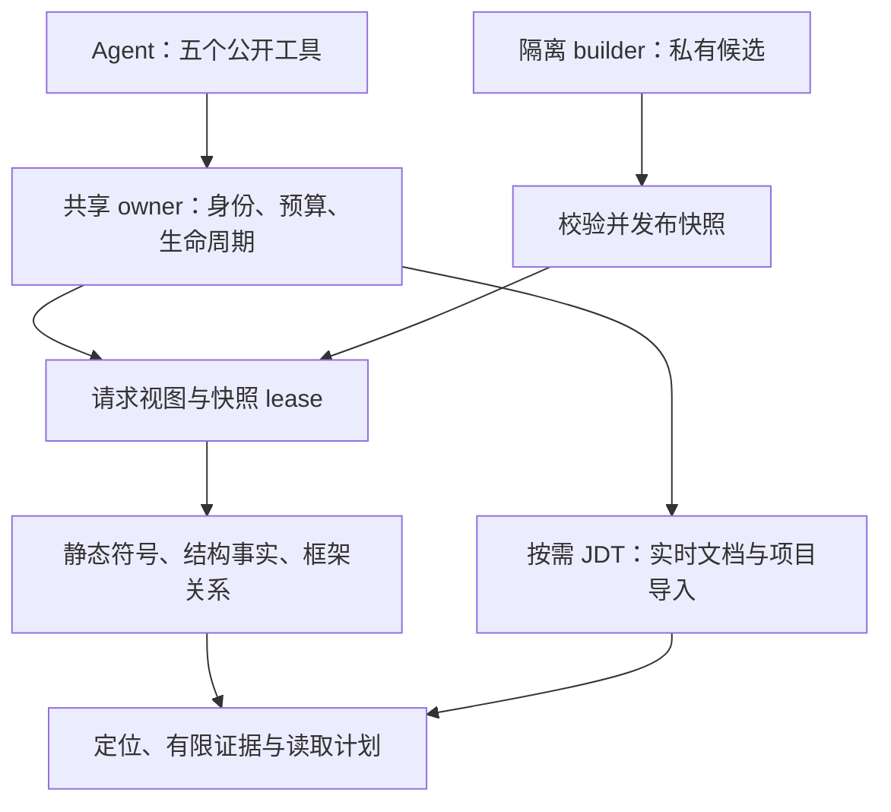

# codex-java-lsp-mcp：当前项目评估与后续投入建议

**评估日期：2026-11-19（Asia/Shanghai）**  
**审计对象：main，`a53c29ef3871ea8b55adc78d6b0af414122cdd56`**  
**适用范围：个人维护、macOS、Java 专项、Agent 使用；embedding 方向保持既有否决结论。**

> **结论：仍有值得做的改动，但已经不适合再开启一轮全面架构改造。**
>
> 当前最值得投入的是：修正少数结果正确性合同，补齐会影响决策的计量缺口，核实并削减没有消费者的计算。完成这些收口后，进入真实工作驱动的维护阶段。
>
> **不需要等待遥测才能修复确定的代码问题；也不能靠等待 30 天，自动证明检索有效或无效。** 排名、扩大读计划、调用图、JDT 去留等决策，应由具体任务及其结果决定。没有新的失败证据，就允许项目停止功能扩张。

本文是一次只读代码、历史实验和社区研究的综合评估，不是本轮重新执行的 Mac 验收报告，也不替代项目的发布门禁。文中的改动建议尚未实施。

---

## 1. 直接回答：现在应继续做什么

| 问题 | 本次判断 | 应采取的动作 |
|---|---|---|
| 稳定性改造是否有效？ | 单 owner、不可变快照、发布校验、请求 lease、封存安装与 Mac 验收已形成可用底座。当前证据支持保留它 | 停止重构底座；出现具体回归时修复 |
| 检索准确性还有空间吗？ | 有。首先是参数真正生效、静态符号身份与实时 JDT 文档一致、未知不伪装成确定结果 | 做有明确反例的小修复 |
| 还应升级排序、扩大上下文吗？ | 现有实验没有提供足够净收益；部分方向已经按门槛关闭 | 保持默认，等新的真实任务失败再立候选 |
| 是否等待遥测？ | 需要观察使用价值，但现有 stats 不足以回答质量、JDT 实际价值、kg 构建成本 | 少量补字段，配合每个真实任务一行结果记录 |
| 性能还能优化吗？ | 可能，但尚无本次实测支持某条热点优先级；无消费者的工作值得先核实 | 按问题定向剖析；不要先换语言、数据库、并发模型 |
| 是否接入 zvec-grep 或重启 embedding？ | 不建议。竞争项目采用某技术，不构成推翻本项目实验结论的证据 | 只吸收小工具面、证据来源、预算与新鲜度合同 |
| 是否继续扩展 callers、implements、outline？ | S2/S3 已关闭；outline/evidence 默认隐藏且有退出期限 | 尊重已有决策，不重新包装成下一阶段必做项 |
| 个人项目最合适的发展方向？ | 无需完整构建即可给出 Java 结构与框架事实，帮助 Agent 找到值得读的源码；精确语义按需复用成熟工具 | 用少数有价值的真实任务证明存在意义 |
| 如果一个月没有出现新问题？ | 可以进入维护模式；这不是项目失败 | 只维护依赖、发布、回归和真实需求 |

**建议的投入顺序：结果正确性 → 决策计量 → 必要减法 → 真实任务触发的质量优化。** 不把“继续写新功能”作为默认目标。

## 2. 审计基线、方法与证据强度

### 2.1 必须区分最新源码与实际部署

| 对象 | 固定身份 | 已知状态 |
|---|---|---|
| 本次源码审计 | `a53c29ef3871ea8b55adc78d6b0af414122cdd56` | main；提交时间为北京时间 2026-11-18 01:17:38 |
| 仓库记录的生产版本 | `cd6b96ff84ac314e89d46a57f79300c30ef424db` | 11-18 升级报告记录已部署，full seal 与五工具 smoke 通过 |
| 上次 post-ILV2 包的分支基线 | `b1475cddac01ab6ce589a1d465578d5ab7772533` | 用来识别后续变化，不作为当前生产状态 |
| 历史证据位置 | `archive/evidence-2026-11-17` | 历史大体积证据和部分旧脚本已归档；主分支删除不等于历史证据不存在 |

上次基线至当前 main 有 **173 个提交**；限定 `src/scripts/native` 的差异为 **162 个文件、12,745 行新增、1,906 行删除**。这是本次 Git 统计，不能据此推导性能改善比例。

生产版本至本次 main 的 `src` 内容没有差异，但安装脚本、fixture 配额及相关文档/测试有后续改动。因此，**可以讨论相同产品源代码的行为，不能把最新安装路径也称为已经完成生产复验**。[基线提交]、[生产报告]、[当前交接]

### 2.2 哪些验证真正发生过

| 证据 | 本次核实程度 | 能支持什么 | 不能支持什么 |
|---|---|---|---|
| 当前源码、调用链、参数流、Git 差异 | 本次直接读取 | 确定的实现行为、缺失检查、生产路径和维护边界 | 真实事故发生率、Mac 性能数值 |
| 最新 GitHub CI | 本次读取运行状态和原始 job 日志；head 精确匹配本次 SHA | `gate:pr` 成功；1,693 tests，1,692 pass，0 fail，1 skip | 真实 JDT、launchd/TCC、完整安装升级、脚本全套、生产回滚 |
| 11-18 生产 full seal 与 smoke | 读取仓库内报告；未取得私人 Mac 原始工件 | 维护者记录了部署和验收过程 | 本次独立重放或重新验收 |
| Q10、D15、S1/S3 等结果 | 读取决策、报告与结果 JSON；复算主要比例 | 这些特定任务、配置与预算下的历史结果 | 当前所有工作负载、所有工具、所有模型的普遍收益 |
| 社区项目 | Exa 检索，官方源码/发行说明/文档交叉核实 | 当前架构、声明能力及可见边界 | 在用户 Mac 上谁更快、谁更准 |
| 本文列出的故障时序 | 静态数据流推导，标明未复现 | 应增加的保护及回归场景 | “已经观察到生产错绑/崩溃” |

最新 CI 的运行编号为 **44135377135**，使用 `macos-15`、Node `22.16.0`；日志内 unit 测试约 356.5 秒，`gate:pr` 步骤约 442 秒。它包含 hygiene、lint、隔离编译和 dist 单测，没有替代用户 Mac 的 `gate:release`。[最新CI]、[CI配置]

11-18 生产报告记录：

- 单测：1,693 总数、1,692 通过、1 跳过；跳过项是 48 小时 GC。
- 脚本测试：828 总数、817 通过、11 跳过。
- 隔离及生产五工具 smoke、status、healthz、readyz 通过。
- 首次 JDT 状态请求超时，等待同一 JDT READY 后补验通过。
- 有回滚指针，但**本次升级没有执行回滚**。[生产报告]

本次遵守当前 HANDOFF 的验证边界：**未安装依赖，未运行产品测试、tsc、eslint、JDT、模型评测或生产操作，未修改项目代码。** 这不是借口性保留，而是区分“代码审计”“读取已有验收证据”和“亲自运行”的必要条件。[当前交接]

### 2.3 研究范围与取舍

重点研究 zvec-grep、codebase-memory-mcp、Graphify；补充 Serena、Aider、SCIP Java、Bifrost 与 JetBrains 官方 MCP 文档，阅读三篇直接相关的论文/预印本。优先采用官方源码、发布说明和论文，未按 star 数或宣传中的 token 倍数排序。

先前 2026-11-05 文档包已作为背景重新对照，但当前 HANDOFF、README、post-ILV2 decisions 的已完成/停止决定优先。**不能将旧规划中的待办重新描述成当前缺陷。**

## 3. 当前架构已经解决了什么

### 3.1 应保留的核心结构

`canonical cache root` 对应单一 owner；native launcher 持有锁并 exec 冻结 Node；stdio 客户端负责转发。索引构建写私有候选，校验后发布为不可变 SQLite snapshot，请求通过 workspace binding 和 lease 使用一致视图。JDT 作为可选语义路径存在。[当前交接]、[所有者]、[请求视图]



这套设计的价值在于：缓存和索引不再被不同客户端随意争用；查询不会读取半构建状态；失败候选不会覆盖最后可服务的视图。它已经承担了相当多复杂性，**再次拆 owner、改存储、增加旁路 daemon，会重新打开已经处理过的状态空间**。当前没有证据支持这样做。

### 3.2 产品能力应按真实入口理解

当前公开面固定为 `java_status / java_symbol / java_impact / java_diagnostics / java_runtime` 五个工具。[项目规则]

- `java_symbol query` 默认走静态发现；`backend=jdt`、position、references 进入 JDT 路径。
- 静态检索不是简单 `LIKE`，也不是 SQLite FTS `MATCH`：当前使用自建倒排表、BM25、identifier/chunk/document 路线及交错去重。
- query 已有 scope 前置过滤、稳定身份、源码 hash 校验、有界预览；无效模块不会悄悄扩大为全仓搜索。
- `java_impact` 主要提供关系与 **readPlan**；计划里有源码范围，不等于模型已经读到这些源码。
- outline/evidence 的代码仍保留，但默认 schema 不注册；只有 `JAVA_LSP_EXPERIMENTAL_SYMBOL_OPS=1` 时开放。
- fast 不启动 JDT；auto 也不代表“只要 JDT READY 就总用”，仍受实际策略、锚点和预算限制；required 才是显式要求。[工具入口]、[静态发现]、[词法检索]、[实验决策]、[项目说明]

查询池已有**按需创建、最多 2 个可复用的常驻 query worker、有限队列和 deadline 处置**；静态解析与构建已考虑离开请求事件循环。没有证据支持立刻增加 worker 数或重写成 Rust。[查询池]

当前小内存机器配置对 JDT 采用更保守的活跃数与空闲回收策略；JVM `-Xmx` 是堆上限，不是实际 RSS。不要用“配置 1.5/2/3G”直接替代真实物理内存测量。[资源配置]

### 3.3 “稳定性已收口”仍有准确边界

11-16 代码审计中的多项静态/共用问题已经修复；JDT 的 H1、H2、C-M3、C-M4 等明确登记为暂缓。当前交接并没有声称所有高严重度问题已消失。[旧审计状态]

另外，JDT import 预算与后续 indexing barrier 已分离；不能再把旧的单一 120 秒超时结论套到整个当前启动流程。当前有 120 秒导入阶段和后续 600 秒 indexing barrier 的分阶段限制。[JDT会话]

因此更准确的状态是：

> **静态默认路径已经具有继续使用和有限维护的工程基础；可选 JDT 路径仍有已知边界。稳定性验收不自动证明任务成功率或普遍性能优势。**

## 4. 历史实验真正说明了什么

### 4.1 重要结果与其适用范围

| 实验 | 数据规模与比较对象 | 结果 | 本次解释 |
|---|---|---|---|
| Q10 LIVE | 12 个独立任务组：11 QA、1 repair；2 臂 × 3 重复，共 72 slots | B0 11/36，B2 15/36；组级配对差 +11.1 个百分点，95% bootstrap 区间 −2.8 至 +27.8 个百分点 | **收益不确定**；重复运行没有把 12 个任务变成 72 个独立任务 |
| Q10 输入成本 | 同一实验所有 slots 的单次尝试输入 token 中位数 | 21,770 → 25,682.5，约 +18.0% | 是历史报告口径；不是“每个成功任务成本”，且须保留下文 usage 聚合审计限制 |
| D15 W2 | query limit=8 的开发集重放 | 产品 required-region 平均召回约 38.9%，原生约 42.8%；4 好、4 差、12 持平 | 没有默认更强的证据；不等于所有 Java 搜索都更差 |
| D15 F | 33 开发任务、104 个目标；每配置 56 次 impact 调用 | C0 42.42% → C3 46.21%，+3.79 个百分点；接收源码字节 p50 15,154 → 22,097，+45.82% | 放大预算的成本超过既定 20% 门槛，保留 C0 有依据 |
| S1 | 列出接口实现的定向修复及 Mac 门禁 | 新命中 2 个开发集目标、0 丢失、字节中位数不变 | 机制回归通过；不能把触发修复的开发样本当成独立泛化证明 |
| S2 / S3 | 传递实现与静态 caller 的后续候选 | 已按既定门槛关闭 | 除非出现新的独立失败，不应继续排期 |

依据：[Q10结果]、[验收说明]、[D15报告]、[D15F结果]、[S1结果]、[S3结果]、[实验决策]。

**Q10 的工具面尤其重要：两臂都有 `java_symbol query` 和相同原生工具，B2 增加 outline/evidence；没有向模型开放 `java_impact`、position、references 或 JDT。** 因而它既不能证明整个项目优于原生工具，也不能证明 JDT 或 impact 没价值。[LIVE工具面]、[实验决策]

D15 F 是 driver 重放，未设置真实 slot deadline；它支持范围召回与字节的比较，不能直接充当端到端延迟或真实 Agent 成功率证据。其默认“6 文件 / 14 KiB”是 readPlan 预算，并有锚点超额等明确规则，**不是整个响应及全部后续模型 token 的硬上限**。[D15F结果]、[读取预算]

### 4.2 有价值的定位信号，但没有足够大的优势证明

D15 W2 的 20 任务配对中，分类统计保存在 D15-F 报告的后续归因部分：Spring 的产品/原生召回约为 0.700/0.517，DTO impact 约为 0.806/0.583；callers 为 0.292/0.438，implementations 为 0.467/0.667。每类只有 3–4 个任务，不能据此宣传总体领先，却与“Java 框架事实更适合做差异化、通用调用者搜索不必自己包办”的方向一致。不要将这里的分母换成 F 预算实验的 33 个任务。[D15F结果]

XML 类的零召回也不能直接归因于 MyBatis：三个冻结语料中的 mapper XML/statement 均为零，现有 XML 任务包含其他 XML/YAML。没有有效样本，便没有理由立刻扩建 MyBatis 引擎。[MyBatis清点]

### 4.3 已完成或已关闭的内容，不重复建议

| 旧建议 | 当前状态 | 本文处理 |
|---|---|---|
| 部署 ILV2、增加 CI、增加 stats | 已完成 | 不再列成新工作 |
| 证明源码实际进入模型输入 | SOURCE_RECEIVED / receipt 基础设施已存在 | 保留；不再新建一套 |
| 扩大 readPlan / W3 排序 | 收益或预算条件未达标，已停止 | 保持当前默认 |
| S1 接口实现与注入选择分离 | 已实现 | 保留，防止回退 |
| S2 传递实现 / S3 静态 caller | 已关闭 | 新任务触发才可能重新判断 |
| outline/evidence | 默认隐藏；2027-02-13 有明确删除条件及有限例外 | 不因竞争项目有 overview 就重新默认开启 |
| 封存集 v2 与新产品方向 | 暂不投入 | 不为维持研究活动再造大数据集 |
| 历史证据清理 | 已归档到固定 tag | 不把文件数下降当产品性能成果 |

outline/evidence 的现行决定是：下一次真实 Agent 评测仍为 INCONCLUSIVE 或 NO_GAIN 时，删除对应代码和开关；到 2027-02-13 仍无新评测，也按 NO_GAIN 删除，除非已有至少 2 个不同任务组的日常失败案例确实需要它们。无需为保留功能而专门启动大实验。[当前交接]、[实验决策]

## 5. 准确性、效率与性能：要分别判断

“检索准确率”容易混在一起。对这个项目，应拆成四个问题：

| 层面 | 要回答的问题 | 适合的证据 |
|---|---|---|
| 身份与绑定 | 这个 symbolId、定义、引用是否属于用户指定的 Java 声明？ | 重载、泛型、模块、文件版本的确定性回归；必要时成熟编译器/LSP 对照 |
| 发现与排序 | 在同样预算内，是否找到了这次任务需要的文件和范围？ | 有标签的真实失败、固定候选/预算的范围召回与误导项 |
| 证据送达 | 返回的计划、摘要和源码，哪些真的进入 Agent 上下文？ | 工具响应、实际源码 receipt、模型请求记录 |
| 最终任务收益 | 最终回答或代码修复是否正确？总时间、重试和费用如何？ | 独立任务结果、冻结判定器、完整失败分母及成本覆盖 |

前两层改进不保证第四层改进。返回更短可以少 token，也可能让 Agent 多调用三次；更多图边可以提高召回，也可能把错误关联包装得更像事实。

### 5.1 应优先加强的“准确性”

优先修“声称做了但没有做”的合同：scope 生效、身份与版本一致、来源与不确定性明确。它们直接降低 Agent 被误导的风险，而且可以用小型确定性回归判定，不需要 100 个仓库或一套新 benchmark。

对 Java 框架关系，也应区分：

- 源码明确声明的注解、字段、类型和映射；
- 在限定条件下推导出的候选实现/依赖；
- 需要 profile、条件装配、运行时代理或反射才能确定的真实行为。

静态 Spring 关系不是运行时容器装配的完整真值。现有接口实现与 `@Primary` 选择的分离值得保留，不能为了“结果更确定”把候选集合压成一个未经证明的答案。[实验决策]、[项目说明]

### 5.2 暂时不应扩建的“准确性”

当前 query 已支持 identifier 拆词、NFKC、Han 连续串与二元词；不能说“完全不支持中文”。中文需求与英文源码没有词汇重合时仍可能找不到，工具已有 code terms 提示。缺少跨语言语义映射是能力边界，但不自动构成重新引入 embedding 的理由。[分词器]、[工具入口]

同理，不建议现在新做完整 Java 类型求解器、points-to、通用调用图、跨仓知识图或框架 DSL 全覆盖。它们的维护成本会先发生，真实收益仍待证明。

如以后出现同类真实失败，优先顺序应是：

1. 明确 query、terms、module/sourceSet 是否正确表达已知线索。
2. 检查候选是否存在、是否被 scope/预算/身份过滤。
3. 检查已返回范围是否包含需要的证据、是否真正被读取。
4. 最后才判断需要新事实抽取、局部排名或新的检索方式。

这能避免把“没用对已有能力”或“源码没有送达”都归因于检索引擎不够先进。

## 6. 现在就值得处理的代码问题

本节不是一次生产事故清单。每项都区分源码确认的行为与尚未运行的故障场景。

### 6.1 Scope 合同不一致：可以立即修，不需要等使用量

**确认的行为：**

- static query 的 schema 接受 `layer`，但调用 `runStaticDiscovery` 时没有传递它。
- JDT query 接受 `module/layer/sourceSet`，却仅查询 workspace symbols，没有应用这些范围约束。
- 静态 scope 用 `"."` 表示根模块；`classifyPath("src/main/java/...")` 不填 module。references 再做严格字符串比较，因此 `module="."` 会滤掉这些根模块引用。
- 静态 locator 的根模块字段还可能输出空串；输入合同却不接受空串。[符号工具]、[范围解析]、[路径分类]、[文件布局]、[静态发现]

以 references 为例，这不是统计意义上的“可能召回低”：对于上述路径分类，`undefined === "."` 必然为假。结果可以出现 totalReferences 大于零，却 matchedReferences 为零且没有截断标记。

**最小处理：**

统一公共根模块表示；明确每个 operation/backend 支持的参数。对暂不支持的组合，可以显式返回 INVALID_INPUT 并修正 schema 描述。**无需为了修合同先增加 layer 排名能力或重建统一查询框架。**

不要把问题夸大成“所有嵌套模块都错”。普通 `a/core/src/main/java` 的前缀本来可以保留；alias、basename 歧义等应在统一合同内分别处理。

**验收反例：**

- 根模块内已知有引用，传与不传 `module="."` 不应产生错误的空集合。
- static query+layer、JDT query+scope：要么约束生效，要么明确拒绝，不能静默忽略。
- 未知模块不扩大为全仓；main/test 与 module 为交集。
- 如支持 alias，覆盖唯一 alias、同名歧义及嵌套模块。

本次未运行这些回归；源码足以支持列入当前小修复。

### 6.2 symbolId 转实时 JDT 缺少同文档版本桥

**源码确认：** owner prepare 为控制等待时间允许使用 STALE held snapshot；符号解析对 FOUND 返回旧快照的 file/line/column，但没有携带用于转交的 contentHash。随后 position/references 把这些坐标递归传入 JDT；JDT 的 `withDocument` 重新读取磁盘当前文本，并把它同步后使用旧坐标。[所有者]、[符号目标]、[符号身份]、[符号工具]、[JDT文档IO]

风险时序：

1. 快照 S 中方法 A 的位置为 N/C，query 返回 idA。
2. 文件变化，A 移位，B 占据旧位置；S 仍被请求持有。
3. idA 在 S 中解析出旧 N/C。
4. JDT 对当前文本的 N/C 查询，可能正确返回 B 的信息；调用者以为那是 A。

**已经确认的是缺少一致性检查；尚未在真实 Mac/JDT 上复现错误绑定。** 本文不声称已经发生事故，也不给发生率。

**修复边界：**

校验快照目标文件身份与**实际同步给 JDT 的同一份文本/文档版本**。外层先 hash、内层再重新读文件，仍有 TOCTOU。全仓 STALE 一律拒绝也过度：另一个文件变化，不表示目标文件变了。

若目标已变，应在剩余预算内重新取得可验证定位，或明确返回需要重新定位/源码已变的状态；不得用同名猜测替代身份。不建议把 generation 塞进稳定 symbolId 来回避问题。

**最低回归：**冻结旧快照、插行或交换重载位置、调用旧 ID；确认不会把旧坐标直接发给新文本。再发布新快照，确认稳定 ID 可定位新位置。还需覆盖目标未变但全仓 STALE，以及校验与同步之间发生编辑的边界。

如果 JDT 继续可调用，这项比增加新语义能力更优先；如果只使用静态路径，其风险不能算成静态 query 已经错绑。

### 6.3 可选 JDT 的故障仍可能影响共享 owner

当前 `JdtlsChild` 接口只暴露 exit/close 监听；子进程与日志 WriteStream 的 error 路径仍缺少对应处理。会话中的 JSON-RPC `connection.onError` 不能替代子进程和日志流各自的 error 事件。另有在 exit 而非完整 close 后结束日志流，以及 shutdown 失败时后续清理被跳过的已知边界。[JDT传输]、[JDT会话]、[运行管理器]、[旧审计状态]

Node 对没有监听器的 error 事件有明确的抛错行为。因此，“可选 JDT”并不天然意味着它失败时只影响自己的请求。[Node事件]

**本次建议是对现行暂缓决定做一项窄调整：**如果保留 JDT 的公开可调用性，应优先补最低限度的 child/stream error 处置、close 顺序和失败后的清理，使可选能力不因可预期 I/O 错误拖垮静态服务。无需先设计 SemanticBackend 插件体系。

H2 lease 回收问题依赖的多 owner 场景前提尚未证实，不应与上述确定缺少监听的情况混为一谈；也不应把旧审计所有暂缓项一键升级为紧急重构。

**验收：**注入 spawn 失败、日志流失败和 session.stop 拒绝；受影响请求得到明确失败，静态 owner 仍可服务，资源最终释放，关停遵从总 deadline。真实 Mac 长时验证继续沿用现有门禁。

### 6.4 生产可达性扫描漏掉 re-export：减法前先修

`scripts/ilv2-mac-removed-paths.mjs` 的正则跟踪 import、动态 import 和 new URL，不跟踪 `export ... from`。生产 `RouterJavaIndex` 正通过只有一行 `export *` 的桶文件导出，实际调用方却被该图漏标。[可达性脚本]、[桶文件]、[运行管理器]

本次只读源码图分析：原图 218 个可达文件；在同一入口与解析逻辑上补 re-export 边后为 223 个。漏掉的包括 `agent-router/java-index-router.ts`、framework-index-view、router-facts 及两个 cold 适配文件。

这不意味着所有 test-only 台账都错。补边后，旧 sql-client、discovery/query-worker、retrieval-policy、repair-policy 等仍不可达。

**处理：**任何 dead-code 或 `kg_*` 删除前，先补桶文件导出边与小型 fixture；同时承认可达文件内仍可能有不可达 export。不要把这个有限扫描器扩成一套新的程序分析平台。

## 7. 遥测还不能回答什么，以及怎样最小补齐

### 7.1 现有 stats 有价值，但不是质量判定器

现有本地 JSONL 与 stats 已能按工具/operation 汇总调用数、错误、耗时、部分 indexState 和 impact 预算估算。这些应继续用。问题在指标语义：

| 当前指标或缺口 | 实际含义 | 不应推导的结论 |
|---|---|---|
| `ok=true` | handler 没有 throw | 回答正确、任务完成、结果完整 |
| symbol operation=query | 静态与 JDT query 混在一起 | JDT 总使用量或价值 |
| impact 调用量 | 可能是 fast、auto、required；实际 semantic.used 未记录 | 每次 impact 都用了/都没用 JDT |
| indexState 来自响应 indexView | 某些成功静态结果有状态；throw 与正常 JDT 返回常无该字段 | 缺失就是 FRESH，或缺失就是 NOT_READY |
| estimatedTokens | 由 wire/计划源码字节代理估计 | provider 实际输入输出 token、账单、成功任务成本 |
| cold 次数 | 汇总混合真实阶段证据和“超过 2 秒”的启发式 | 实际冷启动次数或后台构建成本 |
| 30 天调用行 | 记录到的尝试 | 30 天完整工作任务样本、无记录等于无需求 |

依据：[遥测记录]、[遥测汇总]、[工具工厂]、[成本模型]。

当前 throw 路径给记录器的 value 是 undefined，静态 NOT_READY 常先抛 INDEX_PARTIAL，因此只看 `indexStates.NOT_READY` 会漏掉相关尝试。JDT query/position/references 正常返回也没有静态 indexView；生产报告 position 的 “-” 与代码形状一致。[请求视图]、[符号工具]、[生产报告]

此外，owner telemetry 仍仅在显式隔离验证模式开启，普通生产 stats 不消费它。**kg 构建时间、表页体积、编辑至 FRESH、后台 CPU、daemon 在线时间，不会因为再等 30 天自然出现。**[owner遥测]

### 7.2 三项计量问题值得修，但用途和优先级不同

#### A. LIVE usage 聚合会丢历史数值

`mergeUsage` 目前会出现：

```text
MEASURED(100) + UNMEASURED → PARTIAL(100)
PARTIAL(100) + MEASURED(20) → MEASURED(20)
```

前面的 100 丢失，缺失的一轮也消失。首轮未知与初始空 accumulator 也可能混淆；部分字段缺失时还会被当成零拼接 total。该函数确实用于每轮模型响应的聚合。[usage聚合]、[LIVE驱动]

**优先级：下次 LIVE 或成本比较之前修。** 这不是生产 query 算法缺陷。应区分 EMPTY 与 UNMEASURED，保留 known sum、请求数和字段覆盖数；存在缺失后不能自动恢复为完整 MEASURED。覆盖 M→U→M、U→M、M→U→U、部分字段缺失及全完整序列。

不能据此直接宣布 Q10 的全部 token 数字错误：原始 474 次请求/响应证据未在本环境取得。正确做法是从已保留原始响应重算，无需重新付费跑模型。

#### B. 缺失的 impact cost 被写成 0

失败或没有执行真正 impact 的返回可能没有 cost；记录器把缺失值变成零，stats 又把零纳入 token p50。这能制造“失败越多，估计成本越低”的假象。[遥测记录]、[遥测汇总]

缺失保持 null/unknown，并单独报告 costKnown/attempts。失败行仍保留在调用量、失败率和耗时分母；不要为清理 token 指标把失败整行删除。

#### C. 慢调用与冷路径混在一起

记录器已有 `coldPathHeuristic`，但 stats 没保留这一差别。把“有阶段证据的 cold”和“只是超过 2 秒的 slow/unclassified”分开即可，不需要新建 trace 平台。[遥测记录]、[遥测汇总]

日期文件 GC 对近 30 天窗口边缘还有少于一天的数据损失可能，属于次要覆盖问题。周报应保存首末时间与未知说明；除非要承诺完整窗口，不必把它升级成大型运维改造。

### 7.3 建议的最小新增信息

不是字段越多越好。只收集会改变下一次决定的信息：

| 信息 | 目的 | 最小实现方式 |
|---|---|---|
| resolved backend | 分开 static/JDT query | 在已有分支选择点记录 |
| impact 请求 semanticPolicy 与实际 semantic.used | 判断 JDT 是否实际参与 | 使用已有执行结果，不另跑探针 |
| result status | 区分完整、PARTIAL、EMPTY、AMBIGUOUS 等与异常 | 尽量复用现有返回语义 |
| 已获取的静态 view state | 失败也能解释状态；区分 unknown/not-applicable | 从请求 scope 记录，别只读成功 value |
| 版本身份 | 避免升级前后数据混算 | buildSha，或每周汇总人工记录 |
| cost 覆盖、cold 证据类型 | 防止“未知=0”“慢=冷” | 修现有汇总，不扩系统 |

不需要收集业务源码、查询明文或绝对路径才能完成这些判断。如果维护者希望零代码投入，JDT 的实际使用与价值也可暂时人工记一行，但报告必须承认 stats 归因不完整。

### 7.4 用“真实工作问题”作观察单位

每个实际任务记录一行，重试归入同一个任务。下面是**建议模板，不是已采集结果**：

| 日期/版本 | 脱敏任务类别 | 用到的工具与实际后端 | 结果 | 原因/绕过方式 |
|---|---|---|---|---|
| 待填写 | Spring 装配 / DTO / 配置 / 定义引用等 | query、impact、JDT 是否实际参与 | 帮助完成 / 错误 / 缺证据 / 太慢 / unknown | scope、定位、范围、未读取、启动等待、原生替代 |

不要只记失败，也记确有帮助的使用；否则无法判断低频高价值功能。没有调用不等于工具没价值：可能没有遇到相关任务，可能入口不可见，也可能用户主动绕过。当前 outline/evidence 默认隐藏，尤其不能用零调用证明其无用；但已有退出期限依然有效。

计算真实成本时，分别报告：

- 全部尝试的已知总成本 / 验证成功任务数，包括失败和重试浪费。
- 成功任务条件下的耗时与用量分布。
- 任务判定覆盖与 usage 覆盖；未知不补零。
- 冷启动、工具等待、模型时间是否包含。

两个指标回答不同问题，不可用所有尝试的中位数代替“每成功任务成本”。

### 7.5 2026-12-18 是复查日期，不是统计充分性保证

遵循现行 HANDOFF 的复查时间，但按证据给出下列出口：

| 届时情况 | 决定 |
|---|---|
| 使用正常，没有重复的真实质量失败 | 进入维护模式，不自动开启新一轮优化 |
| JDT 低频，但有明确不可替代的任务价值 | 保留按需路径；补必要故障隔离 |
| 已有相关工作，始终由静态/原生工具完成，维护者明确不要 JDT | 可作产品范围缩减；先说明影响五工具合同的具体变化 |
| 没有相关任务，或关键字段/结果未知 | 证据不足；维持当前，不强行判优劣，也不无限追加 benchmark |
| 至少两个不同真实任务出现同类失败 | 建一个最小回归，试一个候选改动 |
| 一个关键、可确定的正确性缺陷 | 不必等待第二个任务，直接修复 |
| kg 确认无产品查询消费者、无近期需求；内部封存校验可同步调整 | 做有边界的减法；不等待调用量给答案 |

“两次不同任务”是控制个人研发投入的触发规则，不是统计显著性门槛。稀疏数据展示 N、中位数、最大值和具体案例即可；p95 可以保留原始统计，但不能凭很小样本声称达到稳定 SLO。


## 8. 性能还有空间，但优化顺序应改成“先定位成本”

### 8.1 首先分开不同性能状态

| 状态 | 应观测的指标 | 容易混淆的东西 |
|---|---|---|
| 新工作区、依赖也冷 | 导入、依赖获取、首次索引、可用结果时间 | 将下载耗时归给 SQLite 查询 |
| 依赖热、工作区/进程新 | JDT 重新同步、静态快照建立、首个有效请求 | 把已有依赖缓存说成完全冷启动 |
| 有持久化索引后的 owner 重启 | 恢复 binding、首次静态查询、是否重复构建 | 与空缓存初始化混算 |
| READY 下重复查询 | 排队、SQL、候选校验、序列化与返回大小 | 用所有 operation 混合 p95 判断查询热点 |
| 编辑后再查询 | 编辑至新证据可见、STALE 窗口、增量工作量 | 只测稳态 SQL，却忽略日常编辑 |
| 多工作区/多客户端 | 重复工作、资源争用、回收与隔离 | 将不同 worktree 当成同一项目状态 |

在这些状态没有分开前，增加 worker、缓存、预热或者提高 JDT 超时，都可能只是转移成本。

### 8.2 JDT 冷启动已有一个线索，但还不是根因结论

11-17 报告记录：使用同一业务仓和已有缓存启动新 JDT 进程，95.63 秒达到 READY；首次定义 3.32 秒、引用 1.74 秒。较早尝试曾在导入阶段耗尽 120 秒。25、60、88 秒的线程栈落在 Buildship 递归刷新资源树；一次 Gradle 调用约 22 秒返回，随后仍有资源刷新。[JDT冷启动报告]

该仓库有 15 个嵌套 worktree，现行资源过滤器没有覆盖该目录。但报告已明确：**尚未证明这些目录占主要时间，也尚未证明在当前过滤器设置时机下排除它们能改善首次导入。**

合理的下一步仅在日常再次被慢启动打断时触发：

1. 用同一封存候选、同一仓库和同种缓存状态，采集实际刷新路径。
2. 确认 `.worktrees` 是否真的被遍历及其占比。
3. 若成立，隔离比较“首次导入前排除”与原方案。
4. 以相同定义、引用、模块/项目模型验证结果不被缩窄。
5. 仅当收益可见且语义不退化，才改默认。

不建议现在把所有仓库预热、增加更多常驻 JDT，或再单纯放大超时。用户有明确价值的低频语义查询，可以接受一定冷成本；没有实际价值的路径，再快也不值得长期维护。

### 8.3 更值得先检查的是通用 `kg_*` 物化的价值

当前 cold build 的 `writeKnowledgeAndEntities` 将知识图物化、entity/search document 写入放在同一流程中；增量路径也维护图相关内容。快照 query-ops 注册 graphDigest、graphReachable、contextGraph，客户端与 router 有对应包装。[冷构建]、[增量构建]、[查询操作]、[索引路由]

本次调用点检查没有发现当前五个工具/默认发现链路调用这些图查询。仍可见 benchmark、API 适配和测试消费者；生产封存流程也校验 kg 表，逻辑导出保留 kg 引用规则。这些是维护其自身一致性的内部消费者，不能证明通用图对五工具有业务读取价值，但删除时必须同步调整。[封存校验]、[逻辑导出]。因此：

> **持久化通用 kg 的生产读取价值值得质疑；不等于所有图关系都无用，更不等于可以删除当前 framework/impact 使用的 edge、entity 和 search_doc。**

这是代码依赖问题，不需要等待一个月调用统计。删除之前必须完成两件事：

- 修 `export ... from` 的可达性漏边；核对 worker op、动态分发、benchmark 是否属于现行保留合同。
- 将 kg 专用写入与仍在用的检索实体/文档写入分开，不能按文件名整个删除。

若确认无当前产品查询消费者、无明确近期需求，建议停止这部分物化，并删除仅为它存在的增量维护分支；同步调整 kg 专属封存校验和逻辑导出规则，保留核心表的完整性检查。schema/facts 版本、旧快照处置和冷/增量一致性继续按现行规则处理。没有兼容性要求，也不等于可以让旧 schema 被误读。

**本次没有测得停止 kg 能省多少时间、CPU 或磁盘。** 若需要数字，做一次定向隔离 A/B：同一输入、同一构建预算，比较图写入开/关的逻辑表页、构建阶段、CPU 和冷/增量结果。现有 graph/search 阶段混有仍有价值的检索写入，不能把整个阶段耗时记为 kg 浪费。APFS clone 的逻辑文件大小，也不能直接算实际占用。

即便性能收益很小，只要确实没有产品查询消费者，减少故障面和维护概念仍可能值得；这应是一次有终点的删除，不是再添永久开关。

### 8.4 个人维护成本也是性能预算的一部分

本次对 tracked 文件的统计：

- 总计 1,015 个文件。
- `src` 非 test、非 test-support 的 TypeScript：254 个文件、56,934 行；其中包含 17 个 benchmark 文件、4,902 行，不能称为纯生产代码量。
- `src` 测试文件：204 个、50,517 行。
- scripts 中非测试代码：158 个文件、35,408 行。
- docs：160 个文件，约 8.71 MiB。

这不是“代码太多所以必须砍到某个数字”的证据。它说明对单人维护而言，**脚本、证据、安装与测试工具本身也是显著维护面**。合理减法应按“当前谁调用、验证什么真实合同、删除能减少什么维护工作”判断，而不是设 4 万行或 100 文件的指标。

保留现有有效门禁；不为每个小修复再造完整 kit、不反复扩大测试范围、不用新的长期平台维护一组旧平台。小改只跑必要回归与既定门禁，证据够了就停止。

## 9. 社区对比：该借什么，不该跟进什么

### 9.1 版本冻结与比较原则

| 项目 | 本次核实快照 | 发布基线 |
|---|---|---|
| zvec-ai/zvec-grep | `cc3ff0fe376f4351ad1440880a45c5ba3205b0e2` | v0.3.1，2026-11-18 |
| DeusData/codebase-memory-mcp | `4f8b66e2d6a7021c728adb78e1dc3f5ad284d009` | latest stable v0.12.1，2026-10-16；主分支后续能力不等于该稳定包全部具备 |
| Graphify-Labs/graphify | `340268a70a83588d6b3c6de1fffb05326350ef1d`，默认分支 v8 | v0.9.112，2026-11-17 |

这些快照用于防止搜索结果与源码时代不一致。维护/资源成本是对组件范围的工程判断；本次没有在同一 Mac 上做三者与本项目的性能竞赛。[Z提交]、[C提交]、[G提交]、[Z发布]、[C发布]、[G发布]

### 9.2 总体比较

| 维度 | 本项目当前方向 | zvec-grep | codebase-memory-mcp | Graphify |
|---|---|---|---|---|
| 核心 | Java 静态事实、词法发现、框架关系、可选 JDT | rg/BM25/vector 混合检索与可选调用图 | 广语言 SQLite 代码图与 C 类型解析 | AST/文档知识图、图查询、聚类/可视化 |
| Java 精度来源 | 静态抽取规则；需要精确语义时用 JDT | 名称、导入、层级、arity 等规则 | 自研 C Java resolver；“Hybrid LSP”并非 JDT | 规则化 receiver/层级/调用绑定 |
| Agent 接口倾向 | 五工具、定位和有界 readPlan | 少量默认工具，搜索及 caller/callee | 较多图、搜索、覆盖与变更工具 | 子图、邻居、社区、路径等 |
| 额外成本 | Mac owner/快照/JDT 生命周期 | 模型、原生运行时、daemon/watch/index | 多 grammar、类型算法、分发和平台功能 | Python、图/聚类、cache/schema、集成 |
| 适合吸收 | 已有能力持续收口 | 预览与新鲜度、少工具 | coverage/分页/预算合同 | 关系来源与有界子图 |
| 不适合复制 | 无需再开平台化方向 | 整套 embedding runtime | 多语言类型系统、Cypher/跨服务平台 | 可视化社区、媒体合图和广泛 hooks |

共同的有效经验是：让 Agent 知道“结果来自哪里、搜索了哪里、有没有遗漏、下一步该读什么”。它们没有证明个人 Java 工具必须拥有向量、图查询语言或可视化。

### 9.3 zvec-grep：值得借鉴接口与证据，不足以推翻 embedding 决策

当前版本的核心已是 Rust workspace，包含 engine、daemon、MCP transport；旧 TypeScript 目录仍在，不能继续用旧架构说明判断产品。检索组合 rg、BM25 和向量；v0.3.1 加入显式启用的持久化调用图。[Z说明]、[Z构建]、[Z发布]

其图模型区分已解析边与 pending reference，provenance 包括 arity、文件范围、导入绑定、限定名、工作区唯一性等。Java 解析也会处理包名、import 和层级，并在同 arity 候选无法唯一选择时保留不确定性。这比纯同名连边谨慎，但没有构成 JDT 的编译 classpath、泛型推断与完整重载绑定替代品。[Z图模型]、[Z解析器]

当前 MCP 源码默认工具有 search、callers、callees 三个；调用关系工具明确说明不会刷新图、空结果不能证明没有调用。官网 Local Server 页面在本次读取时仍只说默认 search，属于文档滞后，本文以当前源码和发行说明为准。[ZMCP]、[Z官网]

可以借鉴的只有窄点：

- 默认结果围绕命中行，完整函数或 section 按需读取。
- freshness 与诊断先说明；不要让旧结果看上去像实时事实。
- 调用查询只返回已解析关系，标明截断，并说明空结果不能证明不存在；内部索引另行保存未解析引用。

本项目已有 preview、hash、新鲜度和有界读计划；应找真实差距，不是照抄一遍。特别是“完整符号按需读取”与此前 outline/evidence 实验有关，不能借外部案例绕开其已有停止/隐藏决定。[Z预览]、[实验决策]

zvec 的本地模型免去了外部 embedding API 账单，但模型下载、CPU/内存、ONNX/llama.cpp、原生 ABI 与发布成本仍存在。作者的 Agent A/B 使用特定模型与以 Python 为主的样例，不能转换成用户 Java 场景的固定收益。[Z构建]、[Z说明]

**结论：不建议集成 zvec-grep，不建议重开 embedding。** 只有未来出现明确的词汇无重叠任务，并且现有 Agent 查询改写和原生方法都持续失败，才有理由重新讨论；届时也应另行设置停止条件，不能把“社区流行”当收益证据。

### 9.4 codebase-memory-mcp：真正值得借的是覆盖合同

当前主分支是 C native backend，README 列出 17 个 MCP 工具、164 个 vendored grammar，包含图、搜索、变更、跨项目、部署配置与 UI 等能力。它的产品目标明显比个人 Java 专项工具宽。[C说明]

需要纠正两个常见误读：

1. **Hybrid LSP 不等于调用 Eclipse JDT LS。** 官方定义的是内嵌 C 类型解析算法。当前 Java 已有 per-file 和 cross-file 处理；旧搜索结果里“Java cross LSP 未接入”的注释已经不能代表本次 HEAD。其方法查找仍有 arity 优先与同名 fallback，不能称编译器完整绑定。[CJava头]、[C跨文件]、[CJava实现]
2. **内置 Nomic 路线不等于运行时加载 7B Transformer。** 该版本预置 40,856 个词条 × 768 维 int8 静态词向量表；运行时查表并结合统计/共现/结构信号，词表外 token 使用确定性稀疏随机向量。这仍是 embedding/向量计算，不是零成本；“40K tokens”是词表规模，不能理解为模型输入窗口。[C向量表]、[C向量生成]、[C语义]

值得借鉴的结果合同包括：

- 路径和范围的 coverage 检查，同时说明“没有已记录 gap”不证明完全覆盖。
- 按完整语义行裁剪，返回 omitted/has_more，不从代码或标识符中间随意截断。
- `detect_changes` 的快照游标与 commit、worktree 内容、graph generation、语义参数绑定；相关状态变化时拒绝续页，避免静默漏行。不能将这一保障推广到所有工具的分页。
- 静态关系与实际运行 trace 分开表示。[C说明]、[C工具]

不能照搬其广语言类型解析、Cypher 接口、部署图和 UI。项目越是宣称单二进制，越容易忽略发布成本：v0.12.1 的发行说明专门修复了前版 331–335 MB 二进制超过 wrapper 256 MiB 限制造成的安装失败。这是前版归档内可执行文件的大小，**不是本次测得的 RSS 或当前版本下载尺寸**。[C发布]

也不应引用其 Java “87%”或“parity≥90%”作为 JDT 精度证据。前者来自旧版 Petclinic 12 题任务评分、允许重试；后者测试比较调用计数与高置信解析项，并未逐条启动 JDT 做 oracle。维护者关于答案质量、系统延迟、Agent 消费分开计量的方法，比总倍数宣传更值得采用。[C基准]、[CJava测试]、[C成本方法]

### 9.5 Graphify：有用的关系视图，不是 Java 精确绑定真值

Graphify 的核心是 Python、tree-sitter、NetworkX 和图产物；代码 AST 提取可本地执行，文档/媒体的语义 pass 则可能使用模型。其聚类、图报告和可视化有独立产品价值，但也有 Python、grammar、cache/schema 与集成维护面。[G说明]、[G依赖]

它已实现多种 Java receiver、继承、链式调用等规则，不能说完全没有类型理解。但当前 v0.9.112 的公开边界很明确：

- 普通方法重载按 arity 和擦除 signature 分成不同节点。
- 同 arity、只按参数类型区分的重载，仍绑定首个声明。
- 重载构造器仍共享节点。

发行说明与回归测试都明确这一点。所以，图看起来完整，仍不意味着可以不复核地用于 Java 精确影响分析或安全重构。[G发布]、[G重载测试]

Graphify 的默认 query 从少量 seed 做有界 BFS/DFS，提供路径与来源。这种“从问题裁剪关系证据”的交互可以参考；但本项目已有框架关系和读计划，**不应为了模仿图查询而重新证明 kg 的必要性**。[G查询]

此外，固定的 confidence 1.0/0.85 更接近规则来源等级，不能当作经校准的正确概率。其会话记忆 benchmark、Python ERPNext 少量任务或 FastAPI 边抽查，不是本项目 Java 准确率的直接比较证据。[G抽取]、[G基准]

### 9.6 其他项目提供的窄启示

| 项目 | 一手证据中的有效经验 | 对本项目的建议 |
|---|---|---|
| Serena | Java 适配器实际复用 JDT LS；区分服务运行 JDK、项目 runtime、Gradle、Lombok；macOS arm64 有相应配置 | 借鉴依赖锁定与文档，保留按需语义；不扩多语言/双后端平台 |
| Aider repo-map | tree-sitter tags、文件图排名和 token 预算提供导航 | 理解“短导航→精读”的价值；当前 outline 实验未给足够收益，不另建默认地图 |
| SCIP Java | compiler plugin 随真实构建获取语义、输出 shard | 仅在未来有具体绑定争议时，用少量可构建 fixture 作离线对照 |
| Bifrost | proof 与 completeness 分开，unknown/ambiguous/unsupported/budget/cancelled 明确 | 借结果合同；不复制 IR、RQL、flow 和广语言平台 |
| JetBrains MCP | IDE 可暴露项目内搜索、分析等已有能力 | 用户已有 IDE 且版本支持时可复用；不要为了竞争而重复实现 IDE |

依据：[Serena适配]、[Aider地图]、[SCIP设计]、[SCIP入门]、[Bifrost合同]、[Bifrost能力]、[JetBrainsMCP]。

Serena 的默认 `Xmx=3G` 仍只是堆设置；SCIP Java 当前文档针对 Java 17/21/25，通常需要真实构建，默认 clean 可能清空编译缓存，不能把它当轻量实时检索替代。JetBrains 本次读取的是官方现行帮助页，不能假定用户安装版本具备其中所有工具。

这里的共同原则是：**复用成熟 Java 语义能力，自己只维护有差异化价值的薄层。** 也不假定任何 Agent 宿主已经内置可调用 LSP；只有实际存在时才将其当替代路径。

## 10. 论文与文章给出的启示，以及不能推出的结论

### 10.1 Embeddings vs. Grep（2026-11，预印本）

该研究在文件定位任务中重新比较 dense 检索与配置合理的 BM25/查询扩展，说明词法基线的构造和评测标签会显著影响结论；它同时报告融合方法的优势，不能只截取标题宣称“向量无用”。主要实验与扩展场景也不等于本项目的 Java MCP 工作负载。[论文检索]

其 Agent edited-file 实验没有运行修复后的测试，因此是文件定位证据，不是修复正确率证明。对本项目的启发只有：先把已有 Agent 能提供的代码词、范围和词法基线用正确，再判断是否缺一种检索技术。

### 10.2 How Should Agents See Code?（2026-11，预印本）

研究比较不同代码表示与按需工具工作流，收益依任务而变，并非更丰富的结构表示总能提高最终成功率。本文不把其 token 或成功率数字转换为本项目预期收益。[论文表示]

启发是按任务选择足够证据，而不是一次返回尽可能完整的仓库信息。这与本项目的有界 preview/readPlan 一致，但不能反过来替默认关闭的 outline/evidence 背书。

### 10.3 The Devil Is in the Interface（2026-08）

研究强调：即使底层能力接近，工具接口组织也会影响 Agent 的步骤、用量和行为。因此改进参数含义、结果来源、错误可行动性，可能比增加一个后端更值得优先尝试。[论文接口]

**三项研究共同支持的是实验与接口设计的重要性，不是本项目应选用某个新模型或新数据库。** 本项目已有真实实验和停止规则，应以自己的任务证据为主，论文只辅助提出可检验假设。

## 11. 建议的后续执行节奏：有范围、有出口

本次不建议再发布一个涵盖数月、几十项功能的新路线图。以下是范围受限的工作队列；其中条件项不因写进文档就自动获得最高优先级。

### 阶段 A：收口可信结果

**目标：**让现有能力说到做到，不新增工具。

| 工作 | 触发/优先级 | 完成标准 |
|---|---|---|
| Scope 合同与根模块统一 | 现在 | 支持的参数生效；不支持的组合明确拒绝；根模块引用不会被错误过滤 |
| symbolId→live JDT 文档身份桥 | 保留/继续使用 JDT 时优先 | 同一份同步文本经过身份验证，陈旧坐标不能冒充原符号 |
| JDT child/log/close 最低故障隔离 | 保留 JDT 可调用性时优先 | 注入故障不拖垮静态 owner，清理与总 deadline 有保证 |
| re-export 可达性补边 | 任何 dead-code/kg 减法之前 | 已知生产 RouterJavaIndex 被覆盖，关键桶文件 fixture 通过 |

每项应是能独立审查和回滚的小改动。不要顺便重写 runtime manager、引入通用插件层或扩大 schema。

### 阶段 B：使观察能支持决策

**目标：**修仪表，不建观测平台。

- 修 unknown cost、cold heuristic 汇总和缺失状态；补最小后端/实际语义参与信息。
- 若准备再做 LIVE，先修 usage reducer；用原始历史响应重算能重算的成本。
- 每周导出一次已有 stats，记录版本与覆盖范围；真实任务一行。
- 无明确候选，不跑收费大实验；没有新失败，不扩测试集。

这一阶段的完成标准是：能区分一次静态查询、一次实际 JDT 使用、一个未判定结果和一条没有 cost 的失败；不会再把它们平均成漂亮但不可解释的数字。

### 阶段 C：有证据地做减法

**可并行于观察，不必等 12-18：**核实 `kg_*` 的当前消费者和构建成本。若确认无用，停止物化并削减专用维护代码；保留有价值的 edge/entity/search_doc。

JDT 的删除是产品能力取舍，不能用“调用少”自动决定。若维护者明确不需要，再给出影响 tools/schema、启动、依赖、脚本、验收的具体删除清单；不要先为将来可能删除的能力花数周做插件化。

### 阶段 D：按真实任务触发一个候选

只在新证据达到触发条件后进行：

1. 固定原任务、失败证据及目标源码范围。
2. 先分清是错误、缺能力、预算、调用方式还是证据未送达。
3. 选择一个最小候选，写下预计改善的任务类别和可能代价。
4. 用已有回归确认机制；开发样本不充当独立收益验证。
5. 只有仍需判断真实净收益，才做小规模、有冻结判定的 LIVE。
6. 未达质量/字节/延迟条件就停，不再用下一项功能掩盖这一项没收益。

此流程允许在阶段 B/C 后直接进入维护模式。不是每个阶段都必须执行到 D。

## 12. 给后续 AI 的最小执行卡

以下卡片是具体建议，不表示已在本轮执行。执行者必须先重读当时最新 HANDOFF；若 HEAD 与本文不同，重新核对相关调用链。沿用现有测试组织，不新建第二套评测系统。

### 卡 A：修 scope 合同

**读取：** `src/tools/symbol.ts`、`src/discovery/scope.ts`、`src/discovery/query.ts`、`src/repo-layout.ts`、`src/tools/shared.ts`、现有 scope/symbol 测试。

**实施约束：**

- 先列 operation × backend × 参数支持表。
- 统一公共根模块标识，避免空串/undefined/"." 三种表示跨层流动。
- 对不支持组合显式拒绝即可，不为修合同新增排名特性。
- 不改变不带 scope 的默认检索结果。

**验证：**根模块命中、嵌套模块、唯一/歧义 alias、未知模块、main/test 交集、静态 layer 和 JDT scope 的明确行为。只有已有 JDT 返回结果的过滤逻辑可用单元 fixture 验证；真正语义路径再走授权 Mac 门禁。

**退出：**支持矩阵、schema 描述、实现和测试一致；没有隐式扩大范围。

### 卡 B：修静态身份到 JDT 的桥

**读取：** `symbol-target.ts`、`symbol-identity.ts`、request-view、index-owner、`jdtls-lsp-io.ts` 与文档同步实现。

**实施约束：**

- 将 snapshot 目标内容身份带到实际文档同步边界。
- 同一份被验证的文本用于 didOpen/didChange 和坐标查询。
- 目标文件变更时显式重定位或拒绝；不可按同名 fallback。
- 目标文件未变时，不因其他文件导致全仓 STALE 而无条件拒绝。
- 不将 generation 混入稳定 symbolId。

**验证：**编辑前 ID、编辑后未发布、移动方法/交换同名重载、无关文件变化、验证与同步竞争、取消与 deadline、新快照发布后恢复。

**退出：**旧 ID 的旧坐标不会未经验证发送给新文本；失败原因可让 Agent 采取重新定位动作。

### 卡 C：修计量

**读取：** `src/telemetry/impact-telemetry.ts`、`telemetry-stats.ts`、`mcp-server-factory.ts`、`scripts/openai-compatible-chat.mjs`、`run-agent-trace-live.mjs`。

**实施约束：**

- unknown 不是零；EMPTY accumulator 与未知响应分开。
- known sums 与缺失计数共存，不把 PARTIAL 恢复成完整。
- 失败仍保留在 attempts/elapsed/error 分母。
- 后端、semantic.used、结果状态从已有分支/结果采集，不新增调用。
- 静态 indexState 与 JDT readiness 不混成一个状态。
- 旧行可读，无法补出的字段明确 unknown；无需迁移造数。

**验证：**M→U→M 等序列、缺失字段、全完整响应、失败无 cost、AMBIGUOUS、NOT_READY 抛错、正常 JDT 无 indexView、慢但非冷、历史记录。测试的是计量反例，不是实现自身的镜像。

**退出：**统计结果可追溯到已知值和覆盖分母；历史 Q10 只有重算成功后才能更新成本结论。

### 卡 D：核实并削减无产品查询价值的 kg

**前置：**先修可达性 re-export 漏边。

**读取：** cold-build、incremental、query-ops、request-view、java-index-router、graph API、`snapshot/seal-worker.ts`、`sql/logical-export.ts`、benchmark、既有 graph invariant/full-delta 回归和当前维护合同。

**实施约束：**

- 写出当前消费者清单，区分生产工具、生产封存/逻辑导出、benchmark、测试、只剩类型声明。
- 明确 kg 与核心 edge/entity/search_doc 的边界。
- 先拆共享写入，再停止仅 kg 物化；清理相应增量闭包，同步调整 kg 专属封存、逻辑导出和回归合同，保留核心表完整性检查。
- 更新 schema/facts 版本和失效处置，不静默读取不兼容快照。
- 若留下消费者，应先明确其价值，不能边称无人使用边保留生产强依赖。

**验证：**冷构建与增量产物的一致性、query/impact 结果不退化、发布失败保留旧快照、重启/旧 snapshot 处置。性能对照只需回答这一项改动的成本，毋须全平台 benchmark。

**退出：**删除了真实无用工作，或明确证明存在消费者而停止删除；不以“待研究”留下永久半开关。

### 统一提交与验证规则

先完成局部反例与实现，再按当前流程使用 GitHub `gate:pr`。提交/发布要求的 compile、full、full seal 以及对应 Mac 验证，仍按执行时的 AGENTS、README、HANDOFF 完成；本文不减免门禁，也不改变其执行地点。未执行项必须明确标注，不因本文引用旧报告就继承新提交的通过结论。

提交说明至少包含：问题与影响、变更范围、未改变的能力合同、验证命令与结果、未执行项、回滚方式。涉及生产部署、业务仓读取、merge 等仍遵循当时授权边界；本文评估不代替这些具体动作授权。

## 13. 未来三个月的产品边界

### 应保留

- Java 专项，不扩语言。
- 默认无需完整构建/IDE 的静态发现与框架事实。
- 小工具面、明确 scope、来源、新鲜度与预算。
- JDT 按实际价值保留为可选精确语义路径。
- 当前快照发布/lease、Mac 封存发布与必要门禁。
- 已有有效回归与真实失败台账。

### 应暂停

- 新的 embedding/向量混合检索整合。
- 全面调用图、传递实现、points-to 或自研 Java 编译器级类型系统。
- 重新默认开放 outline/evidence。
- 通用图数据库/API、跨语言 IR、媒体知识图、可视化社区。
- 没有候选改动的定期大型 LIVE、封存集 v2 扩建。
- 为低频路径先做大规模插件化，之后再决定是否保留。

### 有条件再考虑

- 某类 Spring/DTO/配置失败在不同真实任务中重复出现：补一条可证明的关系或读取证据。
- 固定查询词与 scope 后仍稳定漏关键目标：尝试一个局部词法/排序候选。
- JDT 冷启动反复阻碍有价值任务：进行一次导入路径剖析。
- 外部成熟工具已在用户工作流中提供相同能力：优先减少本项目重复实现。
- 新研究提出了能对应真实失败、成本可控的假设：先设停机条件，再做小实验。

“Java 专精”不等于覆盖 Java 的所有静态分析问题。对个人项目，专精可以是：**可靠地解决几类高频且原生工具不顺手的问题，并对范围之外的请求明确交还给原生搜索或成熟语义工具。**

## 14. 最终评估

当前项目已经从“基础不稳，必须继续重构”走到了“默认路径可用，需要证明边际投入”的阶段。已有测试和实验提供了两类互补信息：底座改造确有工程交付；扩大检索与关系能力的净收益没有被稳定证明。两者都应尊重。

下一轮值得做的不是更多技术选型，而是：

1. 修 scope 与符号版本桥等可明确判定的正确性问题。
2. 若继续提供 JDT，补最低故障边界。
3. 修会误导判断的计量，让“未知”保持未知。
4. 核实并删掉没有产品查询消费者的 kg 专用工作，同时调整其内部校验依赖。
5. 让后续改动由真实任务触发；没有触发，就维护现有产品。

**对这个个人项目，停下扩张、持续可用、减少维护负担，本身就是合理的发展结果。** 不需要为证明它“仍在进步”而持续添加检索技术。

---

## 附录：可复核来源

下列仓库链接尽量固定到本次读取的 commit；运行日志、发行说明和外部论文按其具体页面引用。日期均以 2026-11-19 检索时可见内容为准。外部项目的宣传指标仅用于辨识口径，本文没有将其视为本次独立测试结果。

### A. 项目状态与既有实验

- [当前 main 提交][基线提交]；[当前 HANDOFF][当前交接]；[README][项目说明]；[AGENTS 合同][项目规则]。
- [最新 GitHub CI 原始运行入口][最新CI]；[CI 工作流][CI配置]。
- [11-18 生产验收][生产报告]；[11-17 JDT 冷启动记录][JDT冷启动报告]；[11-16 审计及当前处置状态][旧审计状态]。
- [post-ILV2 决策][实验决策]；[验收说明][验收说明]；[Q10 结果][Q10结果]；[D15 分析][D15报告]；[D15 F 结果][D15F结果]。
- [S1 门禁][S1结果]；[S3 探针][S3结果]；[MyBatis 样本清点][MyBatis清点]。
- [失败台账][失败台账]；历史证据 tag：`archive/evidence-2026-11-17`。

### B. 本次代码结论的入口

- 参数、scope、身份：[symbol][符号工具]、[scope][范围解析]、[repo-layout][路径分类]、[symbol-target][符号目标]、[symbol-identity][符号身份]、[JDT 文档同步][JDT文档IO]。
- 运行与快照：[owner][所有者]、[request-view][请求视图]、[query-pool][查询池]、[runtime manager][运行管理器]、[JDT transport][JDT传输]、[session][JDT会话]。
- 计量：[记录器][遥测记录]、[汇总器][遥测汇总]、[模型 usage][usage聚合]、[LIVE 驱动][LIVE驱动]、[owner telemetry][owner遥测]。
- 减法：[可达性脚本][可达性脚本]、[桶文件][桶文件]、[cold build][冷构建]、[incremental][增量构建]、[query ops][查询操作]。

### C. 外部研究

- zvec-grep：[源码快照][Z提交]、[v0.3.1][Z发布]、[MCP][ZMCP]、[Java 图解析][Z解析器]。
- codebase-memory-mcp：[源码快照][C提交]、[v0.12.1][C发布]、[Java resolver][CJava实现]、[向量表][C向量表]、[benchmark 口径][C基准]、[测量方法][C成本方法]。
- Graphify：[源码快照][G提交]、[v0.9.112][G发布]、[Java 重载测试][G重载测试]、[基准说明][G基准]。
- 补充对照：[Serena][Serena适配]、[Aider][Aider地图]、[SCIP Java][SCIP设计]、[Bifrost][Bifrost合同]、[JetBrains][JetBrainsMCP]。
- 论文：[Embeddings vs. Grep][论文检索]、[How Should Agents See Code?][论文表示]、[The Devil Is in the Interface][论文接口]。

### D. 本次未验证事项

未在用户 Mac 复现 symbolId 竞态或 JDT I/O 故障；未测 kg 删除收益；未重放私人生产日志与 Q10 全量原始响应；未执行任何新的 LIVE、性能竞赛、产品测试或发布。本文不能作为“所有缺陷已发现”“所有行为已验证”或“未来成功率必然提高”的证明。

[基线提交]: https://github.com/lkyprogramer/codex-java-lsp-mcp/commit/a53c29ef3871ea8b55adc78d6b0af414122cdd56
[当前交接]: https://github.com/lkyprogramer/codex-java-lsp-mcp/blob/a53c29ef3871ea8b55adc78d6b0af414122cdd56/HANDOFF.md
[项目说明]: https://github.com/lkyprogramer/codex-java-lsp-mcp/blob/a53c29ef3871ea8b55adc78d6b0af414122cdd56/README.md
[项目规则]: https://github.com/lkyprogramer/codex-java-lsp-mcp/blob/a53c29ef3871ea8b55adc78d6b0af414122cdd56/AGENTS.md
[生产报告]: https://github.com/lkyprogramer/codex-java-lsp-mcp/blob/a53c29ef3871ea8b55adc78d6b0af414122cdd56/docs/index-lifecycle-v2/mac/mac-17/production-upgrade-2026-11-18.md
[最新CI]: https://github.com/lkyprogramer/codex-java-lsp-mcp/actions/runs/44135377135
[CI配置]: https://github.com/lkyprogramer/codex-java-lsp-mcp/blob/a53c29ef3871ea8b55adc78d6b0af414122cdd56/.github/workflows/gates.yml
[旧审计状态]: https://github.com/lkyprogramer/codex-java-lsp-mcp/blob/a53c29ef3871ea8b55adc78d6b0af414122cdd56/docs/code-quality-audit-2026-11-16.md
[JDT冷启动报告]: https://github.com/lkyprogramer/codex-java-lsp-mcp/blob/a53c29ef3871ea8b55adc78d6b0af414122cdd56/docs/index-lifecycle-v2/mac/mac-17/production-upgrade-2026-11-17.md
[失败台账]: https://github.com/lkyprogramer/codex-java-lsp-mcp/blob/a53c29ef3871ea8b55adc78d6b0af414122cdd56/docs/failure-ledger.md
[实验决策]: https://github.com/lkyprogramer/codex-java-lsp-mcp/blob/a53c29ef3871ea8b55adc78d6b0af414122cdd56/docs/post-ilv2/decisions.md
[验收说明]: https://github.com/lkyprogramer/codex-java-lsp-mcp/blob/a53c29ef3871ea8b55adc78d6b0af414122cdd56/docs/post-ilv2/acceptance.md
[Q10结果]: https://github.com/lkyprogramer/codex-java-lsp-mcp/blob/a53c29ef3871ea8b55adc78d6b0af414122cdd56/docs/post-ilv2/results/Q10.json
[D15报告]: https://github.com/lkyprogramer/codex-java-lsp-mcp/blob/a53c29ef3871ea8b55adc78d6b0af414122cdd56/docs/post-ilv2/d15-discovery-ranking.md
[D15F结果]: https://github.com/lkyprogramer/codex-java-lsp-mcp/blob/a53c29ef3871ea8b55adc78d6b0af414122cdd56/docs/post-ilv2/results/D15-F.json
[S1结果]: https://github.com/lkyprogramer/codex-java-lsp-mcp/blob/a53c29ef3871ea8b55adc78d6b0af414122cdd56/docs/post-ilv2/results/S1-MAC-GATES.json
[S3结果]: https://github.com/lkyprogramer/codex-java-lsp-mcp/blob/a53c29ef3871ea8b55adc78d6b0af414122cdd56/docs/post-ilv2/results/S3-PROBE.json
[MyBatis清点]: https://github.com/lkyprogramer/codex-java-lsp-mcp/blob/a53c29ef3871ea8b55adc78d6b0af414122cdd56/docs/post-ilv2/results/D15-MYBATIS-CENSUS.json
[LIVE工具面]: https://github.com/lkyprogramer/codex-java-lsp-mcp/blob/a53c29ef3871ea8b55adc78d6b0af414122cdd56/scripts/evaluate-java-task.mjs#L128-L140
[LIVE驱动]: https://github.com/lkyprogramer/codex-java-lsp-mcp/blob/a53c29ef3871ea8b55adc78d6b0af414122cdd56/scripts/run-agent-trace-live.mjs
[usage聚合]: https://github.com/lkyprogramer/codex-java-lsp-mcp/blob/a53c29ef3871ea8b55adc78d6b0af414122cdd56/scripts/openai-compatible-chat.mjs#L134-L183
[工具入口]: https://github.com/lkyprogramer/codex-java-lsp-mcp/blob/a53c29ef3871ea8b55adc78d6b0af414122cdd56/src/mcp-server-factory.ts#L40-L120
[工具工厂]: https://github.com/lkyprogramer/codex-java-lsp-mcp/blob/a53c29ef3871ea8b55adc78d6b0af414122cdd56/src/mcp-server-factory.ts
[所有者]: https://github.com/lkyprogramer/codex-java-lsp-mcp/blob/a53c29ef3871ea8b55adc78d6b0af414122cdd56/src/java-index/snapshot/index-owner.ts#L680-L716
[请求视图]: https://github.com/lkyprogramer/codex-java-lsp-mcp/blob/a53c29ef3871ea8b55adc78d6b0af414122cdd56/src/java-index/snapshot/request-view.ts
[查询池]: https://github.com/lkyprogramer/codex-java-lsp-mcp/blob/a53c29ef3871ea8b55adc78d6b0af414122cdd56/src/java-index/snapshot/query-pool.ts
[资源配置]: https://github.com/lkyprogramer/codex-java-lsp-mcp/blob/a53c29ef3871ea8b55adc78d6b0af414122cdd56/src/resource-defaults.ts
[符号工具]: https://github.com/lkyprogramer/codex-java-lsp-mcp/blob/a53c29ef3871ea8b55adc78d6b0af414122cdd56/src/tools/symbol.ts
[静态发现]: https://github.com/lkyprogramer/codex-java-lsp-mcp/blob/a53c29ef3871ea8b55adc78d6b0af414122cdd56/src/discovery/query.ts
[词法检索]: https://github.com/lkyprogramer/codex-java-lsp-mcp/blob/a53c29ef3871ea8b55adc78d6b0af414122cdd56/src/java-index/sql/entity-search.ts
[范围解析]: https://github.com/lkyprogramer/codex-java-lsp-mcp/blob/a53c29ef3871ea8b55adc78d6b0af414122cdd56/src/discovery/scope.ts
[路径分类]: https://github.com/lkyprogramer/codex-java-lsp-mcp/blob/a53c29ef3871ea8b55adc78d6b0af414122cdd56/src/repo-layout.ts#L118-L155
[文件布局]: https://github.com/lkyprogramer/codex-java-lsp-mcp/blob/a53c29ef3871ea8b55adc78d6b0af414122cdd56/src/java-index/java-index-file-parse.ts#L26-L41
[符号目标]: https://github.com/lkyprogramer/codex-java-lsp-mcp/blob/a53c29ef3871ea8b55adc78d6b0af414122cdd56/src/tools/symbol-target.ts#L176-L269
[符号身份]: https://github.com/lkyprogramer/codex-java-lsp-mcp/blob/a53c29ef3871ea8b55adc78d6b0af414122cdd56/src/java-index/symbol-identity.ts#L129-L143
[JDT文档IO]: https://github.com/lkyprogramer/codex-java-lsp-mcp/blob/a53c29ef3871ea8b55adc78d6b0af414122cdd56/src/jdtls-lsp-io.ts#L594-L628
[JDT传输]: https://github.com/lkyprogramer/codex-java-lsp-mcp/blob/a53c29ef3871ea8b55adc78d6b0af414122cdd56/src/jdtls-transport.ts
[JDT会话]: https://github.com/lkyprogramer/codex-java-lsp-mcp/blob/a53c29ef3871ea8b55adc78d6b0af414122cdd56/src/jdtls-session.ts
[运行管理器]: https://github.com/lkyprogramer/codex-java-lsp-mcp/blob/a53c29ef3871ea8b55adc78d6b0af414122cdd56/src/repo-runtime-manager.ts
[读取预算]: https://github.com/lkyprogramer/codex-java-lsp-mcp/blob/a53c29ef3871ea8b55adc78d6b0af414122cdd56/src/agent-router/read-plan-budget.ts
[分词器]: https://github.com/lkyprogramer/codex-java-lsp-mcp/blob/a53c29ef3871ea8b55adc78d6b0af414122cdd56/src/java-index/entity-scoring.ts#L19-L56
[可达性脚本]: https://github.com/lkyprogramer/codex-java-lsp-mcp/blob/a53c29ef3871ea8b55adc78d6b0af414122cdd56/scripts/ilv2-mac-removed-paths.mjs#L78-L99
[桶文件]: https://github.com/lkyprogramer/codex-java-lsp-mcp/blob/a53c29ef3871ea8b55adc78d6b0af414122cdd56/src/java-index/router-java-index.ts
[遥测记录]: https://github.com/lkyprogramer/codex-java-lsp-mcp/blob/a53c29ef3871ea8b55adc78d6b0af414122cdd56/src/telemetry/impact-telemetry.ts
[遥测汇总]: https://github.com/lkyprogramer/codex-java-lsp-mcp/blob/a53c29ef3871ea8b55adc78d6b0af414122cdd56/src/telemetry/telemetry-stats.ts
[成本模型]: https://github.com/lkyprogramer/codex-java-lsp-mcp/blob/a53c29ef3871ea8b55adc78d6b0af414122cdd56/src/agent-router/retrieval/cost-model.ts
[owner遥测]: https://github.com/lkyprogramer/codex-java-lsp-mcp/blob/a53c29ef3871ea8b55adc78d6b0af414122cdd56/src/java-index/snapshot/owner-telemetry.ts
[冷构建]: https://github.com/lkyprogramer/codex-java-lsp-mcp/blob/a53c29ef3871ea8b55adc78d6b0af414122cdd56/src/index-builder/cold-build.ts#L334-L368
[增量构建]: https://github.com/lkyprogramer/codex-java-lsp-mcp/blob/a53c29ef3871ea8b55adc78d6b0af414122cdd56/src/index-builder/incremental.ts
[查询操作]: https://github.com/lkyprogramer/codex-java-lsp-mcp/blob/a53c29ef3871ea8b55adc78d6b0af414122cdd56/src/java-index/snapshot/query-ops.ts
[索引路由]: https://github.com/lkyprogramer/codex-java-lsp-mcp/blob/a53c29ef3871ea8b55adc78d6b0af414122cdd56/src/agent-router/java-index-router.ts
[Node事件]: https://nodejs.org/docs/latest-v22.x/api/events.html#error-events
[Z提交]: https://github.com/zvec-ai/zvec-grep/commit/cc3ff0fe376f4351ad1440880a45c5ba3205b0e2
[Z发布]: https://github.com/zvec-ai/zvec-grep/releases/tag/v0.3.1
[Z说明]: https://github.com/zvec-ai/zvec-grep/blob/cc3ff0fe376f4351ad1440880a45c5ba3205b0e2/README.md
[Z构建]: https://github.com/zvec-ai/zvec-grep/blob/cc3ff0fe376f4351ad1440880a45c5ba3205b0e2/rust/Cargo.toml
[Z图模型]: https://github.com/zvec-ai/zvec-grep/blob/cc3ff0fe376f4351ad1440880a45c5ba3205b0e2/rust/crates/zg-engine/src/domain/graph.rs
[Z解析器]: https://github.com/zvec-ai/zvec-grep/blob/cc3ff0fe376f4351ad1440880a45c5ba3205b0e2/rust/crates/zg-engine/src/pipelines/indexing/graph_resolver.rs
[ZMCP]: https://github.com/zvec-ai/zvec-grep/blob/cc3ff0fe376f4351ad1440880a45c5ba3205b0e2/rust/crates/zg-transport-mcp/src/lib.rs
[Z预览]: https://github.com/zvec-ai/zvec-grep/blob/cc3ff0fe376f4351ad1440880a45c5ba3205b0e2/rust/crates/zg-transport-mcp/src/search_format.rs
[Z官网]: https://zvec.org/en/docs/zvec-grep/server/
[C提交]: https://github.com/DeusData/codebase-memory-mcp/commit/4f8b66e2d6a7021c728adb78e1dc3f5ad284d009
[C发布]: https://github.com/DeusData/codebase-memory-mcp/releases/tag/v0.12.1
[C说明]: https://github.com/DeusData/codebase-memory-mcp/blob/4f8b66e2d6a7021c728adb78e1dc3f5ad284d009/README.md
[C工具]: https://github.com/DeusData/codebase-memory-mcp/blob/4f8b66e2d6a7021c728adb78e1dc3f5ad284d009/README.md#mcp-tools
[CJava头]: https://github.com/DeusData/codebase-memory-mcp/blob/4f8b66e2d6a7021c728adb78e1dc3f5ad284d009/internal/cbm/lsp/java_lsp.h
[CJava实现]: https://github.com/DeusData/codebase-memory-mcp/blob/4f8b66e2d6a7021c728adb78e1dc3f5ad284d009/internal/cbm/lsp/java_lsp.c
[C跨文件]: https://github.com/DeusData/codebase-memory-mcp/blob/4f8b66e2d6a7021c728adb78e1dc3f5ad284d009/src/pipeline/pass_lsp_cross.c
[C向量表]: https://github.com/DeusData/codebase-memory-mcp/blob/4f8b66e2d6a7021c728adb78e1dc3f5ad284d009/vendored/nomic/code_vectors.h
[C向量生成]: https://github.com/DeusData/codebase-memory-mcp/blob/4f8b66e2d6a7021c728adb78e1dc3f5ad284d009/scripts/extract_nomic_vectors.py
[C语义]: https://github.com/DeusData/codebase-memory-mcp/blob/4f8b66e2d6a7021c728adb78e1dc3f5ad284d009/src/semantic/semantic.c
[C基准]: https://github.com/DeusData/codebase-memory-mcp/blob/4f8b66e2d6a7021c728adb78e1dc3f5ad284d009/docs/BENCHMARK.md
[CJava测试]: https://github.com/DeusData/codebase-memory-mcp/blob/4f8b66e2d6a7021c728adb78e1dc3f5ad284d009/tests/test_java_lsp.c
[C成本方法]: https://github.com/DeusData/codebase-memory-mcp/blob/4f8b66e2d6a7021c728adb78e1dc3f5ad284d009/docs/MEASURING_SAVINGS.md
[G提交]: https://github.com/Graphify-Labs/graphify/commit/340268a70a83588d6b3c6de1fffb05326350ef1d
[G发布]: https://github.com/Graphify-Labs/graphify/releases/tag/v0.9.112
[G说明]: https://github.com/Graphify-Labs/graphify/blob/340268a70a83588d6b3c6de1fffb05326350ef1d/README.md
[G依赖]: https://github.com/Graphify-Labs/graphify/blob/340268a70a83588d6b3c6de1fffb05326350ef1d/pyproject.toml
[G重载测试]: https://github.com/Graphify-Labs/graphify/blob/340268a70a83588d6b3c6de1fffb05326350ef1d/tests/test_java_overloads.py
[G查询]: https://github.com/Graphify-Labs/graphify/blob/340268a70a83588d6b3c6de1fffb05326350ef1d/graphify/serve.py
[G抽取]: https://github.com/Graphify-Labs/graphify/blob/340268a70a83588d6b3c6de1fffb05326350ef1d/graphify/extract.py
[G基准]: https://github.com/Graphify-Labs/graphify/blob/340268a70a83588d6b3c6de1fffb05326350ef1d/BENCHMARKS.md
[Serena适配]: https://github.com/oraios/serena/blob/e14b02501da872394ada13f0b3f941056d462eee/src/solidlsp/language_servers/eclipse_jdtls.py
[Aider地图]: https://github.com/Aider-AI/aider/blob/5dc9490bb35f9729ef2c95d00a19ccd30c26339c/aider/repomap.py
[SCIP设计]: https://github.com/scip-code/scip-java/blob/a63bdc8a1e2d4d0c37dcd610bbfa85d3de98625c/docs/design.md
[SCIP入门]: https://github.com/scip-code/scip-java/blob/a63bdc8a1e2d4d0c37dcd610bbfa85d3de98625c/docs/getting-started.md
[Bifrost合同]: https://github.com/BrokkAi/bifrost/blob/f7e104a77b4f869f342dd73af0cc622c4a1a0584/docs/src/content/docs/design/evidence-and-results.md
[Bifrost能力]: https://bifrost.brokk.ai/capabilities/
[JetBrainsMCP]: https://www.jetbrains.com/help/idea/mcp-server.html
[论文检索]: https://arxiv.org/abs/2611.20455
[论文表示]: https://arxiv.org/abs/2611.07286
[论文接口]: https://www.microsoft.com/en-us/research/publication/the-devil-is-in-the-interface-evaluating-how-tool-architecture-shapes-coding-agent-behavior/
[封存校验]: https://github.com/lkyprogramer/codex-java-lsp-mcp/blob/a53c29ef3871ea8b55adc78d6b0af414122cdd56/src/java-index/snapshot/seal-worker.ts#L40-L74
[逻辑导出]: https://github.com/lkyprogramer/codex-java-lsp-mcp/blob/a53c29ef3871ea8b55adc78d6b0af414122cdd56/src/java-index/sql/logical-export.ts#L49-L54


