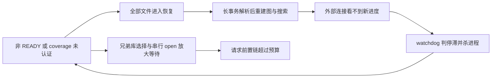
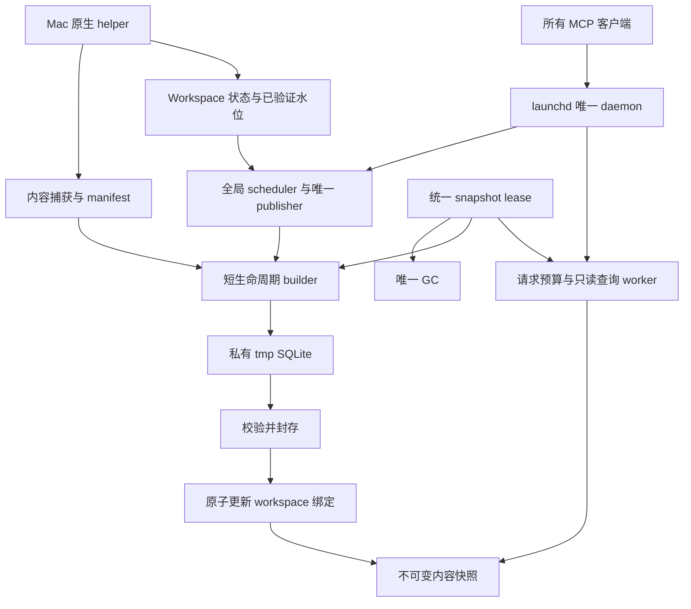

# ILV2 深度评审：停止修补旧生命周期，收敛为 Mac 专用索引服务

日期：2026-10-13。评审代码：`9b3a110`，分支 `codex/index-lifecycle-v2`；已部署源码基线提交为 `ad412ce`。评审对象：[ILV2 执行手册](https://github.com/lkyprogramer/codex-java-lsp-mcp/blob/9b3a110437bbd9c5dd6db578e6f8824dbc763aa4/docs/deep/codex-java-lsp-mcp-index-lifecycle-v2-ai-execution-manual-2026-10-13.md)。

> 引用版本说明（2026-10-13补充）：本review的“手册§/行号/旧P任务”均指commit `9b3a110437bbd9c5dd6db578e6f8824dbc763aa4` 的原手册，不指后来重写的行号；源码/历史证据链接也固定该commit。当前实施合同见[最新版Mac执行手册](codex-java-lsp-mcp-index-lifecycle-v2-ai-execution-manual-2026-10-13.md)。后续手册修订和反馈核实另记于§8；§1–7保留首次review的事实和验证范围，历史23项测试未因文档修订而重跑。


## Review Verdict

**结论：保留“后台构建、不可变 SQLite 快照、原子发布、请求不等构建”的方向；不建议按当前手册直接进入实现。它识别了主要故障链，但还没有把造成这些故障的状态模型彻底拆开，部分步骤会直接重新触发旧问题。**

**可以做更彻底的 Mac 专用方案。推荐一个由 launchd 管理的唯一 daemon，加一个范围很小的原生 helper；直接使用 FSEvents 和 clonefile，将工作区状态与内容事实分开。删除旧存储、旧恢复路径、独立 stdio runtime 和非 APFS fallback，不再为它们维护第二套生命周期。** 不建议为了“深度定制”重写整个系统语言或更换数据库：当前证据指向输入一致性、所有权、状态转换和验证缺口，未指向 SQLite 无法胜任。

这里的“不考虑兼容性”落实为可以改变 schema、内部 API、工具输出和部署配置，不保留历史索引读写路径；不意味着可以放弃源码归属、负查询完整性和 worktree 隔离。后者是产品正确性。

对上述方向的信心为高；对“所有真实 worktree 都能在 5 秒内完成 seed”的信心仍有限。依赖扩展、SQLite 写放大、真实构建阶段耗时尚未测清，不能把目标写成已经得到的性能。

本文是评审和改写建议，不冒充已经接受的新执行合同。本轮只新增本文，没有修改产品代码、原手册、业务仓库、生产服务或全局配置，也没有提交、推送或部署。

## 1. Evidence And Current State

### 1.1 当前状态与附件里的历史现场必须分开

- 工作区在评审开始时干净，HEAD 为 `9b3a110`。`ad412ce` 已固化部署源码；`34d2f63` 加入手册，`9b3a110` 记录 P0-T0。附件“部署源码尚未提交”的描述已经过时。
- ILV2 当前只记录了 P0-T0 完成；快照、scheduler 和原生 helper 尚未实现。手册中的大部分性能数字是目标或待测，不能当实施成果。
- 手册 §1.6 与 P0-T0 记录生产已停用、索引已清除；本轮没有重新探测生产服务。因此下文“14 个 BUILDING worktree”“840 秒请求”“13 GB 缓存”均指 Claude 调研记录的历史现场，不宣称它们此刻仍存在。
- P0-T0 冻结清单里的 lishu-v2 实际为 `fd9c117b4cfad46247757d4c373b9465534fe33f`、6160 个 Java 文件；手册 §1.4 的旧现场为 `8bc0fb96b`、6156 个。后续重现与比较应引用冻结清单，并注明无法逐字重放清理前现场。[冻结清单](https://github.com/lkyprogramer/codex-java-lsp-mcp/blob/9b3a110437bbd9c5dd6db578e6f8824dbc763aa4/docs/index-lifecycle-v2/p0/frozen-repos.json)

### 1.2 最近提交确实解决了什么

| 提交或阶段 | 实际改善 | 尚不能推出的结论 |
| --- | --- | --- |
| `321bde0`、`ee3e774`、`b58d3f1`、`c8ab600`、`04f8e2d` | 模型收到真实工具内容；计划分母、两臂隔离和冻结 judge 更可信 | 分数上涨全部来自检索能力提升 |
| `3c12b57`、`77d7e61`、`791c520`、`8a9d485`、`b22c0a5`、`463ba33` | 重名、作用域、exact、证据来源和资源更新等正确性修复 | 大仓 cold、恢复、seed 的组合生命周期已经成立 |
| `836f772` | 检索及交付阶段统一 deadline | resolver、runtime 创建和 watcher listener 等前置等待也受相同截止约束 |
| `aed7603` | schema / facts revision 不匹配时重建，避免继续服务旧事实 | 多仓同时失效后的重建流量受到全局调度保护 |
| `ad412ce` 固化的 integrity 改造 | 防止部分 refresh 冒充全量完整；恢复覆盖、继承事实和 XML 更新更准确 | 全仓 recovering 长事务不会被 watchdog 误杀 |
| `7f62569`、`04058e4` | 删除没有证明收益的 dense 路径，回退未过 token 守卫的 declaration ranges | 应恢复这些能力或继续围绕它们投入 |

模型结果也要按 profile 分开。最终发布记录同时包含：原 28 QA 回归集 **26/28 对 24/28**；完整 public QA **26/28 对 25/28**；原 repair **8/8 对 8/8**；新 locked QA **9/9 对 9/9**，repair **2/3 对 2/3**。原 28 QA 的输入 token 为 312,589 对 231,768，约多 34.9%。这些支持“评测可信、部分正确性改善”，不支持“已经证明 agent 整体显著增强”。完整 public 的原 CLI qualification 还保留独立失败限制，不能只摘一个 PASS。[发布结果及边界](https://github.com/lkyprogramer/codex-java-lsp-mcp/blob/9b3a110437bbd9c5dd6db578e6f8824dbc763aa4/docs/next-stage/qa-contract-release-review.md#L15)、[token 原始汇总](https://github.com/lkyprogramer/codex-java-lsp-mcp/blob/9b3a110437bbd9c5dd6db578e6f8824dbc763aa4/docs/next-stage/qa-contract-release-evidence/p4-release/final-qa/review.md#L28)

## 2. Why Repeated Rebuilds Still Fail

**主要问题是多轮改造一直复用“同一份可写库既是工作现场，也是对外事实”的模型。修好了一个局部不变量，却把代价转移给另一个模块。**

1. `buildState` 同时表达作业进度、恢复入口、coverage 和服务资格。防止假 READY 的改动让非 READY 必须全量恢复；但恢复仍放在一个大事务里。
2. watchdog 把“另一条连接能看到的已提交进度”当成“进程是否仍在工作”。长事务内没有可见提交，正常 CPU 工作也可能被判停滞。冷建 resolve 第一遍和 graph 阶段又存在进度观测空窗。
3. sibling 复用首先选到一份库，再设法修正目标工作区。`f997066` 为避免目标未 reconcile 就被服务而增加等待，改善了隔离，却使 `open → createEntry → familyGates` 串行等待加重。
4. 每个 root 一个 supervisor；facts revision 失效会同时扩大重建需求。没有机器范围的索引作业调度，只在请求外面分散加超时，不能控制后台工作量。
5. 测试分别验证“失败后不能假 READY”“挂起后必须 kill”“worktree 内容不串”，却没有让这些机制在真实大仓、多个 worktree、健康长事务、持续编辑下同时运行。

可以由当前源码确认的链条是：



其中“生产当时一定由这条链形成反复活锁”仍是强推断，本轮未跑 P0-T1 真实复现。不能把历史进度停在 declare 和大 WAL 直接写成已经复现；但恢复选择、长事务和预算缺口是已读代码确认的事实。[恢复判断](https://github.com/lkyprogramer/codex-java-lsp-mcp/blob/9b3a110437bbd9c5dd6db578e6f8824dbc763aa4/src/index-builder/incremental.ts#L581)、[事务](https://github.com/lkyprogramer/codex-java-lsp-mcp/blob/9b3a110437bbd9c5dd6db578e6f8824dbc763aa4/src/index-builder/incremental.ts#L303)、[请求前置等待](https://github.com/lkyprogramer/codex-java-lsp-mcp/blob/9b3a110437bbd9c5dd6db578e6f8824dbc763aa4/src/repo-runtime-manager.ts#L363)

因此，下一轮应验收状态模型和真实路径，而不是再以“新增多少测试、通过多少轮 review”代表完成。

## 3. Findings

以下 P1 指进入对应实施阶段前应修正的设计缺陷；未把未实现的计划错误冒充线上新增故障。各项均给出触发条件和可验证修正方向。

### F01 · P1 · delta 按手册执行会重新进入全量恢复路径

**位置：手册 §2.5 第 4–5 步，507–510 行；P1-T4b。**

方案先把克隆 tmp 的 `buildState` 改为 `BUILDING`，再复用 `applyJavaReconcile` 的“非 recovering 分支”，并断言 recovering 不可达。当前代码却以 `buildState !== READY` 判 recovering，把全部文件加入 changed；`applyParsedRefresh` 随后清图、清实体与搜索，在一个事务里重建。只补断言会使 delta 全部失败；照旧复用则重现全量恢复成本。[源码入口](https://github.com/lkyprogramer/codex-java-lsp-mcp/blob/9b3a110437bbd9c5dd6db578e6f8824dbc763aa4/src/index-builder/incremental.ts#L566)、[coverage 也依赖 READY](https://github.com/lkyprogramer/codex-java-lsp-mcp/blob/9b3a110437bbd9c5dd6db578e6f8824dbc763aa4/src/index-builder/progress.ts#L111)

**修正：** 删除通过数据库 `buildState` 推导作业类型的机制。作业状态由 scheduler 持有；builder 接收显式 `FullPlan` 或 `DeltaPlan`；base 有独立的结构完整性和 coverage。对密封 tmp 的校验不再反过来决定它该走恢复还是增量。对应测试必须证明一个文件差量没有偷偷解析全部文件。

### F02 · P1 · 只允许 READY 发布，会被正常编辑中的语法错误锁住整个工作区

**位置：手册 §2.3 发布第 1 步，428 行；§2.7 否定回答，574 行。**

现有冷建在部分解析失败时可以 `ok:true`，但 coverage 为 `DEGRADED`。若快照只有 READY 才能发布，一个未写完的方法或 recovered parse 就能使新 worktree 一直 NOT_READY；已有快照时，其他正确文件的新修改也无法发布。[冷建返回值](https://github.com/lkyprogramer/codex-java-lsp-mcp/blob/9b3a110437bbd9c5dd6db578e6f8824dbc763aa4/src/index-builder/cold-build.ts#L255)、[coverage 判定](https://github.com/lkyprogramer/codex-java-lsp-mcp/blob/9b3a110437bbd9c5dd6db578e6f8824dbc763aa4/src/index-builder/progress.ts#L119)

**修正：** 分开“快照结构完整、遍历完成”和“所有文件语义完整”。允许发布带明确局部 coverage 缺口的可用快照；不把坏文件的旧事实当成当前事实。否定回答要求请求所依赖范围的 coverage 完整，并且请求快照满足新鲜度，不能只看全局 `FRESH`。测试一个坏文件与另一个文件新增调用方同时存在，后者必须可见，前者及其受影响范围必须保留缺口。

### F03 · P1 · 输出库不可变，仍不能阻止 hash、AST 与搜索文本来自不同源码版本

**位置：手册 §2.5 full/delta 复用路径；现有冷建和增量实现。**

`parseJavaFile` 先读取内容、计算 hash 和 AST；graph/search 阶段再次读取实时文件；搜索文档却继续使用旧 bundle 的 contentHash。agent 在两次读取之间修改源码时，可以产出旧事实与新搜索文本混在一起的密封快照。同一 SQLite 事务只保护库，保护不了两次文件读取。[首次读取](https://github.com/lkyprogramer/codex-java-lsp-mcp/blob/9b3a110437bbd9c5dd6db578e6f8824dbc763aa4/src/java-index/java-index-file-parse.ts#L86)、[冷建二读](https://github.com/lkyprogramer/codex-java-lsp-mcp/blob/9b3a110437bbd9c5dd6db578e6f8824dbc763aa4/src/index-builder/cold-build.ts#L293)、[增量二读](https://github.com/lkyprogramer/codex-java-lsp-mcp/blob/9b3a110437bbd9c5dd6db578e6f8824dbc763aa4/src/index-builder/incremental.ts#L210)、[搜索文档 hash 来源](https://github.com/lkyprogramer/codex-java-lsp-mcp/blob/9b3a110437bbd9c5dd6db578e6f8824dbc763aa4/src/discovery/search-document.ts#L231)

**修正：** 一次捕获的字节产生 hash、AST、声明片段和搜索文档，后续阶段只使用该捕获结果。构建身份绑定明确的文件内容清单。可以保留 Buffer、受控 staging 或单文件 APFS clone；逐文件 clone 不等于整棵源码树在同一瞬间的文件系统快照。持续编辑时允许发布可自洽但已知陈旧的捕获清单，保留后续事件并续建，不能声明它就是最新磁盘状态。

必要测试是在 parse 后、search-doc 前注入修改，核对所有证据 hash 与实际捕获字节；只对静止仓库做 full/delta 比较检测不到此问题。

### F04 · P1 · 请求 view 与新鲜度等待顺序冲突，noop 也没有完成确认协议

**位置：手册 504、544、558–574 行；P1-T5、P1-T7。**

请求先 acquire 旧快照，再在 handler 内等待新快照发布。等待成功仍查询旧 view，会把旧事实标为 fresh；中途切换部分查询则破坏同请求一致性。`indexFreshness` 必须描述请求持有的快照，而非返回时的全局 CURRENT。

此外，启动校验、touch、编辑后恢复原内容都可能 `noop`。手册只在 published 后清 suspect，noop 无发布就可能永远 VERIFYING/STALE。`seq < startSeq` 与等待 `startSeq > suspect.seq` 的边界没有定义，`BuildJobSpec` 也没有携带对应确认水位。

**修正：** 在首次 acquire 前完成有界的新鲜度准备；之后固定 view，不再升级该请求的新鲜度。定义扫描身份及 `coveredThroughSeq`，publish 和 verified-noop 都产生确认结果；只清除已确认水位内的事件，扫描期间的新事件保留。对 noop 必须重新核对其 base 仍适用。覆盖首次校验无变化、单事件、edit-revert、扫描中第二事件、两个请求跨发布五种时序。

### F05 · P1 · “内容为准”仍会被相同 stat 绕过，Mac 掉事件也没有闭环

**位置：手册 I5、§2.4、BuildJobSpec.hints；P1-T3 要求 v9 行为不变。**

现有 Java/XML 扫描在 size 与 mtime 相同时直接跳过哈希；ctime 虽有存储，却不参加这个判定。手册原样继承，并把 watcher hints 说成只影响加速。保留时间戳的同长修改，即使已收到事件，也可能被扫描判为 noop，之后继续允许否定回答。[Java](https://github.com/lkyprogramer/codex-java-lsp-mcp/blob/9b3a110437bbd9c5dd6db578e6f8824dbc763aa4/src/index-builder/incremental.ts#L591)、[XML](https://github.com/lkyprogramer/codex-java-lsp-mcp/blob/9b3a110437bbd9c5dd6db578e6f8824dbc763aa4/src/index-builder/incremental.ts#L532)

当前 `fs.watch` 包装只暴露 eventType/filename，没有原生 FSEvents 的 drop、rescan 和事件游标。Apple 要求合并目录事件按标志递归扫描，掉事件后全面重扫，并先监听再开始初始扫描；事件记录本身只是提示。[当前 watcher](https://github.com/lkyprogramer/codex-java-lsp-mcp/blob/9b3a110437bbd9c5dd6db578e6f8824dbc763aa4/src/repo-fs-watch.ts#L177)、[Apple FSEvents 指南](https://developer.apple.com/library/archive/documentation/Darwin/Conceptual/FSEvents_ProgGuide/UsingtheFSEventsFramework/UsingtheFSEventsFramework.html)

**修正：** suspect 路径强制内容校验；启动、事件流不可信和掉事件后做全量 hash；正常 stat 快路包含文件身份与高精度时间，但不把 stat 相同当完整证明。原生 helper 传递 volume/stream 身份、eventId 和 flags，sidecar 保存已验证游标；掉事件或根变化置 `rescanRequired`，直到扫描确认才清除。游标数字不连续本身不是掉事件证据。周期巡检兜住未被事件流表达的变化。

### F06 · P1 · Promise.race 只能结束响应，不能兑现硬截止与资源回收

**位置：手册 §2.7、P0-T6 第 1 条，552、826–828 行。**

手册要求超时后后台 operation 继续，依靠自己的 finally 释放。若 handler 永不结束，finally 也永不发生；当前 application 的 activeRequests、runtime refCount 等会继续占用，drain 和快照 GC 受到影响。R5 仅断言“后台 handler 结束后归零”，没有测试永不结束时的边界。[请求计数](https://github.com/lkyprogramer/codex-java-lsp-mcp/blob/9b3a110437bbd9c5dd6db578e6f8824dbc763aa4/src/application.ts#L118)、[当前入口](https://github.com/lkyprogramer/codex-java-lsp-mcp/blob/9b3a110437bbd9c5dd6db578e6f8824dbc763aa4/src/mcp-server-factory.ts#L203)

同一 Node 主线程里的 timer 也无法打断同步 SQL、同步大循环；所谓“硬截止”必须以主线程不承载不可中断重活为前提。

**修正：** 明确区分请求专属工作与共享构建。调用超时撤销该 caller 的等待、查询和响应所有权；共享 builder 由 scheduler 独立管理。查询留在有界 worker 队列，无法协作中断的请求专属 worker 在 grace 后回收；slot 和 snapshot lease 在实际工作结束后释放，不能提前释放还在读取的资源。反复超时测试应观察队列、线程、活动请求和 lease 最终收敛，并覆盖主线程阻塞检测。

### F07 · P1 · “全局两个 builder”只有进程内保证，GC 缺少所有使用者的 lease

**位置：手册 §2.6、§2.8、P1-T5/T6/T8。**

每个 application 一个 scheduler，而 stdio 和 HTTP 都能创建 application；现有 ownership 按 root 获取。两个进程各持有不同 root 合法，却可以各跑两个 builder。因此这不是机器级两个槽。跨进程读者也不受内存引用计数保护。[ownership](https://github.com/lkyprogramer/codex-java-lsp-mcp/blob/9b3a110437bbd9c5dd6db578e6f8824dbc763aa4/src/repo-ownership-lease.ts#L124)

即便只有一个进程，retired 快照 GC 只检查请求读者，未统一保护候选扫描和 builder 的 base。候选排队或扫描期间从 CURRENT 变 retired，克隆前可能被 GC 删除；固定十分钟 grace 不是引用协议。父进程在构建中途退出后的孤儿 builder、stop 后排队 promise、result/exit 竞态，也没有完整终止合同。

**修正：** Mac 专用版本只保留一个 cache owner。所有客户端连接同一 daemon，stdio 如保留仅做转发。请求、query worker、候选读取和 clone 使用同一种 lease；dispatch 时重取候选，clone 完成后释放 base lease；所有 GC 分支遵守 lease。作业收到 result 不等于进程已退出，槽位释放须等待 exit/reap；父连接断开时 builder 退出，重启恢复必须回收遗留作业再恢复槽位。增加“候选被 retire 时 GC”和“构建中 kill daemon 后重启”的真实进程测试。

### F08 · P1 · signed int64 hash 主键没有覆盖 JavaScript 数值边界

**位置：手册 §2.10 和 P1B-T1，619、1094–1100 行。**

方案把 SHA-256 前 8 字节作为 signed int64 主键。当前 sym API、Map 和 SQL 消费者使用 `number`，`asId` 会把 bigint 转 number，并拒绝非正 ID。[sym 实现](https://github.com/lkyprogramer/codex-java-lsp-mcp/blob/9b3a110437bbd9c5dd6db578e6f8824dbc763aa4/src/java-index/sql/sym.ts#L6)、[其他转换](https://github.com/lkyprogramer/codex-java-lsp-mcp/blob/9b3a110437bbd9c5dd6db578e6f8824dbc763aa4/src/java-index/sql/facts-store.ts#L38)

本轮在 Node v22.16.0 的内存 SQLite 上实测：身份字符串 `method:type:v2:Example#run()` 的前 8 字节值为 `571394878254686318`，默认 SELECT 抛 `ERR_OUT_OF_RANGE`；启用 `setReadBigInts(true)` 后读取正确，但 `Number` 往返不相等。另有 `Number(9007199254740992n) === Number(9007199254740993n)`。因此“碰撞注入＋文本往返”远不足以覆盖类型边界；约一半 signed hash 还是负数。

**修正：** 首选保留小整数内部 surrogate ID，使用固定长度 hash BLOB 做文本查找索引，并比较原文本检测碰撞；减少长 TEXT UNIQUE 索引的重复存储。这样不用把所有图、查询和 IPC 改成 bigint。若选完整 bigint 改造，必须明确 SQL、Map、JSON、排序和所有 number 转换的端到端迁移。两者都应实测页写入和查询成本，不能仅从删掉 autoindex 推算净收益。

facts 当前已通过 `deflateRawSync` 压缩；“再字典化必省 40–80 MiB”尚无证据，需同时测字典开销、解码 CPU、读放大和 COW 页变化。[当前编码](https://github.com/lkyprogramer/codex-java-lsp-mcp/blob/9b3a110437bbd9c5dd6db578e6f8824dbc763aa4/src/java-index/sql/rows.ts#L78)

### F09 · P1 · cp -c 的成功不证明克隆，重戳整表也可能抵消 COW 收益

**位置：手册 §2.5 第 4/6 步、P1-T2 cloneFile、S2。**

`cp -c` 在跨文件系统或不支持 clone 时会自动回退普通复制并成功。把退出码 0 写成 `cloned:true`，会误报克隆与磁盘成本。这与手册在当前 APFS 卷上观察到真实克隆并不矛盾。[Apple cp 手册](https://raw.githubusercontent.com/apple-oss-distributions/file_cmds/main/cp/cp.1)

此外，seed 要给全部 `file/resource_scan` 重戳工作区 stat，会修改本来可以共享的数据库页。此处是写放大风险，不是已测退化；随机大文件克隆只占几十 KiB，不能证明真实 SQLite delta 也只付少量成本。

**修正：** Mac/APFS 为硬运行条件，使用小型原生 helper 直接调用 clonefile，明确返回不支持/跨卷/空间错误，删除静默 full-copy fallback。workspace 的 root、stat、事件游标、lastRequestAt 和验证水位放 sidecar，事实快照只留相对路径及内容与语义事实。先测零差异、20 文件、200 文件 seed 的物理增量，再定 storage 目标；不要拿 sealed 文件逻辑大小代替物理占用。

### F10 · P1 · 当前验证手册有几处无法按原文执行或不能证明声明的门

| 位置 | 具体问题 | 必须修正的测法 |
| --- | --- | --- |
| §7.2 与 §11.2 | 先常驻 :38457 canary，再运行拒绝已占用端口且自行启动 daemon 的 burst | burst 分 start/attach；attach 核对 instanceId、源码和缓存隔离，负载复用同一 daemon |
| §2.7 最后、P1-T7b 与 §11.2 第 1 步 | `status(start=false)` 被定义为纯读，却又要求新 worktree 请求安排 seed；harness 仅轮询 status 等主库 READY | 固定语义：status 纯读；显式预热或首个功能查询发起后台 build；harness 明确触发者 |
| §11.2 第 4/5 步与 p1 门 | 每 10 秒请求一次，却验收编辑可见 p95 ≤ 3 秒；只有两个编辑点 | 编辑后 100–200ms 有界查询，至少 20 个样本，校验唯一新方法和 contentHash |
| §11.3 incremental 与 P1A-G5 | 实测 edit→published，声明 edit→query-visible | 分别记录 edit、publish、first-correct-query，真实覆盖 query worker 切换 |
| P0-T3a | 每秒最多一次 heartbeat，3 秒同步循环却要求收到至少 5 次 | 统一节流、测试时长与次数，验证到达间隔，不设互相冲突的断言 |

这些不是文字润色问题：照文执行会阻断门禁，或迫使执行者临时改口径。应在实现前完成 harness 最小跑通；不能等最后一个验证 Task 才发现。

### F11 · P1 · 新任务集评测链并不存在手册假定的接口

**位置：手册 P2-T1/T2/T3，1189–1208 行。**

`generate-commit-tasks.mjs` 输出候选 commit 任务容器；evaluator 消费 JSONL、公开答案合同、私有 gold，repair 还需要真实 oracle，两者没有现成转换。`evaluate-java-task.mjs` 没有“不调用模型的确定性检索”模式：缺 backend 只写 UNMEASURED/BLOCKED_AUTH，dry-run 也不测检索。`eval-pilot-compare.mjs` 又硬读旧 pilot IDs 和旧 dev dataset，新任务可能与 QA 比较分母脱节。[生成格式](https://github.com/lkyprogramer/codex-java-lsp-mcp/blob/9b3a110437bbd9c5dd6db578e6f8824dbc763aa4/scripts/generate-commit-tasks.mjs#L257)、[evaluator 分支](https://github.com/lkyprogramer/codex-java-lsp-mcp/blob/9b3a110437bbd9c5dd6db578e6f8824dbc763aa4/scripts/evaluate-java-task.mjs#L1108)、[比较器绑定](https://github.com/lkyprogramer/codex-java-lsp-mcp/blob/9b3a110437bbd9c5dd6db578e6f8824dbc763aa4/scripts/eval-pilot-compare.mjs#L99)

**修正：** 明确建设三个产物：人工核验的 task/gold/oracle 转换；无模型的 retrieval runner；显式接受 dataset/gold/schedule 的成对比较器。commit 改动文件只能作为候选线索，不能直接当必需证据或影响面真值。新评测至少选少量真实任务前置跑通，否则生命周期完成后仍无法回答“agent 强了没有”。

P2 的 ±1 题、+10pp、重复 ≥3 次也要定义统计单位。同题重复不是独立新任务；按任务成对比较，保留失败 slot，按仓库和任务类别分层，报告不确定性。holdout 在方案冻结后只做最后验收，不能失败后反复调到通过。

### F12 · P2 · 共享 JDT 的 didOpen overlay 还不是可接受的隔离方案

**位置：手册 P3-T1，1240 行。**

同一 JDT workspace 中，同一 URI 的打开内容只有一个当前版本。两个 worktree 同时覆盖同名文件时，单纯 didOpen 和路径映射不能隔离后台解析、引用、diagnostics 与缓存。即使构建文件相同，Java 内容不同也足以发生串扰。按当前候选文字，没有会话级切换与结果版本绑定协议。[LSP didOpen 规范源码](https://raw.githubusercontent.com/microsoft/language-server-protocol/gh-pages/_specifications/lsp/3.17/textDocument/didOpen.md)

**修正：** 首轮不采用该候选。保留按工作区和构建环境隔离的语义 session，加机器级槽位；只有相同内容与环境的不可变产物可以共享。若未来仍实验共享 JDT，先证明两个冲突 worktree 并发查询、取消、后台任务和缓存没有串扰；200 符号的 98% 总体一致率不能豁免任何 worktree 隔离错误。

## 4. Mac-Only Clean Target

### 4.1 删除继承约束，而不是保留两套系统到 P4

推荐 **Staged clean path：以干净目标分阶段验证，一次切换到单一生产路径**。不选择“v9 生命周期补一遍、v9 快照部署一遍、v10 再重建部署一遍、到 P4 才删旧路径”。用户当前不需要这类兼容成本。

| Option | 代价与收益 | 判断 |
| --- | --- | --- |
| Conservative path：按现手册保留多个阶段的旧 runtime/schema 适配 | 小步 diff 较容易，但重复恢复、双 ownership 和旧测试耦合继续存在 | 不推荐 |
| Clean target：一次重写所有语言、数据库和协议 | 变化面最大，当前没有证据说明更换 SQLite/TypeScript 能解决根因 | 不推荐 |
| Staged clean path：先完成唯一 owner、正确状态和输入模型，再接入已验证的 APFS/存储改造 | 可独立验证，每个构件只有一条正式路径，最终统一切换 | 推荐 |

“不新增生产依赖”是手册的自设限制，不应排斥有明确用途的小型原生 helper；采用它的收益应由 F05/F09 的验证证明。现有规则禁止未经授权部署、写生产和改全局配置则继续有效，本评审不跨越这些边界。

### 4.2 目标结构



这里的“原子 workspace 绑定”是一个 manifest：同一次切换绑定 snapshotId、内容清单身份、已验证水位及环境身份。不能把 CURRENT 和可信游标分成两次无关系的写入，崩溃后再猜哪一个有效。统计时间、lastRequestAt 等非正确性字段可以独立写。

### 4.3 只保留五个明确职责

1. **HostOwner。** 一个 launchd job、一个 cache owner、一个 scheduler/publisher/GC。固定已验证的 macOS、CPU 架构和 Node/SQLite 构建；此处“固定”是减少运行组合，不宣称当前 Node 必须永远不升级。保留现有本机 MCP 传输即可，stdio 不能再创建独立 runtime。没有必要把 XPC 作为首轮前置。
2. **WorkspaceTracker。** 原生 FSEvents 负责变化提示和恢复信号；sidecar 记录 canonical root、卷/根身份、stat、suspect、校验游标和工作区绑定。根被删除、移动或同路径重建后必须重新核验身份，不复用旧 FRESH。
3. **ContentCapture。** 捕获目录清单和实际源码字节；所有派生事实都基于同一份每文件内容。明确包含 Java、XML，以及实际影响解析/解析环境的配置身份。Git common-dir 和对象可加速 family 与基线定位，但不能覆盖 dirty/untracked、冲突 stages、attributes/filter 后的工作树字节。Git 后台读取使用 `--no-optional-locks`；不再笼统否决 Git。[Git status](https://git-scm.com/docs/git-status)、[Git ls-files](https://git-scm.com/docs/git-ls-files)
4. **SnapshotBuilder。** 从明确 full/delta plan 构建；从结构完整的不可变 base 直接 clonefile，私有 tmp 可以分批提交。所有权与 sealed 输入消除了“必须用巨型事务保护读者”的理由。按文件数限制只是起点；依赖扩展和大文件可突破估计，还需阶段进度、工作量和墙钟边界。解析、解析引用和构图的正确性边界分别验证。
5. **SnapshotStore。** 一个发布协议、一个读 lease 协议、一个 GC。只读连接绑定具体快照；旧 reader 完成前不回收。SQLite `immutable=1` 会跳过锁及变化检测，必须确保发布文件永不再写；其正确性不来自参数名。[SQLite URI 说明](https://www.sqlite.org/uri.html)

### 4.4 内容快照与工作区绑定分离，是比“cp -c 更快”更大的收益

当前设计把 repoRoot、mtime、工作区 generation 等写进事实库，迫使同样的源码在每个 worktree 里被复制、重戳。建议事实快照只包含相对路径、内容 hash、语法事实、派生关系和完整性；工作区绑定携带 root 与验证状态。

新 worktree 经完整内容和环境核验后，如果与已发布快照完全一致，可以直接绑定同一不可变快照。**这不等于借兄弟内容回答：只有目标工作区已经证明同内容、同环境后才允许绑定，响应的路径与身份来自目标 workspace。** 否则按差量构建目标快照；尚未核验时仍 NOT_READY。

快照身份应覆盖内容清单、schema、parser/grammar、facts/resolver 版本和真正影响结果的布局/环境输入。不能只因为 schema 数字相同就认定事实可互换，也不应把每次遥测改动的整仓 Git SHA 都当解析失效条件。

### 4.5 后续提升：跨 worktree 复用解析，语义仍绑定自己的环境

手册以“差量小”否决逐文件 CAS 过早。实际已经记录落后 962 个提交、差异 5618 文件的 worktree；升级全量重建、多分支 full、同文件跨仓复用也是现实场景。

建议把 **内容寻址的语法提取缓存** 作为首个生命周期闭环之后的性能候选，先测解析占比与跨 worktree 命中率。key 覆盖内容、grammar/extractor 版本，以及会改变提取结果的输入。当前 bundle 含路径、模块和 generation，不能原样按 contentHash 跨 root 共享；应缓存位置无关的原始语法信息，再绑定相对路径和环境，随后做 resolver/graph。依赖解析结果与 JDT 状态不能仅因单文件字节相同而共享。

收益若成立，是大批 worktree 和缓存重建不必重复解析相同内容；若 profile 显示解析不占主要时间，就暂不实现持久 CAS，先解决 resolver/graph 重算与数据库写放大。不要为了实现“高级缓存”再引入第二种存储引擎。

### 4.6 Storage Decision

- 首版正式切换前确定一个新 schema，删除 legacy 恢复和迁移读取。旧 release 只作独立回滚工件；若旧版本本身不能可靠工作，停用服务优于恢复已知活锁版本。
- 首先移出 workspace stat，避免 seed 全表改写；再处理长身份字符串和重复索引。内部用紧凑数字关联 file、owner、kind，外部 ID 可直接重新定义，不为旧长字符串专设拼接兼容层。
- facts 压缩方案以真实库实测决定，不按推测强制要求字典化。比较总物理增长、seed/增量时延和查询 CPU；350 MiB 逻辑目标不能取代这些指标。
- schema 改造分独立内部提交评审，但不要求先部署 v9 快照、随后让所有仓库再冷建 v10。验证 runner 可以给旧基线和新候选使用不同 driver，不必保留生产 API 兼容来迁就 benchmark。

需要删除的正式路径：`copySibling/VACUUM INTO`、mtime 最新 sibling 选择、`familyGates` 创建等待、共享可写服务库、`recovering` 自动分支、每 repo 的旧常驻 serve supervisor、独立 stdio builder owner、非 APFS full-copy fallback、旧 schema 读取及无使用者的 env。删除时核对真实调用者；保留函数名不属于需求。

## 5. Validation That Addresses The Actual Failure

### 5.1 历史测试的缺口有明确位置

| 验证 | 实际证明 | 没有覆盖 |
| --- | --- | --- |
| [K12](https://github.com/lkyprogramer/codex-java-lsp-mcp/blob/9b3a110437bbd9c5dd6db578e6f8824dbc763aa4/scripts/release-mcp-contracts.test.mjs#L127) | deadline=0 参数拒绝 | 有效预算经过 resolve/create/flush/reconcile 全链路的截止 |
| [K06](https://github.com/lkyprogramer/codex-java-lsp-mcp/blob/9b3a110437bbd9c5dd6db578e6f8824dbc763aa4/src/benchmark/release-index-contracts.test.ts#L82) | 两个 worktree 分别冷建后查询隔离 | BUILDING sibling、family 串行、六个 worktree 同时 seed |
| [supervisor stall 单测](https://github.com/lkyprogramer/codex-java-lsp-mcp/blob/9b3a110437bbd9c5dd6db578e6f8824dbc763aa4/src/java-index/builder-supervisor.test.ts#L143) | fake child 挂起后被 kill/retry | 真实大事务健康运行、已提交进度不变时不能误杀 |
| [K29 scope](https://github.com/lkyprogramer/codex-java-lsp-mcp/blob/9b3a110437bbd9c5dd6db578e6f8824dbc763aa4/scripts/run-release-contracts.mjs#L127) | 固定 1000 文件合成库查询容量 | lishu-v2 真库 cold/seed/full fallback 的组合压力 |
| 三仓 cold-nolsp | 三个冻结仓的检索质量与相对耗时 | lishu-v2、一个 daemon 的多工作区生命周期和持续编辑 |

历史通过结果不应推翻，也不应外推。新门要覆盖之前没有执行到的生产路径。

### 5.2 First Proof Point：先交付一个完整的纵向闭环

在写完整手册所列的全部模块之前，先完成一个隔离原型：**lishu-v2 一个 full → 六个并发 worktree → 持续编辑 → 中途杀 builder/daemon → 重启恢复 → 真查询命中**。加入一个差异大到 full fallback 的旧分支，与五个小差量 worktree 同跑。

| 必须成立的性质 | 直接 oracle |
| --- | --- |
| 健康构建不被误杀，异常构建可终止 | 真实进程阶段时间线、完成结果、exit/reap；不能只注入 fake heartbeat |
| 请求始终有界，超时资源收敛 | 外部调用耗时＋活动请求、worker 队列、snapshot lease 与 builder 数量 |
| 没有跨 worktree 证据 | 同路径异内容、Java/XML 的实际 hash、独有方法与引用 |
| capture 自洽 | parse→search 之间编辑，所有派生结果仍对应所声明的捕获字节 |
| 正常脏工作树可用 | 一个语法坏文件与正常文件更新同时存在；可用结果更新、受影响范围保留缺口 |
| 新鲜度闭环 | 同 stat 异内容、touch、edit-revert、启动 noop、扫描中修改、事件丢失后恢复 |
| 发布和 GC 安全 | 每个发布边界崩溃、读 lease、base lease、CURRENT 更新后 metadata 写入前崩溃 |
| 同机并发上限真实有效 | 多客户端、多 root、daemon 重启后都不越过槽位，旧孤儿被回收 |
| seed/full 混合不饥饿 | 两个长 full 不得无限压住小差量与前台请求；记录各优先级排队和首个正确证据时间 |
| 克隆收益真实 | clone 原语明确成功，零差量不重写事实库；20/200 文件变化后实测物理页成本 |

`faultAt → process.exit(137)` 只模拟阶段出口，不等同于外部 SIGKILL 落在事务/checkpoint/发布中途；两种测试都需要。父进程在作业中途死亡尤其不能遗漏，否则 launchd 重启可能把孤儿 builder 留在旁边。

暂定沿用 status 200ms、常见 seed 5/15s、编辑到正确查询 3s 等用户可感知目标，但明确样本、负载和起止点。验证失败必须报告，不能为了让阶段 PASS 悄悄改变目标或只测 publish 事件。

**Falsifier：** 若“事实与 stat 分离”后真实差量仍普遍接近全量页重写，或大多数修改都触发全图重算，则 APFS clone 不能独自兑现差量成本；需要继续拆派生数据更新和依赖闭包，再讨论分片。若主要耗时并非解析，就不以并行 parser/CAS 作为提速主线。上述证据都不支持直接转向更换语言。

### 5.3 验证投入顺序

1. 保留 P0-T1 的诊断价值，限定用它确认历史机制；未复现不应否决已经独立确认的预算、输入一致性和状态模型缺陷。U4 已选不部署旧版，取消修复旧生产路径的非必要工作。
2. 先修订 F01–F11 的合同，做三个最小证明：同字节派生、发布/noop 新鲜度、原生事件及 clone 协议。同时冻结少量真实 QA/repair 任务及真值。
3. 完成单 daemon＋full/delta＋读 lease＋GC 的闭环，并在同一真实负载中验证；旧代码在新路径接入时删除，不拖到最终清理阶段。
4. 根据 profile 决定 schema 紧凑化、解析并行、语法 CAS 的具体投入。合并为一个正式运行格式，一次生产切换，安装授权另行取得。
5. 工程可用后再做真实模型成对 A/B：成功率、首次正确证据时间、输入 token 和任务墙钟一起判断。工程收益与 agent 收益分别出结论。JDT 精度实验由任务失败证据触发。

全量测试和三仓矩阵适用于整合候选及正式门，不能替代上述主场景。纯 helper 修改先跑相关测试；出现新失败再扩大检查，避免每个 Task 与多个 Gate Runner 重复完整矩阵却仍漏掉实际故障路径。正式三仓运行继续遵守现有 load 政策，不因主机 load 人为跳过。

## 6. Expected Payoff And Cost

| 决策 | 现在付出的成本 | 解决的实际痛点或增加的能力 | 何时能观察到 |
| --- | --- | --- | --- |
| 单 launchd owner，删除独立 runtime owner | 调整启动入口和客户端接入 | 多 root 也只有一组 builder 槽；GC 不再跨多个私有引用计数猜测 | 多客户端 burst 和 daemon 重启 |
| job/coverage/freshness 分开 | 重写状态接口与相关测试 | BUILDING 不再自动放大全仓恢复；一个坏文件不再阻止所有正常更新 | 一个文件 delta 和坏文件并存测试 |
| 捕获字节只读一次并贯穿派生 | 调整 parse/search 数据接口 | 不再返回旧 hash 标记的新文本，证据真正可追溯 | 构建中注入源码编辑 |
| FSEvents 完整信号＋verified-noop | 原生 helper 与恢复协议 | 丢事件、touch、edit-revert 后能恢复可信状态，不永久卡 STALE 或错误 FRESH | 掉事件、重启、同 stat 测试 |
| 内容快照与 workspace sidecar 分离 | 新 schema 和绑定协议 | 同内容 worktree 可复用完整快照；少量差异不因 stat 重戳而改整库 | 零/20/200 文件 seed 实测 |
| clonefile 明确失败、取消复制兜底 | 限定 APFS，增加原生分发工件 | 不再把几百 MB 全量复制误报成零成本克隆 | capability 测试和磁盘观测 |
| 紧凑身份与测量后再压缩 | 数据表示重做与差分验证 | 减少长字符串索引重复、避免 64 位 number 精度错误 | dbstat、页增长、K29 与真库查询 |
| 修正真实任务 runner 和 oracle | 少量前置任务标注与 harness 改造 | 下一轮能明确证明 agent 是否少读、少等、少犯错 | 同任务同预算的冻结 A/B |

最大收益首先来自：**索引可靠可用、内容可核验、新 worktree 不重复支付全仓成本。** 接着才是模型成功率和 token 改善；两者不能混成一个“版本升级成功”的口号。

## 7. Validation Performed In This Review

已执行：

- Git 状态、近期历史与 `ad412ce` / `aed7603` / `f997066` 等相关 diff 检查；源码、测试映射、手册和历史发布记录交叉核对。
- 文档经过独立只读复核，未发现需要阻塞交付的事实错误或设计矛盾；31 个本地文件链接均可定位，新增文档的空白检查通过。该复核没有追加产品测试，也不代替未来实现评审。
- 隔离 clone 中重新编译当前源码并执行以下定向测试，**23 PASS，0 FAIL，0 SKIP，0 TODO**；命令退出 0：

  ```sh
  sh scripts/run-isolated-node.sh scripts/run-isolated-validation.mjs --profile targeted -- \
    node --test --test-concurrency=1 \
    dist/index-builder/integrity.test.js \
    dist/java-index/sql/sql-client-incremental.test.js \
    dist/java-index/sql/rows.test.js
  ```

- Node v22.16.0 内存 SQLite int64 实验，观察到默认读取越界与 Number 精度损失。最小复现：

  ```js
  import { DatabaseSync } from "node:sqlite";
  const db = new DatabaseSync(":memory:");
  db.exec("CREATE TABLE s(id INTEGER PRIMARY KEY)");
  db.prepare("INSERT INTO s VALUES (?)").run(571394878254686318n);
  db.prepare("SELECT id FROM s").get(); // ERR_OUT_OF_RANGE
  ```

- 核验 Apple cp/FSEvents、SQLite immutable 和版本相关 Node/libuv 真源。手册针对 Node 22.16/22.17 的 `COPYFILE_FICLONE` 本机观察有源码支持，应保留其版本限定。另一个精确性修订：这两个版本的 Darwin `fsync` 实现会先尝试 `F_FULLFSYNC`，因此不能按“仅普通 fsync”估算封存成本；这也不自动等于完整断电耐久已经验证。[Node 22.16 libuv](https://raw.githubusercontent.com/nodejs/node/v22.16.0/deps/uv/src/unix/fs.c)、[Node 22.17 libuv](https://raw.githubusercontent.com/nodejs/node/v22.17.0/deps/uv/src/unix/fs.c)

未运行：P0-T1 真实大仓活锁复现、ILV2 尚未实现的 harness、APFS 真库性能矩阵、完整 K01–K32、三仓正式矩阵、真实 JDT、付费模型 A/B、生产安装与回滚。当前交付是方案 review，不是实现或发布候选；上述 23 项通过只证明相应既有覆盖，不能用来宣布新架构有效或生产故障已修复。

## 8. 手册修订核实记录

### 8.1 ILV2-MAC/2 反馈处理（2026-10-13）

以下内容由手册原§10及验证说明移入，属于当时的文档修订记录，不是产品验收。该轮用户只授权文档修改，未启动产品实施；这项会话范围不再写成长期合同。

本轮核实Claude反馈后修订手册和review引用，并做文档一致性检查与独立只读复核；只读探测了本会话runtime并核对源码/本机man/官方资料。没有实施MAC任务、修改产品代码、运行spike/新harness/进程故障/真实JDT/模型A/B、提交、push或安装，也未清理附件所述历史临时目录。前序review的23项既有测试仍只属于该review，不计入本版任何G门。

| 反馈 | 核实结论与处理 |
| --- | --- |
| U4被扩成必须等最终部署 | 成立；§0.1纠正历史授权含义，§3.1增加具体候选的可选提前切换，安全门与安装授权不省略 |
| 首次验证太晚 | 成立；MAC-00旧实现成本spike、MAC-05真库薄切片、MAC-08C容量/三仓前移，MAC-11继续证明完整系统 |
| guardian过重 | 采纳简化；launchd+flock launcher为首选。Node不会默认传任意fd，显式映射/稳定inode/禁止LOCK_UN及真实继承与重启测试是必需条件 |
| 业务任务误作公开内容 | 成立；改agent-visible命名、固定本机datasets/runs路径，恢复每次commit扫描暂存blob与禁止原始业务内容入库 |
| PATH Node已经22.17/SQLite3.50 | 本会话未复现，当前读取22.16/3.49.1；但broker/installer按PATH选Node的结构风险属实，冻结绝对路径/digest/versions并统一入口；生产当前版本未在本轮核实 |
| symbolId每发布失效 | 原文含混，会损害多步调用；命名ID跨无关发布稳定，库内declarationKey与workspace包装分离，版本证据用另一种handle |
| FSEvents持久cursor无收益 | 成立；当前一律startup full，不保留磁盘原生cursor；运行中flags/fence/rescan水位继续保留 |
| 清理缺少时点/路径/校验 | 成立；每G门closeout核对未登记/到期残留为0，有consumer的carry-over例外；归档解包重算hash后才删原件 |
| 大卡太粗/每卡先评审计划 | 部分采纳；MAC-02/06/08分3子卡、MAC-03分2子卡并给目标测试，补task-result模板；不增加所有小任务的统一审批等待 |
| K29/三仓过晚 | 成立；G08C前置新查询路径的负载/质量回归，最终门按身份与影响复用或重跑；不能假设两次必然不同SHA |
| 捕获跨卷、HANDOFF约束 | 明确read capture与缓存clone卷边界；保留两个禁用选项、常驻实例限制，隔离短命fixture单独计数并清理 |
| 状态词/删除项类型/D09归属 | 已分任务/候选/文档状态、CODE/PLAN删除；D09运行时归MAC-08B、guidance归MAC-13 |
| 串行依赖、引用与术语 | MAC-03A不依赖native；增加数据模型表；review声明旧手册commit并改为固定commit的GitHub链接 |

本表是反馈处理记录，不是产品实现验收；各MAC/G状态仍为PLAN。

### 8.2 ILV2-MAC/3 再次核实（2026-10-13）

输入为Claude针对手册blob `d30808a8`、review blob `94b30ac6`的反馈；两份均未提交。源码HEAD仍为 `9b3a110437bbd9c5dd6db578e6f8824dbc763aa4`。已纠正上一轮手册把“字面node已重绑定”写成现状的错误。

| 反馈 / 新发现 | 核实与修订 |
| --- | --- |
| 定向/K命令仍会用PATH Node | 成立。`scripts/isolation-utils.mjs:128,155–187`仅允许字面node并绑定路径；nested broker还会提前返回。`run-isolated-validation.mjs:175–177`原样执行。示例立即改绝对Node；独立复核还发现`scripts/run-v4-gates.mjs:27`的PR子命令写死node，故PR固定runtime入口标为MAC-02A后可用。MAC-02A新增所有返回分支重绑定及实际test/PR/K子进程身份测试。没有把Claude会话的22.17版本外推成本会话现场 |
| K输出命令不可执行、证据易丢 | 核实时额外发现。binder拒绝不含占位符的`--output`；默认finally删除整个临时根。改`{state}/k-contracts`并使用`--keep`，登记、归档核验后再清理 |
| broker随机根落在受管范围外 | 成立。两个runner先在`os.tmpdir()`建根、较晚才输出。示例先建/登记新run root并设置TMPDIR；MAC-01立即登记随机子根。默认信号终止可能绕过finally，不承诺SIGTERM必然完成清理 |
| Gradle不受同组/锁清理保证 | 采纳，限定事实范围。三个冻结Gradle仓wrapper均为9.3.1；该版本源码与本机jar反汇编存在detach调用链，但本轮没有实际PGID/fd实验。将其单列EXTERNAL_BUILD_DAEMON，保留显式fd4对OWNER_PROCESS的要求 |
| JDT专用Gradle home | 额外查明`src/jdtls-lsp-io.ts:776–789`不传GRADLE_USER_HOME，`src/jdtls-semantic-backend.ts:249–253`仅配jvmArguments。手册选独立home，要求环境与JDT配置同时生效、按实际版本stop和真实退出核验；不共用用户缓存、不误停其他域。两类旧进程共用原10 s门，是否可达仍待G02B，未放宽 |
| DEGRADED阻断MAC-00成本spike | 条件风险成立，未测lishu-v2真实failed/recovered数。允许结构/census完整且退化原因已知的一次性forcedNonRecovering探针，记录原值和实际额外解析；自然分支仍如实不可测，不将强制结果作正确性/正式收益证明 |
| 性能阈值可自行放宽 | 成立。放宽10%/30%与5 s/15 s须用户明确批准并留批准人/时间/授权引用；维持或收紧不增加审批；未批准仍按默认门 |
| 水位统一为审计字段 | 只采纳消除矛盾，不采用统一降级。当前epoch水位参与结果接受、pending清理和FRESH，是正确性字段；重启读到的旧值仅供追溯，新epoch仍全量核验 |
| fixture/launchd清理边界 | 增加同机测试fixture daemon合计≤2；测试plist只在run root，bootout后确认launchctl已查不到该label，进程退出后才删目录 |
| MAC-00扫描空档 | MAC-00证据先留本地受管根；MAC-01提供扫描器后，对暂存blob及人工diff核验通过再提交，不先提交后补扫 |
| 会话记录、依赖与测试命名 | 移出手册原§10/本轮授权与验证叙述；MAC-13改依赖MAC-10/11，与MAC-12可并行，MAC-14显式等待12/13；测试改名child-alive-after-parent-sigkill |

本轮只核对源码、冻结wrapper、Gradle本机jar和官方资料并修订文档。未运行隔离broker端到端、spike、launchd/JDT/Gradle故障、K/三仓/模型评测，未改产品代码、提交、push或安装。Claude报告的fd/flock实验是外部反馈，不计作本轮亲自运行；首次review的23项PASS保留其原证据范围，也不替代新要求的逐子进程runtime身份验收。

附件提及约19项历史临时残留（含业务源码副本）：本轮未核实其完整清单、数量与归属，未执行删除；它们不自动纳入文档修订的清理授权。本轮自行创建的文档检查临时文件单独收尾。

本轮文档验证：`git diff --check`通过；Python一致性检查通过，覆盖20张主卡、11张子卡的无环依赖、F01–F12与D01–D12、12个本地链接、31个固定commit链接/行号、JSON与代码围栏。两名独立只读复核分别检查运行命令/证据合同和Gradle/owner生命周期；上述PR入口遗漏修正后均为PASS。这些结果只证明文档一致性，不构成MAC/G产品验收。


### 8.3 ILV2-MAC/4 命令链与恢复边界复核（2026-10-13）

输入为Claude对MAC/3（手册blob `e5a7a485`、review blob `e853d957`）的反馈。本轮承认此前复核偏重字段、段落与已列问题，没有完整贯通shell展开、runner输出、verifier及进程重启策略；因此此前“文档复核通过”不能当成命令端到端可运行的证明。本轮仍只修改这两份文档。

| 核实项 | 证据与MAC/4处理 |
| --- | --- |
| /tmp不适合冻结输入和跨门证据 | 本机tmp_cleaner的man、plist和脚本确认每天调度及`-atime +3 -mtime +3 -ctime +3`条件；未运行清理器。权威输入、批准/runtime和所有run根改到持久ILV2_WORK_ROOT，历史/tmp副本只作待核验恢复输入；每consumer检查status、fsck、完整输入census/hash，不能只看HEAD |
| 三仓runner/verifier路径不一致 | `scripts/run-three-repo-cold-matrix.mjs:120–121,553`写output/matrix及output/run-manifest；verifier `:33–35,152`从matrix-dir及其父目录读取。模板改three-repo与three-repo/matrix；指出runner已内部verify，第二次只是持久产物复验 |
| shell提前展开glob与环境污染 | 示例统一引用glob，完整子shell限制set-e/TMPDIR作用域；三仓/K模板各自初始化环境，不依赖已经退出的前一子shell。没有把附件44%漏测比例当作本轮实测 |
| launchd默认节流与恢复门冲突 | 本机man确认默认ThrottleInterval=10；立即OWNER_BUSY退出有延迟清理的风险，未声称实际必然超时。改单次5 s有界锁等待、1 s节流及明确KeepAlive/非零退出语义，要求刚启动就崩溃与锁暂占用的真实时间线 |
| Gradle故障扩大成静态停服 | 调整可用性边界：旧OWNER_PROCESS/锁/binding安全恢复仍门控核心服务，Gradle只门控语义；外部状态与snapshot资源隔离，stop失败不启动新JDT、不误杀、不忙重试。10 s完整恢复门仍保留，静态降级通过不抵扣失败，性能窗口要求零遗留进程 |
| serviceStateRoot及冷语义成本 | 定义生产Application Support/state、隔离实例独立service-state，列入布局并排除snapshot GC/自动升级删除。MAC-17披露空私有home的下载、语义可用耗时与磁盘实测；不把一次未见gradle.properties外推成永久无需配置 |
| G01、scope、release、来源细节 | 补扫描无正文/无docs整体豁免、closeout负向、父根归属、配额与冻结缺文件测试；MAC-14列JDT脚本，MAC-02A列HTTP smoke并覆盖release固定端口/后代Node；mac-08改任务ID；源码行号补完整路径；JDT/TAPI正式证据在MAC-02B固定到实际工件版本 |
| 独立核实额外发现：p95承诺与oracle不一致 | `scripts/verify-three-repo-cold-matrix.mjs:22,51–52,61`实际保留+50ms slack，100→140ms也可PASS。MAC-08C须在本计划新contractVersion中落实严格1.25倍和反例，runner与独立verifier共用；历史合同不重标，新门不能用旧PASS顶替 |

本轮未修改产品、运行三仓/K/真实launchd/JDT/Gradle故障、提交或安装；未搬移业务冻结副本、未清理历史临时数据。平台静态资料支持设计风险，实际10 s完整恢复和新oracle仍由实施门证明。修订后的独立review与轻量文档验证结果在本节收尾记录，不能计作MAC产品PASS。

两名新的独立reviewer分别通读手册并核验“生命周期/任务依赖”和“命令/证据执行链”，初审固定手册blob `514afec2e8a5da71ce74d964a3e71048d6c6233d`、review blob `e304441a14a274c4a20f903f2079b9b82dd0f4ee`。两者发现并归并1项P2：G02B/G06C提前要求依赖MAC-07/08/09的完整恢复，形成隐含前置循环。已将早期门限定为进程原语/状态机/真实worker，把新binding、正式transport、required/auto语义降级和GC的恢复集成列为G09必需项，F07追踪同步；没有降低原完整恢复阈值。两者对最终手册blob `1ae9a33ffcfc2c6ec436d28e685fad28db077a5d`定向复查均为PASS，未发现直接回归；本轮审查范围内没有未关闭的P0/P1/P2。提前候选仍必须通过G09，不能绕过该集成门。

主代理实际执行的轻量验证：

- 三个shell模板在Bash/Zsh下共6项语法检查通过；以合成目录和记录argv的替身执行8组命令/输出路径/环境作用域探针，及8组重复run root拒绝探针，均通过。替身没有执行真实broker或矩阵。
- 冻结路径的Node实际读回`v22.16.0`、SQLite `3.49.1`；对合成的顶层/一层/两层测试文件，Bash和Zsh分别运行带引号的`'dist/**/*.test.js'`，各3 PASS。未统计真实仓库的漏测比例。
- 只读导入现有`bindCandidateNodeCommand`，验证绝对Node与`{state}/k-contracts`绑定；未启动其子进程。执行reviewer另做`/bin/sh -n`和binder正常/拒绝边界探针，均通过。
- Python文档一致性检查覆盖20张主卡、11张子卡的显式DAG、F01–F12/D01–D12、12个本地链接、31个固定commit链接及行号、JSON/围栏和当前命令入口文件；`git diff --check`通过。显式DAG检查本身不能替代本轮独立review对隐含能力前置的审查。

以上是文档与合成命令验证，不是三仓/K/launchd/JDT/Gradle或新架构的端到端验收。实际运行仍须对应G门证据；已知目标未验证之处没有被改写为PASS。

### 8.4 ILV2-MAC/5 流程修订（2026-10-14）

输入：MAC-00至02C的执行复盘。02A/B/C的实际墙钟约10 h，测试命令累计约16 min。02B的6次失败都属于环境或夹具问题：pre-main等待、夹具前提、EPERM、可变工具链。用户要求按A（环境）→C（状态与证据）→B（两级开发循环）修订脚本、手册和HANDOFF。产品合同、阈值和G门判据不变；D（手册拆分、spike约束回填MAC-04/05/12、G06C去重、03A∥04排序）与E（harness细项）不在本轮范围。

| 问题与证据 | MAC/5处理 |
| --- | --- |
| G02B两次运行在main前超时：工作根在`~/Documents`，launchd job等待DocumentsFolder的TCC决定 | 工作根迁至`~/Developer/ilv2-work/codex-java-lsp-mcp/ilv2-mac`。运行根、TMPDIR或fixture根位于保护目录时，直接报`BLOCKED_ENV_TCC_PATH`。四个冻结仓以APFS clone复制后重新完整核验，manifest只改repoRoot。02B的工具链清单原本只存在于RAW归档，现持久化为INPUT |
| 环境阻塞只能人工排查 | 新增`ilv2-mac-env-probe.mjs`，检查路径、工具链，并测真实隔离launchd job经native launcher到冻结Node的ready时延。超时时用`launchctl print`、`ps`和TCC日志按本job归因；owner fixture的ready超时也按同样方式归类 |
| 生产TCC风险（本轮新发现） | 隔离探针读取`~/Documents`下的文件时，TCC以launcher为`responsible_path`发出授权提示。业务仓库在`~/Documents/program`，因此列为MAC-17前须由用户作出的开放决定（手册§2.1） |
| 状态漂移：手册逐卡执行状态、mac-02的README/task-result停在IN_PROGRESS，mac-02b的README仍写父门未过 | `status.json`为唯一状态源，父门状态由子门推导、不存储；`ilv2-mac-status.mjs`做一致性校验。删除手册中4段执行状态，修正两份README |
| task-result依赖手抄hash和计数 | broker在运行根追加`validation-index.jsonl`。`ilv2-mac-task-result.mjs`据此生成收尾清单骨架和结果文件，PASS缺少记录支持时拒绝生成 |
| 每次迭代都走一遍完整broker构建 | Tier-0开发循环`ilv2-mac-dev.mjs`：持久tree、增量tsc、native按需重编，不产生证据。Tier-1 broker每卡只为最终候选构建一次 |
| 独立复验和独立收尾每门重复 | 只有G09/G11/G14/G17要求独立复验；其他门由只读评审核对原始断言、归档hash和残留。归档的物理解包校验保留，因为只需秒级 |

验证（结果记录见`docs/index-lifecycle-v2/mac/workflow-mac5/task-result.json`，状态为FAIL）：
- Tier-0实测：冷启动11.2 s，热启动约5 s，其中构建开销约1.7 s。修剪和残留检查正常。
- Tier-1最终候选：环境探针READY，launchd ready约0.2 s，工具链22,304个文件无漂移。main-ilv2为119/120；唯一失败是`native-owner-rejects-closed-fd-and-erased-child-binding`观察超时，单独重跑5/5通过，原失败保留。真实JDT/Gradle导入`launchd-jdt-settings-import-and-fault-recovery`两次失败，方向一致：active域在JDT initialize后90 s内没有Gradle导入进度，主机load在10–13，根因未定位，不计PASS。
- 独立评审初审FAIL，共4项P2：清点漏`*Pid`和逃逸进程、零测试运行可判PASS、收尾记录未绑定本次运行、TCC证据指针悬空。修复后复核PASS。
- 复跑中还发现两项既有问题并已修：`e7c12e4`使`ilv2-mac-runtime-contracts.test.mjs`解析已删除的broker输出行；`node --test`遇到不存在的文件参数会静默不选，曾造成一次INVALID调用。
- 两个运行根都已收尾：早先一次被替代的尝试与最终候选，均为零残留、归档物理校验PASS。A4证据记录为`workflow-mac5-tcc`（BLOCKED_ENV）。

### 8.5 ILV2-MAC/6 结构修订与JDT导入根因（2026-10-14）

输入：ILV2-MAC/5遗留项。用户要求完成D（手册拆分、spike约束回填、G06C去重、03A∥04排序）、`brew pin`、B_full和JDT导入卡住排查，并决定TCC-LAUNCHER-IDENTITY选“业务worktree移出保护目录”。产品合同与阈值不变。

| 问题与证据 | MAC/6处理 |
| --- | --- |
| JDT导入在active域90 s无进展（WF-MAC5两次FAIL）。jstack显示Buildship `CompatibilityChecker`经`ZippedDistribution`在HTTPS下载Gradle；control域daemon的`-cp`是私有home下的`wrapper/dists/gradle-9.3.1-bin`，从开始导入到daemon启动约84 s，MAC-02B归档中同一段约8–9 s | 根因是owner fixture同时给了`gradle.home`和`gradle.version`，JDT LS优先用version。删除version；测试断言设置不带version、daemon `-cp`位于冻结home之下且不含`wrapper/dists`。此前JDT导入证据实际未使用冻结Gradle，这一点如实记录，不改写历史计数 |
| 工具链可被`brew upgrade`改动 | `brew pin gradle jdtls openjdk`；换版本须unpin、重建INPUT并重跑依赖门（verification.md） |
| 手册约120 KB，每张卡都要全量加载 | 原路径改为索引，§0–§1、§2、各卡、§5–§6、§4/§7–§9拆成独立文件，章节号不变；逐行比对只有4行有意修改。状态检查器同时扫描拆分文件 |
| MAC-00 spike数据只在结果JSON里 | MAC-04/05/12卡写入实测约束：逻辑页差11.3%/31.2%、B20/B200为27.4 s/131.2 s、固定reconcile开销约7.2 s、graph-search约58%、parse约18%；MAC-05列出falsifier，MAC-12按旧profile不先做parser并行 |
| G06C重复G02B/G09最慢的真实launchd恢复证明 | G06C改用直接spawn的owner fixture验证调度准入；launchd时间线和≤10 s退出只由G02B（原语）与G09（集成）证明；launcher/锁代码变更后重跑G02B |
| 03A与04可并行但顺序未写明 | 索引给出推荐顺序：03A∥04 → 05（含薄切片）→ 06→07→08，03B在05后、07前 |
| 业务worktree位于`~/Documents/program` | 新增`ilv2-mac-worktree-migration.mjs`，只读生成migrate/verify/rollback脚本，临时仓库测试实际执行迁移、校验、回滚。真实计划在工作根`plans/worktree-migration/`，未执行，等用户确认 |
| Tier-1首个候选上owner在解析`command.json`时崩溃（`Unexpected end of JSON input`），launchd重启后处于RECOVERING，JDT导入未启动 | fixture写命令改为同目录临时文件+rename；owner每25 ms轮询，此前可能读到截断后未写完的文件。该修复没有专门的确定性回归测试，只由下列真实launchd运行覆盖 |

验证（结果见`docs/index-lifecycle-v2/mac/workflow-mac6/task-result.json`，PASS）：
- B_full：旧源码`9b3a110`不插桩，在冻结lishu-v2上跑3次cold full，均自然READY、5887/4文件全部入索引、FAILED/RECOVERED为0、integrity ok、无WAL。build墙钟393.6/409.9/419.7 s，中位数409.9 s；主机load 15–21，属于负载下的基线。聚合数据在`mac-00/b-full.json`。由此full上限为1,230 s，full门为≤327.9 s。
- Tier-0修复后JDT导入测试连续3次通过（load最高29）；修复前同一入口复现失败。
- Tier-1：首个候选`runs/workflow-mac6/20261014T152153Z`的main-jdt为2/3，失败原因是上述command竞态，已收尾归档并被替代。新候选环境探针READY，main-jdt 3/3，main-ilv2 123/123（WF-MAC5的19个文件加迁移测试），收尾零残留。
- 拆分前后逐行比对，只有4行有意修改；拆分文件内相对链接0失效。
