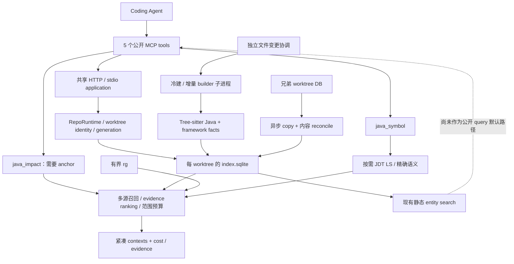
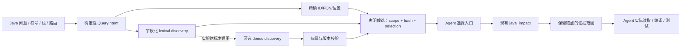
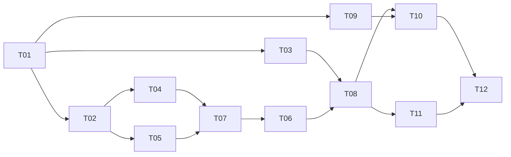

# codex-java-lsp-mcp：Java 专项检索与 Agent 提效的下一阶段指南

> 文档日期：2026-09-19（Asia/Singapore）  
> 适用源码：`d86dba38fccc9bf4b6d83703c9effacedbe9a972`，与本次上传 ZIP 的快照标识及 GitHub `main` 核对一致。  
> 定位：个人维护、Java 专项、本地优先、只读代码分析；允许破坏性调整，但不以重写为目标。  
> 交付性质：当前源码审计 + 历史实测复盘 + 外部研究核验 + 可执行的阶段路线。不是已经完成的代码改造，也不是最新业务仓库 benchmark 的独立复测报告。

## 阅读导航

- [一、结论与方向决策](#一结论与方向决策)
- [二、当前版本到底到了哪里](#二当前版本到底到了哪里)
- [三、源码级发现：先修什么，为什么](#三源码级发现先修什么为什么)
- [四、同类项目与论文：借鉴什么，不照搬什么](#四同类项目与论文借鉴什么不照搬什么)
- [五、语义搜索与 zvec-grep 的明确取舍](#五语义搜索与-zvec-grep-的明确取舍)
- [六、目标设计：保持底座，打通检索闭环](#六目标设计保持底座打通检索闭环)
- [七、开发路线与任务卡](#七开发路线与任务卡)
- [八、验证方法、验收门禁与停止条件](#八验证方法验收门禁与停止条件)
- [九、个人项目的长期维护方式](#九个人项目的长期维护方式)
- [附录 A：本次验证范围与复现结果](#附录-a本次验证范围与复现结果)
- [附录 B：文件定位与证据索引](#附录-b文件定位与证据索引)
- [附录 C：引用与外部资料](#附录-c引用与外部资料)

---

# 一、结论与方向决策

## 1.1 最终建议

**继续做 Java 专项代码智能，不转型为通用语义搜索产品；但应补上一个足够好用的“任务描述 → 代码入口”能力。向量检索可以参加这个入口的竞争，不应替代 JavaIndex、JDT LS 或成为新的主数据源。**

下一阶段最值得做的不是换语言、换向量库、再造大图，而是打通：

```text
不知道从哪里开始
    → 找到可靠的类 / 方法 / 接口 / SQL 入口
    → 沿真实 Java 关系确定相关代码
    → 返回包含关键证据、可直接定位的阅读范围
    → Agent 读取、验证并完成任务
```

现有项目已经投入很多成本解决索引持久化、worktree、新鲜度、JDT 生命周期和资源回收。现在应让这些投入转化为实际任务收益，而不是再开一轮底座工程。

**推荐顺序：**

1. 修复本次已复现的实体身份碰撞、自然语言检索提前终止、长方法锚点丢失。
2. 把已有的静态实体检索接到公开工具，补足搜索表示和有界执行，先获得一个不用启动 JDT 的发现入口。
3. 提升“候选已经存在，但 Agent 没读到关键行”的交付能力；保持现有紧凑输出和多范围阅读，不重新发明 Context Engine。
4. 用预注册的对照实验测试 zvec-grep 或单个 embedding 后端的增量价值。收益成立才接入；没有收益就保留外部组合用法。
5. 仅对反复出现的 Java 绑定缺口，继续加强 JDT / framework evidence。没有缺口证据，不再扩图。

这里的“继续专精”和“支持语义搜索”不是二选一。**产品边界保持 Java，检索入口允许混合；精确性由源码和绑定证据负责，相似性只负责提供线索。**

## 1.2 三个需要分开的“语义”

| 名称 | 回答的问题 | 适合的能力 | 不应承担的保证 |
|---|---|---|---|
| 程序语义 | 这个引用指向哪个声明？这是哪个重载？ | JDT LS、编译器绑定、作用域与类型分析 | 未经运行环境验证，不保证 Spring 最终装配或运行时调用目标 |
| 意图语义 | “防止重复扣款”对应哪里的实现？ | 注释 / 标识符检索、多语言 embedding、任务线索 | 相似度不是调用关系、依赖关系或修改必要性的证明 |
| 任务上下文 | 为解决这个问题，应该先读哪几段？ | 证据排序、范围选择、Agent 的后续探索 | 工具生成的计划不等于 Agent 已读取，更不等于任务成功 |

当前最缺的主要是第二种的公开入口，以及第三种的实际交付质量；不是第一种完全没有，也不是静态索引仍停留在 regex。当前代码已经有 Tree-sitter、SQLite、Java 关系和有界 JDT。[S02][S05][S08]

## 1.3 重新解释“小而精悍”

“小”不是不许用数据库、不许有进程，也不是只计算某个子目录的 LOC。更有意义的定义是：

> 一个主要索引事实来源，一条可解释的检索链，少量能独立证明价值的功能，没有长期并行维护的失败方案。

因此，当前已经解决实际内存问题的 SQLite 应保留；已有 HTTP daemon 不因“个人项目”标签被拆掉。反过来，新增一个 embedding 系统即使只需要几十行调用，也可能带来模型下载、索引更新、权限、缓存和故障排查的第二套运维成本。应按总成本判断，而不是按包装代码行数判断。

## 1.4 本文的决策清单

| 议题 | 决策 |
|---|---|
| Java-only | 保持；相关 XML/YAML/properties 是 Java 运行与配置证据，不是多语言扩张 |
| SQLite on-disk | 保持，除非新的测量证明它是瓶颈；不回到常驻全仓对象图 |
| Tree-sitter / JDT 分工 | 保持“便宜的结构事实 + 按需的精确绑定” |
| 新发现入口 | 现在做，复用已有实体检索，不等待向量实验 |
| zvec-grep | 先作为独立实验后端 / 外部工具；不直接融入 daemon 依赖树 |
| embedding | 从“永久禁止”改为“有条件准入”；默认关闭，不自动下载或上传代码 |
| 自建 Java 编译器 / 完整类型推断器 | 不做；复杂绑定优先交给已有 JDT，必要时研究编译产物索引 |
| 通用图查询、UI、跨语言、Agent 框架 | 不做 |
| `java_context` 失败方案 | 不重新注册；已有可用纯函数允许经过独立验证后复用 |
| 下一阶段成功标准 | 固定质量下更低的任务总成本，或固定预算下更多任务成功，而非单次响应更短 |

---

# 二、当前版本到底到了哪里

## 2.1 本次核查基线

上传文件：`eeecdc94-c844-4e7b-aa56-eb067ca3e80f.zip`。

- ZIP SHA-256：`0e0dae4432a4467c110cde04532654fd449e7b32f6ef55302316609701f3d427`。
- ZIP comment：`d86dba38fccc9bf4b6d83703c9effacedbe9a972`。
- GitHub `main`：同一 SHA；最后提交时间为 2026-09-12。
- 本次审阅包括关键在线调用链、SQLite 实体与图查询、范围构造、测试 harness、`docs/deep` 主要演进文件及其关联的 phase 原始结果。
- 本次没有安装到你的生产 daemon，没有访问私有业务仓库，也没有调用付费模型。

证据标记约定：**[代码]** 为当前快照的静态事实；**[复现]** 为本次实际执行的隔离探针；**[仓库实测]** 为仓库保存的历史结果；**[研究]** 为外部原始资料；**[建议]** 为本文提出的设计和门禁。

这五类证据不能相互替代。

## 2.2 从 V3.1 到当前版本的实质变化

| 时期 / 证据 | 已发生的事情 | 对本轮路线的影响 |
|---|---|---|
| 7 月 V3 / V3.1 | 规划 JavaIndex、生命周期、新鲜度、worktree、安全边界 | 有效的正确性原则可保留；内存快照等技术决策不再具有永久约束力 |
| 8 月多轮 value-realization / V4 / V5 / JIN | 持续尝试压缩输出、交互检索、context planner；有明确失败及停止结论 | 不应再把“设计更完整”当成“Agent 必然更有效” |
| 8 月 23 日 L1 | 新 `java_context` 链在两种模型上未达到门禁，被停用 | 避免重新包装同一失败方向；对新发现入口单独提出假设 |
| 8 月 24 日 RuoYi attribution | 缺口分布在 absent、候选/阅读预算、范围三个环节 | 不能只做新增召回；必须有范围级与阅读级验收 |
| 9 月 on-disk 改造 | SQLite 每 worktree 一库；builder 子进程；移除 heap-era hibernate/recycle 路径 | 主线应保持该底座，不再重做 Worker 全图方案 |
| 9 月 9 日 WAL 修复 | 处理只读连接长期持有快照导致 WAL 无法收敛的问题 | 数据库运行稳定性是既有成果，应被回归保护 |
| 9 月 11 日 P3-G5 | 仓库记录一次 49.7 小时连续进程的采样观察 | 是有价值的运行证据，但不是最新 HEAD 全任务质量证明 |
| 9 月 12 日最新提交 | 异步 sibling copy、等待 reconcile、元数据 root 修正、idle retire、telemetry 错误分类 | 本轮源码分析以这些已落地修复为准 |

来源：[S01][S09][S10][S11][S12][S13]。

## 2.3 当前真实架构



公开工具现在是 `java_status`、`java_impact`、`java_symbol`、`java_diagnostics`、`java_runtime`，不是旧文档里的七个。`java_context` 的代码仍在树中，但没有注册到公开工具面。[S02]

以下能力已存在，不应再被写成下一轮的“从零建设”任务：

- Java AST 索引及本地关系；
- worktree 隔离、generation、新鲜度协调；
- 持久 SQL 查询和 sibling 复用；
- evidence-family / 阅读预算相关实现；
- 紧凑默认输出、多范围阅读与 byte 预算；
- SemanticGateway、deadline、singleflight、JDT 生命周期及文档回收等基础设施。

可以改进它们，但要以当前真实缺口为切入点。[S02–S08]

## 2.4 稳定性成果是真实进步，但不能与检索效果混在一起

**[仓库实测]** `p3-closeout.json` 保存了以下结果：

- 某次隔离验证在 `6a2cbdd` 上为 1,129 个 unit 测试通过、288 个脚本测试通过；它不是本次对 `d86dba3` 的重新执行结果。
- 生产观察记录的连续进程运行 49.7 小时，有 8 次约 6 小时间隔的采样；记录中 IOD-era fatal、watchdog restart 等为零，pin WAL 在采样时为零。
- 报告记录 idle RSS 曾为 26–76 MiB；四仓查询也曾出现约 364 MiB 的瞬时 page-cache 峰值后回落。JDT 的堆资源另算。
- 采样不是每次都执行 `java_impact`，不能宣称在持续实际检索负载下已证明所有请求零错误。
- SQLite 改造的主要门禁是质量内容相同与运行成本治理，并非直接提高 retrieval recall。[S09]

**结论：保留存储成果，停止为“必须继续架构升级”而升级；把质量提升作为独立阶段。**

## 2.5 最新保存的三仓质量矩阵：不能再引用旧的“全部 must=1”

下表来自 2026-09-07 的 `p3-t4-matrix-summary.json`，新实验臂是 `d0ea177`，不是本次 `d86dba3` 的重新测量。每仓有 10 个场景，重复执行用于稳定性与耗时估计；重复运行不能算成新增独立任务。

| 项目 | 候选 Recall | P_read | R_read_must | R_task_blocking | 估算 token P50 | P95 延迟 | RangeLineRecall |
|---|---:|---:|---:|---:|---:|---:|---:|
| lishuedu | 0.7986 | 0.7217 | 0.9250 | 0.5721 | 3,393 | 300.41 ms | 0.8419 |
| cipherlink | 0.8390 | 0.6633 | 0.9100 | 0.4520 | 3,186 | 278.74 ms | 0.8750 |
| exam-parent-v3 | 0.6970 | 0.6000 | 0.8800 | 0.4819 | 2,830 | 336.93 ms | 0.8525 |

再看 holdout，而不是只看 tuning：

| 项目 | tuning R_read_must | holdout R_read_must | holdout RangeLineRecall |
|---|---:|---:|---:|
| lishuedu | 1.0000 | 0.6250 | 0.5429 |
| cipherlink | 1.0000 | 0.5500 | 0.3750 |
| exam-parent-v3 | 1.0000 | 0.4000 | 0.2625 |

这些 holdout 只有少量场景，不能据此精确估计未来总体性能；但足以说明“熟悉场景全部通过”不等于跨模块真实任务已经解决。

同一 on-disk 对照中的 RuoYi 28 个 observation/tuning 场景为：候选 recall 约 0.7482、P_read 约 0.2976、R_read_must 约 0.5384、RangeLineRecall 约 0.3526。新旧臂质量 bit-identical，说明数据库替换保住了原结果，并没有修好原有的相关性和阅读范围问题。[S10]

还必须准确解释门禁：`p3-t4-verdict.json` 的 `contentDelta0=true` 与 `matrixExit=1` 同时成立。原因是多个绝对质量门槛在两臂都失败；exam 的 P95 对照也略超当时阈值。**“存储迁移通过”不能写成“完整质量矩阵全部通过”。**

表中的 estimated token 是工具/计划侧估算，不是模型提供商账单 token。

## 2.6 真正阻塞的是三段链路，不只是召回

**[仓库实测]** RuoYi 的 B0 归因包含 76 个缺失证据文件实例，不是 76 个任务：

| 缺口 | 数量 | 占比 | 更直接的改善方法 |
|---|---:|---:|---|
| 根本未进入候选（absent） | 31 | 40.79% | 改善入口、召回表示、必要的结构关系 |
| 进入了召回链，但被 candidate/readPlan 预算排除 | 30 | 39.47% | 预算内的证据选择、按任务去冗余 |
| 文件已命中，但关键范围没读到 | 15 | 19.74% | 精确范围与 anchor 保真 |

后两项合计约 59.21%。向量可以尝试改善第一项的一部分，不能自动修复其余问题。[S11]

原门禁用“absent 超过 40%”触发某阶段，只能算工程分流规则，不是统计学结论。40.79% 与阈值很接近，不值得以此为理由把另外近六成缺口全部推迟。更好的顺序是按“可复现缺陷 → 修复成本 → 真实任务收益”选择工作。

## 2.7 L1 失败说明什么，不说明什么

**[仓库实测]** L1 新旧链比较中，新 `java_context` 的 token 比旧路径高约 1.74 倍和 2.69 倍；两种模型中各自都是新臂 0/6、旧臂 1/6 的路径覆盖式成功；12 个配对观察里 11 个方向更差、1 个持平。这些观察来自相同的 6 个任务在两种模型上执行，不是 12 个不同任务。[S12]

它说明：这版 planner / packing / 工具交互组合不值得直接上线。

它**不说明**：

- Java 图分析没有价值；
- 任意任务描述检索入口都会失败；
- 向量召回一定无效；
- 增加一点正文一定不省 token；
- 当前公开链已经足够好，不必再改。

尤其需要重新命名指标：`run-agent-trace-live.mjs` 明确把成功定义为路径覆盖；`collectImpactPaths()` 会收集候选、context，甚至某些 unresolved 路径。**路径出现在工具响应里，不等于 Agent 实际读取了对应代码，更不等于修改通过测试。** 原脚本注释对此是诚实的，但总报告里的 `TaskSuccess=MEASURED` 容易让后续读者误解。[S13]

这不是否定旧实验，而是要求下一轮把“路径覆盖”“阅读证据”“任务正确性”分开测。

---

# 三、源码级发现：先修什么，为什么

## 3.1 发现总表

| 编号 | 发现 | 证据等级 | 本轮优先级 |
|---|---|---|---|
| C1 | 相同 FQN 的跨模块声明使用相同 type ID，SQL upsert 覆盖归属 | 复现 + 代码 | P0，先修正确性 |
| C2 | 自然语言含类名时，检索 cascade 提前结束，相关方法不再参加 | 复现 + 代码 | P0，先修发现路径 |
| C3 | 超长方法只保留头尾，可能遗漏请求指定的中间行 | 复现 + 代码 | P0，先修证据交付 |
| C4 | 已有静态实体搜索没有成为公开 query 入口 | 代码 | P1，打通已有能力 |
| C5 | chunk 搜索表示主要是名称集合，没有充分利用注释、路由、关键字面量 | 代码 | P1，改善低成本召回 |
| C6 | SQL 查询存在全量统计 / 大候选 JS 排序；`async` 不消除同步数据库阻塞 | 代码 + EXPLAIN；生产影响待测 | P1，公开前建立执行边界 |
| C7 | graph 查询预装载全量 kg 节点边，可能重新放大常驻内存 | 代码；生产触发频率待测 | P1，禁止直接复活旧全图入口 |
| C8 | `CALLS_EXACT` 等标签需区分静态绑定、启发式关系、运行时目标 | 代码 + Java 规范 | P1，改善结果可信度 |
| C9 | 评测中“路径覆盖/计划 token”被上层当成任务收益 | 代码 + 仓库报告 | P0，与修复同步调整 |

P0 不代表断言所有真实仓库每天都会触发，而是这些机制一旦触发，会破坏其余检索评估的前提。

## 3.2 C1：FQN 不是仓库全局唯一声明身份

位置：`src/java-index/stable-id.ts:17–25`；`src/java-index/sql/rows.ts:218–282`。

当前具名类型大致采用：

```ts
if (input.fqn) return `type:${input.fqn}`;
```

而 SQL 的 type 行以该 symbol 为键，在冲突时更新 `file_id` 等字段。[S04]

**[复现]** 本次使用当前源码的 `javaTypeId()` 和 `writeBundle()` 写入：

```text
module-a/src/main/java/demo/Shared.java → demo.Shared
module-b/src/main/java/demo/Shared.java → demo.Shared
```

结果：两条 file 行，但只有一条 type 行，归属第二个文件。这个探针不需要 JDT，也不依赖模型输出。

多模块、独立 source set、不同编译单元出现同名 FQN 是需要表达的状态；不能靠“通常不会这样写”来消除。当前 probe 证明的是数据模型会合并声明，真实三仓出现频率尚未统计。

**建议修法：**

- 声明 ID 包含规范化 repo-relative path 与具名类型身份；FQN 成为可一对多的查询字段。
- 同一文件的命名类型不把行号作为主要 ID，避免插入空行导致全部 ID 改变。
- 嵌套类型使用准确的 enclosing/binary identity；匿名/局部类型允许文件内定位变化触发该文件重新索引。
- 方法与字段 ID 继续基于 owner declaration ID 与签名，但同步改为新的 owner。
- 同名候选先按 source root / module / 编译上下文约束；没有足够证据时返回歧义，不选最后写入的那个。
- identity version / schema 换代后删除可重建缓存；不做旧 ID 兼容层。
- 同步检查 `sym`、`entity`、基本关系、`kg_*`、persisted semantic cache，不只修改一个函数。

**必须新增测试：**写入顺序调换、删除其中一个文件、两个 worktree 相同路径、main/test 同名、nested type、重载、重命名失效；任一种路径都不得把另一个模块的声明静默覆盖。

## 3.3 C2：四层搜索是“首个非空返回”，不是融合搜索

位置：`src/java-index/sql/entity-search.ts:84–198`。

当前顺序是 FQN → simple-name → identifier BM25 → chunk BM25，并在每层非空时立即返回。simple-name 命中主要针对类型。[S05]

**[复现]** 一个最小 fixture 中：

| 查询 | 返回 |
|---|---|
| `OrderService rollback refund` | 只有 `OrderService` 类型 |
| `rollback refund` | 命中与 rollback/refund 文本相关的方法 |
| `OrderService#reverseDuplicateCharge` | 正常走精确 FQN 方法查找 |

精确 FQN 的快速返回是合理的；自然语言已经包含额外意图时，不能因为出现一个类名就放弃剩余内容。

**建议：**

- `exact` 模式保留确定性短路。
- `text` 模式把类名当作强线索/候选范围，而不是最终答案。
- `auto` 只有整个输入符合已支持的精确符号形式时才使用 exact；“包含 FQN 的一句话”仍属于 text。
- 类型、方法、framework key 分别产生有限候选，按确定性的融合排序返回。
- 一个类命中时，可补该类内与剩余词相关的若干方法，但不能展开整个类。
- 测试不只问“有没有 OrderService”，而要问“能否把 reverseDuplicateCharge 作为可执行锚点返回”。

这一步不需要 embedding。

## 3.4 C3：压缩长方法时，不能把查询锚点压掉

位置：`src/java-index/sql/sql-read-ranges.ts:21–25,68–117`。

当前方法超过 300 行时，主要返回前 40 行和后 40 行，`emitMethod()` 接收到的是方法，不是请求命中的具体位置。[S07]

**[复现]** 一个 422 行 synthetic Java 文件，方法范围 2–421，查询第 201 行。实际 `queryReadRanges()` 返回 1–41 与 382–421，`extremeMethod=true`，第 201 行不在任何范围中。

该实验使用真实导出函数和文件读取，只把 FactsReader 替换为构造好的事实对象；没有运行整条生产 router。因此它证明了范围提供器的丢锚点机制，最终用户遭遇比例需要后续端到端验证。

**修复原则：**

```text
先保护查询命中 / 明确请求的证据行
再保留必要签名、控制条件、上下文
最后才考虑头尾摘要与辅助 callee
```

最小改法是对每个 selected method 累积所有 matched positions；长方法窗口必须围绕这些位置构造，再在预算内增加声明和邻接上下文。优先级冲突必须显式报告 `truncated`，不能悄悄把目标行删掉。

还要覆盖 declaration-order invariance：当前 `sameOwnerCallees()` 只考虑定义在调用者后面且较近的同 owner 方法。把 helper 移到调用者前面不改变程序含义，却可能改变阅读结果。可以保留距离作为成本信号，不能让它代替关系真实性。

**这比继续压缩 JSON 字段名更接近“省 token 且有用”。** 一次漏掉关键行导致 Agent 重查，通常会抵消前一次省下的响应内容；本项目尚需用实际轨迹量化这个成本，不能预先写成百分比。

## 3.5 C4：公开产品缺少“不知道锚点”的第一步

位置：`src/mcp-server-factory.ts:86–98`、`src/tools/symbol.ts`、`src/tools/impact.ts`。

当前 `java_symbol` 注册说明就是 `Always live JDT`，query 调用 workspace symbols；`java_impact` 需要已有锚点。静态 SQL 的 `queryEntitySearch()` 已实现，但主要出现在未注册的 `java_context` 及实验路径里。[S02][S03][S05]

用户的任务却经常是：“某个录题结算规则在哪里算？”“哪个环节防止重复处理？”“这个接口对应哪个 mapper？”这时 Agent 必须先借助其他工具自行定位，再来使用项目的强项。

**机会不是新建一整套 semantic repository，而是把已有索引变成可直接使用的前门。**

建议在现有 `java_symbol` 的 `operation=query` 中提供静态搜索，position/references 仍保留 JDT。工具注册的 `requireLspEnabled` / `mayStartLsp` 必须按 operation/backend 分支处理，不能只是 handler 里改了实现，外层仍强制启动 JDT。

## 3.6 C5：已有中文 tokenizer，不等于已经能搜中文意图

位置：`src/java-index/entity-scoring.ts:35–112`。

当前 `tokenize()` 已处理 NFKC、CamelCase、snake_case、Han 文本和相邻 bigram。不能把问题误诊成“完全不支持中文”。

但实际 chunk 表示主要包括参数名、调用名、局部类型名、返回类型，以及类型的字段名和方法名；不是完整方法源码，也没有把大量 JavaDoc、端点路径、异常业务文本、配置键纳入独立可搜索字段。[S06]

`订单重复扣款后退款` 对只含英文标识符的 fixture 没命中，并不证明中文 tokenizer 失效；它说明查询与表示之间缺少桥梁。

建议按收益/成本补字段：

| 字段 | 默认处理 | 作用 |
|---|---|---|
| FQN / 简名 / 方法名 / 参数类型 | 保留精确与分词形式 | 精确定位与缩写发现 |
| JavaDoc / 紧邻声明注释 | 结构化抽取，限制长度 | 中文业务概念与英文实现之间的桥梁 |
| `@RequestMapping` 等路由 | 抽取明确字面量及方法 | 从 API 路径定位处理入口 |
| MyBatis namespace / statement id | 使用已有资源事实 | Java ↔ XML 的确定性线索 |
| 配置键、事件类型、受控错误码 | 白名单来源，保留源范围 | 定位运行入口与跨文件约束 |
| 整段方法体 | 不作为默认大块全文；必要时按块/命中窗口 | 防止表示与更新成本失控 |
| token/password/密钥式字面量 | 排除，不放入外部 embedding | 避免泄露与无用噪声 |

不要为当前几个业务名手写一个不断增长的全局同义词表。允许调用 Agent 显式给少量 `terms`，也可以测试多语言 embedding，但两者都必须记录使用了什么额外信息。

## 3.7 C6：返回 top-8，不代表底层只处理 8 条

位置：`src/java-index/sql/entity-search.ts`、`sql-client.ts`。

观察到的机制包括：

- FQN 查询包含精确匹配与前置通配 suffix 匹配的 OR；本次 SQLite `EXPLAIN QUERY PLAN` 显示覆盖索引扫描，而非每次都为 point lookup。
- `avgLength()` 对 entity 执行 `count/sum`，为每次 BM25 查询重新计算语料统计。
- BM25 阶段收集匹配 postings、在 JS 聚合和排序，之后才截断。
- 部分 SQL client 方法名是 async，但调用同步 SQLite，且相关 `_requestOptions` 未消费为查询中断机制。[S05][S08]

**[研究]** Node 的 `DatabaseSync` API 是同步的；把外层函数声明为 async 不会使 SQL 自动移到其他线程。[E10]

目前不能仅凭这些机制就声称真实 P95 必定恶化到多少毫秒；需要大库、常见词、并发请求下的测量。但公开 NL 搜索前，必须设计工作量上限。

推荐顺序：

1. 精确匹配独立语句，suffix 查询单独限范围。
2. writer 维护 generation 对应的语料统计，query 不重新全表汇总。
3. 把 module/source-set/path 过滤推入 SQL。
4. 宽泛词查询增加 postings/候选扫描上限，超过时返回 `partial/candidate_budget` 而不是假装穷尽。
5. 实测比较现有 postings 和 SQLite FTS5，选择维护成本更低且满足门禁的一种，不长期维持两个同功能默认后端。
6. 慢的文本检索确实阻塞 HTTP event loop 时，放入一个有界、共享的只读 query worker。不要恢复“每仓一套全量对象图”的旧方案。

FTS5 的 `ORDER BY rank` 与 LIMIT 可以提供合适的检索执行路径，但它不是自动的硬 deadline，也不解决错误语料或身份碰撞。[E11]

## 3.8 C7：不要通过新工具重新激活全量图驻留

`sql-client.ts:236–242` 的 `queryContextGraph()` 会触发 `graph.prefetch()`；`knowledge-graph.ts:351–375` 会读取 kg 节点和边，构造内存邻接结构。[S08]

这不是说整个 on-disk 改造无效，也不是已证明默认每次 impact 都装载全图。它说明：如果直接把旧 context graph 入口注册回来，可能把已经移出 heap 的成本重新引入。

因此，新 discovery 路径应只查询 entity 索引和必要的局部关系。对图关系需要多少，就查询多少；把首次可用的 entry discovery 和全图准备解耦。

清理时先做调用可达性和构建成本盘点。`java_context` 未注册，不代表 `entity_*` 或全部 `kg_*` 都可以直接删；其中有可复用资产，也有需要实测确认的成本。

## 3.9 C8：精确静态关系不能包装成运行时事实

`java-knowledge/call-resolver.ts` 把部分具体类型调用转成 `CALLS_EXACT`。这类标签需要明确指“识别出的静态目标”，而不是“运行时只能调用它”。普通非 final 实例方法仍可能动态分派到覆盖实现；Spring 装配又受 qualifier/profile/configuration 等影响。[S14][E12]

本文不建议因此自建完整 points-to 或全程序动态分析，而建议定义四种证据状态：

```text
SOURCE_FACT       源码显式声明 / 引用的语法事实
STATIC_CANDIDATE  类型/名称/局部规则推导的候选关系
JDT_BOUND         在给定 JDT/classpath 状态下确认的绑定
RUNTIME_OBSERVED  来自明确运行轨迹的观察；当前可没有
```

向量命中另记为 `DISCOVERY_HINT`，不能晋升成 `JDT_BOUND`。一个候选可以同时有多种证据，但要保留各自来源、范围、generation 和限制。

---
# 四、同类项目与论文：借鉴什么，不照搬什么

## 4.1 本轮调研方式

本轮按用户要求使用 Exa 检索，并对重点资料读取原始文档；用户仓库和 zvec-grep 的关键文件通过 GitHub 连接器核对。文献重点看任务定义、基线、消融和代价，而不是只摘最漂亮的数字。

同类项目中，zvec-grep 固定核查到 `e76c89f1e0d0577713fa74b67acc882343fe982d`（2026-09-17）。其他项目的比较用于借鉴机制，不构成相同 Java 场景下的性能排名。本轮没有安装运行所有竞品，也没有核验其全部实现。

## 4.2 项目对照

| 项目 | 主要机制 / 产品边界 | 值得吸收 | 不建议照搬 |
|---|---|---|---|
| **zvec-grep** | 本地 exact、BM25、vector，RRF 融合；统一 CLI/MCP；代码与文档结构抽取 | 未知入口检索、排名融合、索引 schema/模型固定、明确 freshness | 第二套长期常驻 daemon、重复 grammar/index 管线、自动把 embedding 作为任何查询的默认 |
| **codebase-memory-mcp** | 多语言 AST、持久图、符号与结构查询、近似类型解析 | 结构索引的查询效率、范围化图查找、coverage 与负缓存边界 | 跟随语言数量、UI、通用 Cypher、跨服务大平台；也不能把其自报 token 比值移植到本项目 |
| **Graphify** | 本地代码图，代码关系带提取/推断标签，文档等可以加入同一图 | provenance、可解释关系、按内容/提取版本更新 | 通用内容图、社区检测、可视化与多媒体索引成为主线 |
| **Serena** | symbol-level 的 LSP/IDE 检索与操作，逐步展开代码 | 人可读的符号定位、概览到精确源码的渐进读取 | 复制其编辑、重命名、多语言 backend；“semantic”不应被误读为全部使用向量 |
| **Aider repo-map** | 在 token 预算内选择符号与签名，利用结构相关性 | 小型局部概览、签名优先、按需要展开 | 每轮强制注入大地图；MCP 服务无法替宿主控制全部历史上下文 |
| **scip-java** | 编译器插件产生逐文件 SCIP shard，编译后合并 | 需要严格 classpath 绑定时的离线证据来源 | 把 build 集成变成所有冷搜索的前置要求；为此重写当前 TypeScript 控制层 |
| **Brokk** | 片段级上下文、代码智能和更广的开发平台 | 方法/类片段优于全文件，依赖 API 的精确信息 | 把个人只读 MCP 做成另一个 IDE/Agent 平台 |
| **claude-context** | 以向量与检索服务构建代码上下文入口 | chunk/索引更新与用户意图检索的分工 | 引入远端向量服务、默认外发源码与多套部署组件 |

来源：[E01–E08]。这些项目并非“都不需要语义搜索”，也不是“都证明向量才是答案”。它们面向的问题和承担的维护范围不同。

对你而言，最有价值的组合是：**从搜索项目吸收入口体验，从 IDE/LSP 项目吸收绑定与符号精度，从 context 工具吸收渐进阅读。不要从任何一个项目复制它的全部产品边界。**

## 4.3 论文结论及适用边界

### LocAgent：搜索入口与关系导航要一起工作

LocAgent 把实体发现、图遍历和实体读取组合起来，包含分层名称/稀疏索引及渐进输出。其研究主体是 Python，结果也包含模型微调等因素。它支持“入口 + 结构导航”的设计思路，但其 file Acc@5 不能与本项目的 `R_read_must` 或 RangeLineRecall 直接比较，更不能当作 Java 改造的预期提升比例。[P01]

### RepoGraph：相关关系不等于文本相似

RepoGraph 把仓库关系加入已有的软件工程方法，使用有界邻域辅助理解。它提醒我们：单个高相似片段不一定包含真正的跨文件依赖。但这不要求每次输出完整图；对本项目，更合适的是按查询读取少量相关关系。[P02]

### SpIDER：图与 dense retrieval 可以互补，包含 Java 实验

SpIDER 针对 issue localization 融合 dense retrieval、代码的空间/结构信息，并包含 Java 数据；其流程还使用 LLM 推理/过滤。它反驳“业界已经抛弃 embedding”的绝对判断，但没有证明一个低成本 Java MCP 加上任意向量库即可获得同样收益。其包含关系图也不等同于本项目的精确调用图。[P03]

### SWE-Explore：从文件命中走向范围与预算

SWE-Explore 让探索器输出固定预算内的 ranked source regions，用成功修复轨迹构造相关上下文。对本项目最有用的是区分文件到达、关键行覆盖、顺序和噪声；轨迹衍生 ground truth 本身也有不完整和方法偏好，不能简单把“曾经读过”当成“必须读”。[P04]

### LSP token 研究：精度收益和 token 收益不是一回事

《Does a Language Server Save Tokens for Coding Agents?》的原始摘要可检索，讨论的是 Python/TypeScript 上的初步实验，结论依赖任务和模型。值得采用的是相同成功要求下比较 tokens-to-success，以及保留 grep 自由选择；不应将其 +6%～+118% 等实验数字直接外推为 Java/JDT 的通用成本。检索返回的日期元数据与编号存在不一致，本文不以其日期推导演进顺序，也不把摘要当作已经复跑的结论。[P05]

### 上下文压缩研究：压短不等于压低总成本

《Beyond Human-Readable》里常被引用的压缩后总成本增加结果主要来自日志格式实验，并不是对 Java 方法 skeleton 的直接证明。它可以提醒我们测最终任务，不足以给出本项目压缩方式的确定收益/损失比例。[P06]

**综合研究推论：**较稳定的方向不是“图战胜向量”或“向量战胜 grep”，而是区分发现、关系验证、证据读取三个环节，再用下游任务决定组合。这个推论同时符合本项目的真实失败和可复现缺口。

## 4.4 对历史方案的修正

| 旧表述 / 倾向 | 当前应采用的表述 |
|---|---|
| 个人项目永久禁止 SQLite | 存储由实测决定；当前 on-disk 改造已经解决实际问题，应保留 |
| 内存与热路径已到物理天花板 | 只能说某个快照/工作负载下继续优化收益不足，不能宣布绝对上限 |
| 业界已放弃纯 embedding，因此本项目不能用 embedding | 纯相似性不足以表达依赖；embedding 对未知入口仍可能有价值，需实验 |
| 论文 file accuracy 很高，所以我们的 readPlan 应达到同样数字 | 不同任务、语言、分母和模型不能直接对标 |
| 已经全部 must=1，后续只需省 token | 新保存矩阵的 holdout 和 RuoYi 仍有显著缺口 |
| `TaskSuccess=MEASURED` 就代表业务修复成功 | 当前部分脚本测的是路径覆盖；需保留真实含义 |
| 新设计统一封装所有能力，比散工具更好 | L1 已经否定一版大封装；让 Agent 能正确调用，比封装完整更重要 |

技术原则可以长期稳定，具体技术禁用项不能永久化。过去的文档也包括本助手给出的方案，均应按新证据修正，而不是为了维护旧判断继续增加补丁。

---

# 五、语义搜索与 zvec-grep 的明确取舍

## 5.1 哪些请求确实可能需要向量

| 请求形态 | 第一选择 | embedding 的位置 |
|---|---|---|
| 已知 `OrderService#createOrder` | 精确符号查找 | 不调用 |
| 已知异常栈与行号 | 位置定位 + 邻接上下文 | 通常不调用 |
| 已知 `/api/order/confirm` | 路由/注解/文本索引 | 词法仍找不到且用户意图很模糊时备用 |
| “什么地方阻止同一请求重复结算？” | 字段化文本/关键字检索 + 少量结构扩展 | 可以补充词汇不一致的实现 |
| “某 DTO 字段改名影响谁？” | 精确引用、序列化/MyBatis/映射证据 | 不应作为完整性来源 |
| “介绍所有业务子系统” | 局部概览或显式范围概览 | 可能辅助，但不是本项目优先任务 |

因此，向量更适合 **discovery recall**，不适合替代引用完整性、跨模块身份、配置实际生效、编译器重载等事实判断。

## 5.2 zvec-grep 实际提供的是什么

**[代码/官方文档]** 本轮固定 HEAD 的 package 版本为 0.2.1；不能因为外部 CDN 出现别的版本就把它与该源码混用。它公开 `createZvecGrep`、`ZvecGrepSearchOptions`、context types 和 embedding model API，具备库接口，不只是一层 shell 命令。[E01]

其核心是：

```text
workspace 扫描
 → code/text extraction
 → 本地词法与向量索引
 → BM25 / vector / RRF 或独立 rg
 → 带路径和来源的紧凑候选
```

Java 的结构抽取保留符号、签名和 breadcrumbs；XML 等作为文本抽取。它并不替代本项目的 Java 编译上下文、JDT binding 和 MyBatis 关系验证。[E01]

默认 `local/potion-code-16m-v2` 在该版本文档中是 Model2Vec 静态模型，1,024 token 输入上限、256 维向量。静态 lookup 不因 GPU 加速而自动受益。其多语言或代码 Transformer/GGUF 后端属于不同质量/资源档位，不能只测默认模型就得出“所有 embedding 对中文 Java 没用”。[E01]

它还拥有自己的一套 workspace manifest、refresh、模型缓存、daemon 和 MCP 依赖。直接 import 整包进入当前常驻进程，意味着引入重复的 grammar/模型/服务依赖；是否发生具体兼容问题本轮未测试，但维护范围增加是可以从依赖树确认的。

## 5.3 为什么不建议“直接融合”

直接融合存在四类成本：

1. **重复事实源。** 同一 Java 文件被两套 extractor/indexer 处理，行号、chunk ID、忽略规则和 stale 状态可能不同。
2. **重复生命周期。** 当前已解决 daemon/数据库/lease；另一套模型常驻和 refresh 又需要控制。
3. **模型引入的变量。** 中文查询、Java 标识符、源码注释、模型最大输入和量化都会影响结果，不能用向量库性能代替模型评测。
4. **结果误解释。** 高分相似片段容易被当成“必改文件”，而实际上可能只是另一个相似业务。

这不是否定 zvec-grep，而是区分“一个好用的独立工具”和“适合成为当前项目核心依赖”。

## 5.4 推荐三层集成顺序

### 第 0 层：并列使用，验证是否真有新增发现

保持本项目不变，在固定 checkout 的实验环境中给同一 Agent 开放 zvec-grep；不让新工具成为强制入口。记录它是否发现了现有词法/结构链没发现的正确方法。

优点是几乎不改变主项目。缺点是不能隔离 zvec 的 chunking、embedding、ranking、提示指导各自贡献。因此这只能作为产品级可行性试验，不是 embedding 单因素结论。

### 第 1 层：独立实验进程，归一化候选

在 `experiments/semantic-discovery/` 建立独立 package，固定 zvec-grep commit/package、模型 revision 与配置；使用其实际导出的库类型完成适配。不要 import 到生产 `mcp-server-factory` 或主 application。

适配器只输出：

```ts
export interface ExternalDiscoveryHit {
  provider: "zvec-grep";
  relativePath: string;
  startLine: number;
  endLine: number;
  rank: number;
  indexedContentHash?: string;
  sourceIndexIdentity: string;
}
```

这是**本项目拟新增的适配结果**，不是宣称 zvec 已经有同名接口。adapter 编译必须使用固定版本的真实 exported types，不能依赖抓取 CLI 人类可读文本。

这些 hit 经本项目验证后才映射到声明 ID。无法验证内容版本时，只能作为“路径提示”，必须重新读取当前文件并重新定位，不能沿用旧行号当证据。

### 第 2 层：只在增益明确时接入一个可选 provider

满足第八章门禁后，才考虑让 `java_symbol query` 的 text 路径调用一个可选 provider。默认精确查找和 anchored impact 仍完全不依赖它。

此时再选择：保留 zvec-grep 实验适配器作为外部进程，或者只复用一个 embedding 推理能力与本项目自己的语料。不要同时落地三种向量后端；也不要提前建设自定义 Provider DSL。

如果最终 zvec-grep 作为并列工具已经很好用，而内部接入增加了维护负担，**不接入也是成功结论**。

## 5.5 运行命令必须与核查版本一致

该固定版本文档的 CLI 形式包括：

```bash
# These commands are for an isolated experiment checkout, not production.
zg --index --embedding local/potion-code-16m-v2
zg --fts "duplicate payment" --limit 8 --compact
zg --vector "where duplicate payment is prevented" --limit 8 --compact
zg --hybrid "where duplicate payment is prevented" --limit 8 --compact
```

要执行前先在固定版本上核对 `zg --help` 和 index 目录范围。不是本次已经执行的命令，也不自动授权外发源码。

不要照旧资料写 `zg query --json`：当前核查文档使用上述 flag 形式；managed-rg 路径明确拒绝自定义 `--json` 等改变输出格式的参数。生产适配需要结构化库接口或已验证的协议，不能把易变的终端输出当作稳定契约。[E01]

## 5.6 模型试验只保留两个档位

为了控制个人项目试验成本，第一轮最多两个模型：

- **低资源对照：**版本固定的默认 Potion code 模型，测索引开销和英文/标识符查询。
- **多语言对照：**从固定版本实际支持的模型中选择一个能覆盖中文的本地模型，例如 multilingual-e5-small；在任务语料上测它是否真的更好，而不是按模型名称推断质量。

Jina code、较大 Qwen embedding 等作为第二轮候选，只有第一轮揭示“确实是模型表达不足，而非 chunk/路径/排序错误”才考虑。不要因为你另有 4090，就让开发机 MCP 默认依赖那张 GPU；部署位置、跨机器传输和离线可用性是另一组成本。

远端 embedding 仅在明确授权、确认源码可以外发后实验；默认本地。不索引账号配置、密钥文件、生产日志全集和无关的个人文档。

## 5.7 向量索引不是新鲜度权威

不论 provider 返回 `fresh` 还是 `possibly_stale`，本项目必须自己验证：

```text
canonical repoRoot / repoHash
+ normalized relativePath
+ file contentHash
+ entity/chunk schema version
+ embedding model identity
+ requested scope
```

检索响应发生在变更期间时，不能只比 generation 数字；generation 是当前工作树观察状态的代次，不自动证明 provider 对所有文件有相同版本。应比 hit 文件内容指纹，必要时重新读取并定位。

旧路径、删除文件、兄弟 worktree 的不同内容不能被接受。负缓存只在明确已覆盖的范围和版本内有效；“向量没有搜到”永远不能当作“没有引用”。

## 5.8 什么时候应该停止向量工作

出现以下结果时，不继续扩展集成：

- 新增正确入口很少，主要返回已有词法命中的相似副本；
- Recall@K 看似提高，但关键行覆盖或实际任务成功不提升；
- tokenizer/摘要层节省被额外查询、模型加载和重读抵消；
- 对中文有效但让精确名称和已知锚点路径退化；
- 无法在模型不可用、离线、索引 stale 时安静地退回词法/结构路径；
- 维护第二个索引系统的成本超过你的实际使用收益。

停止后留下实验结果、固定配置和失败样例即可，不让实验后端继续成为每次构建的负担。

---

# 六、目标设计：保持底座，打通检索闭环

## 6.1 不改存储中心，只补两个窄模块



新增重点只有：**Discovery** 和 **EvidenceDelivery**。JavaIndex、framework facts、generation、JDT 都继续复用。

## 6.2 拟定公开调用契约

仍使用现有五工具。以下字段是**建议新增**，不是当前已经支持。

```json
{
  "tool": "java_symbol",
  "arguments": {
    "repoRoot": "/absolute/java/worktree",
    "operation": "query",
    "backend": "static",
    "searchMode": "text",
    "query": "重复扣款后在哪里执行回退",
    "terms": ["duplicate", "payment", "rollback"],
    "limit": 8
  }
}
```

规则：

- `operation=query` 默认 `backend=static`；`searchMode=auto` 默认。
- `operation=position/references` 保持 JDT；显式 `backend=jdt` 的 query 也走原 workspaceSymbols。
- static query 不触发 JDT admission 或自动启动；即使项目没有 LSP enablement 也可检索已允许读取的源码。
- query 最多 512 字符；terms 最多 6 个，每个最多 64 字符；limit 默认 8、最大 20。这些是本轮建议初值，非性能承诺。
- 不把模型、多个 provider、图深度、几十个权重都暴露给 Agent。
- 编译器精确绑定与自然语言发现的意图不同，不再用一个含糊的 `semantic=true` 参数混合。

建议内部结果：

```ts
export interface DeclarationLocator {
  id: string;
  relativePath: string;
  contentHash: string;
  module: string;
  sourceRoot: string;
  kind: "type" | "method";
  fqn: string;
  signature: string;
  selection: { line: number; column: number }; // 1-based UTF-16
}

export interface DiscoveryCandidate {
  declaration: DeclarationLocator;
  matchedBy: Array<"exact" | "identifier" | "comment" | "framework" | "dense">;
  evidenceRange?: {
    startLine: number;
    endLine: number; // inclusive line window
  };
  preview?: string;
  binding: "source-declaration" | "ambiguous";
}

export interface DiscoveryResult {
  repoHash: string;
  generation: number;
  candidates: DiscoveryCandidate[];
  scopeState: "READY" | "PARTIAL";
  truncated: boolean;
  stopReason?: "candidate_budget" | "deadline" | "index_partial";
}
```

这里 `READY` 仅描述声明的搜索范围已建索引，不表示世界上不存在其他相关文件。`binding=source-declaration` 也不表示从任意调用点到它的引用已由 JDT 绑定。

在线默认输出只返回行动需要的字段；详细 score/work statistics 留在诊断结果。候选 ID 要短，但不能只给不透明 ID、不提供名称与路径。

## 6.3 发现与影响分析的衔接

Agent 可以把 discovery 返回的 `relativePath + selection` 传入现有 `java_impact`。重点是它不再自己猜行号。

最小安全流程：

1. discovery 返回精确声明 selection 和文件 hash。
2. impact 开始前检查锚点文件版本；发生变化时重新按声明定位，或者明确返回 anchor stale。
3. impact 返回相关证据，而不是再次重复输出整个 discovery 列表。
4. Agent 读取具体 ranges，必要时用现有 `java_symbol references` 请求更强绑定。

不新增有状态 conversation memory、不新增自动多轮 planner，也不假设服务端知道 Agent 已经读过哪些文件。需要去重时由请求显式给当前已读范围，并先实验是否值得扩契约。

## 6.4 搜索文档与声明分开

一个 declaration 可以有几个小型 search document；search document 命中后，映射回同一个 declaration。它们不是同一数据模型。

建议记录：

```text
search_document:
  document_id
  declaration_id
  relative_path
  content_hash
  representation_version
  source_kind: signature | comment | framework-key | body-window
  start_line / end_line
  normalized_text
```

关键规则：

- index 中保存的 comment/framework-key 必须有来源范围，不创建 LLM “业务总结”当默认事实。
- 检索表示更新只影响该文件的文档；不要改变 named declaration ID。
- method chunk 不跨方法拼接；特别长的方法按受控块切分，命中后仍回到该方法。
- class 注释与方法注释可以独立命中，同一实体多文档命中需要去重，不能累计成无限加分。
- method body 初期只在明确需求与预算内加入，不把整仓所有文本复制三份。
- 参数/局部变量 token 是否使用真实词频，或保留二值 term 表示，应作为一个独立消融；先确保语料包含有用信息，再调 BM25 常数。

## 6.5 排名规则：精确匹配和线索融合分开

对于 exact 请求，按 exact/scoped matches 返回，不混入近似语义候选。

对于 text 请求，最多两个内部阶段：

```text
候选阶段：标识符/文本/框架线索；实验时加 dense
精排阶段：scope、任务词、证据位置、有限的结构邻接
```

初始融合使用可解释的 Reciprocal Rank Fusion，而不是直接相加来自不同系统的原始分数：

\[
S(d)=\sum_{j\in J}\frac{w_j}{k_0+\operatorname{rank}_j(d)}
\]

建议先固定 `k0=60`、相同通道权重作为实验起点；分母和参数是设计选项，不是“最佳参数”的实测结论。

去重键必须是 declaration ID，不是 simpleName。dense 命中只能贡献发现分，不能贡献 precise binding。局部结构扩展只给少量名额，防止一个中心类把所有 service 类带入。

不要继续对具体项目名、测试名加分。任何新规则都应给出跨文件的可解释证据，而不只是匹配当前 golden 的命名习惯。

## 6.6 EvidenceDelivery 的最小原则

保持现有范围与 byte-budget 基础，但增加四条不可破坏的不变量：

1. 用户明确请求的 anchor 行不被输出裁剪丢弃。
2. 用来证明候选关系的源码行，至少有一个对应 evidence range，不能只剩下文件头。
3. 文件物理重排不改变关系事实；辅助方法位置远近只能影响成本，不决定是否存在。
4. 预算不足时显式返回“缺了什么、为什么”，不把 partial 解释成已覆盖。

预算冲突的处理次序：保护 anchor → 保留证据行与必要语法上下文 → 去除重复范围 → 删除低置信额外候选 → 标记尚未满足的阅读需求。不得根据 benchmark `mustHit` 标签在运行时保留文件。

默认不返回整段方法全文。对小方法可以一次性返回合理片段；对大方法提供局部有意义窗口，由 Agent 自主决定是否读全。是否 inline preview 更省总 token，交给第八章的同任务试验。

## 6.7 继续加强 Java 深度，但只解决真实任务

优先的业务链路不是更多抽象图边，而是：

| Java 任务 | 重点补强的证据 | 限制 |
|---|---|---|
| 接口行为排查 | endpoint 参数/返回、service 调用、mapper statement、条件配置 | 源码框架配置不是部署环境的最终状态 |
| DTO/字段变更 | 读写点、映射/序列化名、MyBatis resultMap、相关测试断言 | 对反射、JSON 拼接等保留文本补充，不只相信 symbol references |
| 异常与校验失败 | stack frame、异常构造位置、检查条件、近邻分支、调用者 | 不把位置相邻当因果关系 |
| 事务/幂等问题 | transaction 注解、幂等键使用、状态转换、持久化语句 | 并发语义与真实数据库隔离不能仅靠静态图断言 |

这些能力中的一部分已经有 adapter/facts。先检查当前缺口所在的输出环节，再决定补 extractor、relation，还是仅补 range；不要一律加新的框架插件。

## 6.8 暂不引入 SCIP，但保留一个清晰触发条件

scip-java 的编译器插件能够使用实际编译环境生成符号资料，适合某些静态近似无法可靠绑定的问题。[E06]

只有当新 attribution 连续表明“正确入口和相关片段都找到了，但大量任务仍卡在重载/泛型/classpath 的错误绑定”，且按需 JDT 代价明显不能接受时，才研究把已有编译流程产生的 SCIP 当可选离线证据导入。

触发前不写插件、不增加 Java sidecar、不把所有任务改成必须 compile。即使导入成功，也不能解决 runtime DI 全貌或动态 SQL 实际参数等问题。

---
# 七、开发路线与任务卡

## 7.1 四个里程碑，而不是再造一个大版本平台

| 里程碑 | 交付 | 对应任务 | 不做什么 |
|---|---|---|---|
| M0：可信基线 | 身份正确、anchor 不丢、评测口径明确 | T01–T03 | 不上向量、不全局调权 |
| M1：可用的发现入口 | 静态 query、字段化表示、有界 SQL、可交给 impact 的锚点 | T04–T07 | 不复活 `java_context`，不强制启动 JDT |
| M2：任务闭环 | 关键证据实际到达 Agent，真实 QA/修复评估 | T08–T09 | 不以更小 payload 代替更好的结果 |
| M3：证据驱动的选择 | 向量 GO/KEEP_EXTERNAL/NO_GO；只补必要 Java 深度；清理失败资产 | T10–T12 | 不因计划里写过就必须全部实现 |

T09 的事件/指标定义在 T01 就冻结，harness 可以与 M1 并行，但不能让 M1/M2 的效果主张先于它的验证。

依赖图：



这是建议执行顺序，不是声称下面的新增文件已存在。全部改造都在真实 git checkout 的独立开发分支进行，保留原工作区未提交内容，不直接改运行中的安装目录。

## 7.2 T01：冻结当前基线与“成功”的含义

**目标：**阻止继续拿不同 SHA、不同任务、不同成功定义比较。

**检查/修改：**`scripts/run-agent-trace-live.mjs`、`src/telemetry/impact-telemetry.ts`、现有 matrix verifier。新增 `docs/next-stage/baseline.md`、`docs/next-stage/decision-log.md`；新增评测 schema 放在实验/benchmark 目录，不污染工具参数。

**执行：**

- [ ] 记录当前 HEAD、tree、dirty diff hash、Node、SQLite、JDT runtime/project JDK、模型/宿主版本、硬件、任务与语料 hash。
- [ ] 区分 `current-source`、`installed-runtime`、`measured-runtime`，报告不再只写一个 HEAD。
- [ ] 旧 `taskSuccessFromCoverage` 保留历史数据可读性，但输出名称明确改为 `pathCoverageSuccess`，禁止对外作为实际任务成功。
- [ ] 定义 received / read / used-by-task 的观测边界；unresolved/candidate 路径只计发现，不计已读。
- [ ] 把已有失败矩阵保存为基线，不改标签让它变绿。

**验收：**一个只列出全部 required 文件路径但不给代码、不给正确答案的 fake agent，路径覆盖可以是 1，但 actual task success 必须为 false 或 UNMEASURED。

**提交边界：**`test(eval): separate path coverage from task outcomes`。

## 7.3 T02：修复声明身份与 scope

**修改：**`src/java-index/stable-id.ts`、`index-types.ts`、`sql/schema.ts`、`sql/rows.ts`、`sql/entity-tokens.ts`、`java-knowledge` 的引用与旧缓存身份检查。测试放入对应现有 `*.test.ts`。

**输入/输出：**输入文件路径与 AST 声明，输出在同一 worktree 内不碰撞、在兄弟 worktree 相同文件下可重建的 declaration ID；FQN 查询返回候选集合。

**执行：**

- [ ] 先把 C1 的两文件复现写成失败测试，检查 file/type/method/field 归属，不只检查生成 ID 的字符串。
- [ ] 修改具名声明身份，保持规范化路径与大小写语义；named declaration 不依赖行偏移。
- [ ] 增加 explicit version，阻止读取旧规则产生的库、sibling copy 与 semantic cache。
- [ ] 逐个验证所有 relation endpoint 在新 ID 下仍存在，不能留下 dangling edge。
- [ ] 删除文件只删除对应 file 的声明与边；scope 不明返回歧义。
- [ ] 重新建可删除索引，不维护双 ID 数据格式。

**验收：**两条不同路径的 `demo.Shared` 必须对应两条 type 行；写入次序不影响结果；删 A 后 B 仍可查；改 A 不能修改 B 的方法归属。正式业务库另输出 collision audit 数量，不虚构频率。

**提交边界：**`fix(index): scope declaration identities by source file`。

## 7.4 T03：保证范围不丢 anchor

**修改：**`src/java-index/sql/sql-read-ranges.ts` 及其现有测试；必要时最小调整 range 合并与预算消费代码。

**执行：**

- [ ] 写入本次 422 行 fixture，断言查询 201 行时最终阅读范围覆盖 201。
- [ ] 为 selected method 保留 matched positions 集合，而不是去重后丢掉位置。
- [ ] 长方法先构造 anchor windows，再补必要的签名；不要默认强加头尾两个窗口。
- [ ] 同一方法两个相距较远的锚点均有覆盖；超过总预算时保留明确 anchor 并记录缺失。
- [ ] helper 位于调用者之前/之后时关系不消失；歧义重载不凭参数数量冒充精确绑定。
- [ ] 在端到端 `java_impact` 输出上再检查一次，避免 provider 已修复、最终 serializer 又裁掉。

**验收：**明确 anchor 的 containment rate 在定向 fixture 中为 100%；总 bytes、重叠合并、CRLF、UTF-16 column、EOF 边界均正确。该测试通过不等于所有大方法语义上下文都完整。

**提交边界：**`fix(context): preserve matched positions in long methods`。

## 7.5 T04：把查询意图区分清楚

**修改：**`src/java-index/sql/entity-search.ts`、`entity-scoring.ts`。建议新增 `src/discovery/query-intent.ts` 及其测试。

**接口：**

```ts
export type QueryIntent =
  | { kind: "exact"; text: string }
  | { kind: "text"; text: string; terms: string[] };

export function classifyQuery(
  query: string,
  mode: "auto" | "exact" | "text",
  terms: readonly string[]
): QueryIntent;
```

**执行：**

- [ ] exact 符号输入与包含符号的自然语言句子分开。
- [ ] text 查询不因 simpleName 非空提前终止；对类内方法做有限相关检索。
- [ ] 融合键使用 T02 declaration ID；types/methods 不因同简名覆盖。
- [ ] 中文原句与调用方显式 terms 保持可追踪，服务不暗中调用 LLM 翻译。
- [ ] 精确模式不跑 dense，不扫描无关方法全文。

**验收：**`OrderService rollback refund` 返回相关方法；纯 `OrderService#reverseDuplicateCharge` 仍直接定位；改变英文解释词时相应方法排序变化，而不是始终只返回类型。

**提交边界：**`feat(discovery): distinguish exact lookup from text discovery`。

## 7.6 T05：建立有来源的字段化搜索语料

**修改：**`src/java-index/entity-scoring.ts`、AST 注释/注解提取的现有模块、`sql/entity-tokens.ts`、`sql/schema.ts`、`src/index-builder/` 事务写入路径。新增 `src/discovery/search-document.ts` 与测试，只有这一份 representation builder。

**执行：**

- [ ] 按第 6.4 节建立 declaration → search document 映射。
- [ ] 首轮只增加声明旁注释、明确 framework keys 和必要类型/签名字段。
- [ ] 注释与源码更新通过同一 file contentHash/generation 发布；未完成时不把新旧内容混成同一个 READY 文档。
- [ ] XML namespace、statement ID 使用已有 MyBatis facts；不新建通用 XML 知识图谱。
- [ ] 对敏感配置值做排除；索引配置 key 与源文件位置，而不是默认收集所有 value。
- [ ] 测量 file change 的索引写入、df 更新与库增长；不能只报告查询收益。

**验收：**中文 JavaDoc、路由字符串、mapper statement 查询可定位正确声明/资源范围；只改注释会更新该文档；删除文件不留 stale hit；索引中不出现 fixture 的密钥值。

**提交边界：**`feat(discovery): index source-linked comments and framework keys`。

## 7.7 T06：公开已有静态实体检索

**依赖：**T04/T05 的查询行为、T07 的执行边界就绪后对 Agent 开放。

**修改：**`src/tools/symbol.ts`、`src/mcp-server-factory.ts`、`src/agent-router/java-index-router.ts`；新增 `src/discovery/contracts.ts`、`src/discovery/discovery.ts`，不要再起一个服务。

**执行：**

- [ ] 增加第 6.2 节最小参数；query 默认静态，明确需要绑定时用 JDT。
- [ ] 外层 admission / enablement 和 handler 使用同一 backend 决策函数。
- [ ] 把搜索结果转成 declaration + signature + selection + hash，不仅返回路径。
- [ ] 为不完整索引返回 `PARTIAL`，无静默“没找到所以不存在”。
- [ ] 公开工具总数保持 5；测 `tools/list` schema 的新增 token，并检查是否值得。
- [ ] 修改简短工具说明：任务入口用 static query；已知 anchor 用 impact；需要精确绑定用 JDT，不要求每次都先 status/start。

**验收：**在测试中 JDT_BIN 设为失败程序，static query 仍可成功且启动计数为 0；position/references 仍走原 JDT；query 结果能直接构造 impact 请求；没有外部 model calls。

**提交边界：**`feat(mcp): expose static Java discovery through java_symbol`。

## 7.8 T07：限制 SQL 物理工作量，而不只限制输出

**修改：**`src/java-index/sql/entity-search.ts`、`entity-tokens.ts`、`sql-client.ts`、`schema.ts`。仅当 event-loop 实测不达标才新增单一 `src/discovery/query-worker.ts`。

**执行：**

- [ ] 精确查找与 suffix lookup 拆开，记录 EXPLAIN。
- [ ] 保存语料统计；writer 更新 df/stats，query 不执行全库 count/sum。
- [ ] scope 过滤在 shortlist 之前生效。
- [ ] 固定候选/term 工作量 cap；超过时返回 partial 原因。
- [ ] 对当前 postings 与 FTS5 做一个可删除 microbenchmark，冻结同一语料/分词/排序目标。
- [ ] 向生产只选一种默认词法实现。不得把“双后端”长期留作逃避决策的配置项。
- [ ] 若需要 worker，复用当前 `RequestContext` / `budget`，worker 与 caller 同时记录 deadline；caller 超时不能让无限查询继续占满队列。
- [ ] worker 只持有只读 connection 和 bounded request 数据，不 prefetch 全图；需要终止时释放连接并重新建 worker，不与 writer 混用连接。

**验收：**大词频查询、空/宽泛词、20 并发请求、writer 更新、deadline、cancel 均不造成 HTTP event loop 长时间失去响应；输出 cap 与扫描 cap 分别记录。结果正确性与普通查询排序不能靠截掉正确候选换速度。

**提交边界：**`perf(discovery): bound SQL work and cache corpus statistics`。

## 7.9 T08：把选择损失和范围损失逐个关掉

**修改：**当前 `agent-router` 的 evidence/ranking/read-plan 模块和 `sql-read-ranges.ts`，不新建另一套 `context-engine`。

**执行：**

- [ ] 从 B0 与新的失败轨迹各选少量可公开/脱敏 fixture，先分类 absent、evicted、range-miss、ambiguity、stale。
- [ ] 对 evicted 的任务，比较是否存在重复证据占槽；不直接扩大默认 maxFiles。
- [ ] 对 range-miss，保证关系的源码位置进入候选 provenance，而不是统一 line=1。
- [ ] 比较 signature-only 与短 evidence preview 两种输出；模型可以按需要继续用原生文件工具读范围。
- [ ] 对长 XML / DTO / interface 保留恰好相关的 statement/field/signature，避免只剩 class header。
- [ ] 记录新增关键行、删去的噪声行和实际额外 read 次数，不只比较 bytes。

**验收：**关闭具体、可解释的失败样例；旧已通过任务无关键证据退化；新 holdout 不因为 tuning 命名加分而被误导。对于仍 missing 的需求返回诚实限制。

**提交边界：**按一种失败机制一个提交，例如 `fix(context): retain relation evidence ranges in compact plans`。

## 7.10 T09：建立真正的 Agent 任务验证

**修改：**现有 live trace 与 matrix 代码，增加评测适配，而非另造 Agent。建议新增 `scripts/evaluate-java-task.mjs` 和专用测试，数据放 `golden/agent-tasks/`。

**执行：**

- [ ] 把宿主实际工具调用和 returned/received/read ranges 记成事件；不要只统计工具响应中出现过的路径。
- [ ] QA 类任务给明确验证 rubric 与证据要求；修复类任务在隔离 checkout 上运行已冻结测试。
- [ ] 同一 Agent/model/prompt/budget 下，保留 rg/read/build 原生工具，允许不用 MCP。
- [ ] 统计工具 schema、输入/输出、重试、推理 usage（提供商有字段时）、cache-hit usage；缺失字段写 UNMEASURED。
- [ ] 不对不同任务集/不同模型结果计算一个“总体省 token”百分比。
- [ ] 错误/超时/预算用尽也进入分母；不能只统计顺利完成的低成本样例。

**验收：**fake agent 只罗列正确路径不得通过；给出错误结论但碰巧读齐文件不得通过；真实 fixture 修改通过冻结测试才算 repair success。

**提交边界：**`test(agent): evaluate read evidence and validated task outcomes`。

## 7.11 T10：做一次可结束的 zvec 实验

**新增：**`experiments/semantic-discovery/package.json`、版本锁、adapter、README、测试；原始结果在忽略目录，版本化保存小型结果汇总与 manifest。

**执行：**

- [ ] 固定本项目 SHA、zvec HEAD、模型与语料；限定 Java 及允许的关联资源。
- [ ] 先跑 native zvec 产品级发现试验，判断它是否提供额外正确入口。
- [ ] 对有收益的任务，再控制相同 chunk/representation，分离 lexical、dense 与 fusion 的贡献。
- [ ] 某接口不能承载同一语料时，明确记录“整套检索系统对比”，不得把结果归因成 embedding 单因素。
- [ ] 结果经路径/contentHash/ID 验证后，使用同一 impact 与 range 交付链。
- [ ] 执行第八章的质量、总成本、内存、更新、离线与 stale 门禁。

**交付结论只能是：**`GO_OPTIONAL`、`KEEP_EXTERNAL`、`NO_GO`、`INCONCLUSIVE` 之一。不能以“还需要更多工程优化”无限延期。

**提交边界：**实验单独提交；默认依赖不变化，直到 GO_OPTIONAL 被真实证据支持。

## 7.12 T11：只对绑定型残余缺口补 Java 深度

**修改范围按失败决定：**`java-knowledge/call-resolver.ts`、当前 Spring/MyBatis facts、SemanticGateway；或者建立一个离线 SCIP 可行性实验，不两条同时推进。

**执行：**

- [ ] 先确认失败不是入口遗漏或 range-miss。
- [ ] 校准 SOURCE_FACT / STATIC_CANDIDATE / JDT_BOUND 的含义和 provenance。
- [ ] 对 overload/generic/interface dispatch 选择少量真实任务，用 JDT 作为可解释验证路径。
- [ ] 对 framework 配置仅处理能从源码证明的关系；未知运行条件保留 ambiguous。
- [ ] 没有重复失败样本时，这张卡不启动。

**验收：**新增关系必须在真实任务上提高正确性，不因模糊“高置信”增加错误改动建议；不要求扩展语言或解析完整 Java 规范。

## 7.13 T12：收口、删减和唯一主线

**执行：**

- [ ] 盘点 public tool → runtime → SQL → parser/provider 的调用可达性。
- [ ] 将失败且无复用价值的 planner 从默认编译/运行依赖移出；有价值的纯函数移入单一现有模块，避免仅靠“保留备用”维持两条链。
- [ ] 报告总 non-test TS LOC、在线相关 LOC、实验/benchmark LOC 三个口径，不把目录移动当作总体缩小。
- [ ] `docs/deep` 历史文档标记 archived/superseded；运行与开发入口只指向当前 design、baseline、decision log。
- [ ] 运行原隔离 full、release gate、质量矩阵、新 Agent 任务验证；分别报告各门禁，不用一个 release PASS 覆盖全部。
- [ ] schema/identity 变化时重建缓存，清楚记录首次冷启动成本；不在用户仓库写入无关文件。

**完成条件：**当前默认调用链可用一页图解释；每个保留的功能都有一类可验证任务；vector 实验无收益时主项目仍完整可用。

## 7.14 现有命令与新增命令的界限

下列命令在当前 package/scripts 中已经存在，应在拥有 git 元数据、依赖和授权的开发环境执行：

```bash
git rev-parse HEAD
git status --short
npm ci
npm run build:isolated
npm test
npm run gate:pr
npm run gate:release
npm run measure:tool-schema
npm run measure:production-ts
```

定向测试示例，相关新增测试文件创建后执行：

```bash
sh scripts/run-isolated-node.sh scripts/run-isolated-validation.mjs \
  --profile targeted -- \
  node --test \
    dist/java-index/sql/entity-search.test.js \
    dist/discovery/query-intent.test.js
```

真实三仓矩阵需要匹配原脚本要求的业务仓库路径、场景文件与版本；缺少它们时，必须报告 UNMEASURED，不以 generic fixture 或本次探针替代。

`evaluate-java-task.mjs`、semantic experiment runner 是拟新增交付，不把不存在的命令写成“当前一键可运行”。本轮也没有执行上述完整流水线。

---

# 八、验证方法、验收门禁与停止条件

## 8.1 北极星指标：固定质量下的总成本，固定预算下的完成率

不要把“工具返回 2,000 token”当成“Agent 总成本就是 2,000 token”。

建议每个任务分别报告：

```text
taskOutcome             QA 正确 / repair tests 通过 / 失败 / 未测
receivedEvidence        实际交付给 Agent 的源码范围
explicitReadEvidence    后续 read 工具实际读取的范围
requiredEvidenceRecall  被验证所需证据的覆盖率
modelUsage              提供商实际 usage；含缓存字段时单独记
toolCalls               query / impact / rg / read / build 分开
endToEndLatency         从任务开始到判定结束
indexBuildCost          单独记首次建库、embedding、更新与模型加载
```

可以附加：

\[
\operatorname{CostPerValidatedSuccess}
=\frac{\sum_t \operatorname{TotalCost}(t)}{\#\operatorname{ValidatedSuccesses}}
\]

但必须同时展示成功率和失败成本；成功次数为零时该指标不可用，不能除零或隐藏失败。

## 8.2 四层指标，分别回答不同问题

| 层次 | 建议指标 | 注意事项 |
|---|---|---|
| 发现 | declaration Recall@5/10、MRR、首次有用入口位置 | 精确与 NL 分组；同一文件多个声明不能混为一条命中 |
| 选择 | evidence precision、关键证据被 evict 比例、冗余范围 | 不因扩容就宣称算法更好；固定预算 |
| 交付 | anchor containment、RequiredLineRecall、实际读到的关键范围 | emitted / received / explicit-read 分开 |
| 任务 | QA rubric、编译测试、真实 task success、总 usage/latency | 不能只用路径/图覆盖替代 |

现有 `R_read_must`、RangeLineRecall 等继续保留，便于历史回归；新的指标不是删除旧失败，而是补上缺少的业务结果。

## 8.3 建一个个人项目负担得起的数据集

建议起步是 **36 个独立任务：24 个开发任务、12 个锁定验证任务**。这是工程起点，不足以支持细小差异的精确统计结论。

按三类核心 Java 工作流各 12 个任务选样：

- 入口/行为定位：包含纯中文意图、英文意图、路由和未知类名。
- 字段/接口影响：DTO、序列化、跨模块、mapper/XML、实现类。
- 异常/状态排查：stack trace、长方法分支、事务/幂等、配置条件。

跨任务分配 exact、自然语言、中文/英文、冷/热、跨模块与同名冲突。不要把同一个任务的中英文改写当成两个统计独立样本；它们是一个任务组。

至少覆盖现有业务仓库与一个未参与调权的外部 Java 仓库。以前被反复人工分析过的 holdout，后续只能当 regression 集；重新建立从未用于选规则的锁定样本。

标签包括两种不同集合：

```text
editTargets       完成修改必须动到的声明/文件
requiredEvidence  理解与验证任务需要的源码范围
```

两者不能互相替代。测试、配置可以是 required evidence 而不是 edit target；不需要把所有 side 文件强行升级为全场景 must。

## 8.4 对照矩阵：先离线，再付费/在线

### 第一阶段：离线检索与范围评估

| Arm | 内容 | 隔离的问题 |
|---|---|---|
| A0 | 当前固定版本 | 真实起点 |
| A1 | A0 + 身份/anchor 缺陷修复 | 正确性修复是否破坏已有结果 |
| A2 | A1 + 新静态 discovery / 丰富表示 | 不用向量能解决多少未知入口 |
| A3 | A2 + 可选 dense candidates | dense 相对于改良词法到底增加什么 |
| Z | 原生 zvec-grep 的整体检索 | 外部工具作为产品组合是否已经足够 |

A0/A1 用于回归；正式模型对比不必把所有五臂都跑满，选择 A2 与 A3，或 A1 与 A2 的待验证核心假设即可。

相同 representation 的消融要特别标注：若 A2 只索引方法名，而 A3 索引完整注释与正文，无法把提升全部归因于向量。先做表示对齐；做不到时承认是在比较整套系统。

### 第二阶段：真实 Agent 配对评估

首先用 12 个代表任务、一个当前实际使用的模型、两臂、每臂 3 次重复作为成本受控的 pilot。只有方向明确才扩大到完整 36 个任务；再决定是否加入第二个模型验证稳健性。

固定：repo commit、任务、基础 prompt、宿主、模型版本、推理设置、时间/token 上限、原生工具、初始化状态。两臂都保留 grep/read/build，自由选择工具，不在 treatment 中强制“必须先用 MCP”。

冷启动和 warm query 分开；索引预建可以用于隔离查询效果，但首次建库和维护成本必须另列。

不自动执行有费用的模型实验，也不把联网检索授权解释为源码外发授权。

## 8.5 判定阈值：明确是建议，不是已经达到

以下是下一轮可预注册的起始门槛，T01 根据真实开发机基线冻结。它们是工程决策阈值，不是数学上的最优值，也不是本次测得数字。

| 类别 | 建议门禁 |
|---|---|
| C1/C3 正确性 | 定向与 mutation fixtures 零身份串库、明确 anchor 零丢失 |
| 精确查询 | 不调用 embedding/JDT；作用域已确定时不能返回错误声明作为唯一结果 |
| 已通过关键任务 | 不新增明确的关键证据/任务失败；出现就分析，不用总体均值掩盖 |
| 默认静态 discovery | warm P95 目标 ≤150 ms；20 并发下事件循环 delay P95 目标 ≤20 ms；超限先分析 SQL 物理工作 |
| 现有 anchored impact | paired P95 不高于基线 1.2 倍，质量修复例外需单独批准并说明净收益 |
| NL unknown-entry 增益 | A3 相对 A2 的 Recall@10 建议至少 +10 个百分点，或明显修复一类高价值失败；不能只有训练/调参集提升 |
| 可选 vector 总成本 | 在质量不下降的前提下，任务实际 input usage 中位数下降约 15%，或任务成功率提高约 5 个百分点且总成本在预定上限内；两者之一只是筛选信号 |
| 非目标任务 | exact/已知 anchor 路径不能被 vector 开关拖慢；误导性命中不能增加 |
| 常驻资源 | 关闭可选 provider 后默认 daemon 的资源形态基本不变；idle RSS 相对同条件基线增幅建议 ≤10%，schema 测量单列 |
| 外部 provider 故障 | 超时/缺模型/离线/不完整索引可退回 A2；不得启动无限重试 |

小样本下 +5 个百分点可能只来自一两个任务，不能当作稳定结论。必须给出逐任务结果、bootstrap 的任务级区间、失败方向和 `INCONCLUSIVE` 选项。重复次数用来反映随机波动，不能用“运行 216 次”假装拥有 216 个独立问题。

更重要的发布规则是 Pareto 关系：质量明显提升、代价可接受可以采用；质量不变、代价下降可以采用；两者都没有改善就拒绝。

## 8.6 资源与索引成本要按完整生命周期算

建议报告：

\[
\operatorname{AmortizedLocalCost}(N)
=\frac{C_{build}+C_{updates}+N\cdot C_{query}}{N}
\]

这里 C 可以分别是 CPU 时间、wall time、能耗近似或货币，不把单位不一致的成本直接相加。

| 情形 | 必测项 |
|---|---|
| 首次索引 | 文件数、声明数、chunk 数、模型加载/下载、峰值 RSS、磁盘增长 |
| 单文件编辑 | 哪些文档重建、更新耗时、df/向量更新是否原子可见 |
| 注释/路由修改 | 搜索表示是否刷新，而不必解析整仓 |
| branch/worktree 切换 | 不复用错误内容；区分共有模型缓存与每工作树的索引 |
| 删除/移动 | 不留下旧 ID、旧 path、旧行号 |
| 长期 idle | 数据库连接、模型和 WAL 是否收敛；JDT 资源单列 |
| 宽泛查询 | postings 数、VM/worker 工作、deadline、主线程影响 |
| 查询过程中更新 | 结果版本可解释，不能把两个 generation 拼为完整结果 |

不能把模型第一次加载从耗时统计中删除，然后宣称“向量每次几毫秒”；也不能把首次建库全部摊到一次查询上，得出没有长期复用价值的结论。两者都应展示。

## 8.7 Token 统计的具体规则

至少区分三种数：

1. **Wire bytes / token estimate：**MCP 返回体和工具 schema，适合工程回归。
2. **Planned evidence cost：**readPlan 建议读取的源码量，不代表真的全部读取。
3. **Actual model usage：**宿主记录的提供商 usage，适合任务成本比较。

对于实际模型 usage：input、output、cached input、推理 token 采用提供商提供的原始字段，字段缺失写 UNMEASURED。不把不同模型 tokenizer 的 `bytes/4` 当作精确计费数字；中文尤其不能直接外推。

完整任务的 usage 通常包含后续请求重新携带的上下文，这是实际消耗的一部分。分析时可以同时报告去重证据量，但不能把实际累计 usage 误删成“重复计数”。

只返回引用 ID 的方案可能减 wire bytes，却增加 read 工具调用与重新定位；一段短源码 preview 可能加 wire bytes，却降低任务总成本。由配对实验决定，不用“极致压缩”作默认答案。

## 8.8 基线和 gate 的治理

保留两种不同门禁：

- **工程等价性门禁：**索引存储/生命周期优化不应改变相同输入的语义内容；类似 IOD contentDelta0。
- **检索质量门禁：**ranking/表示/范围优化本来就可能改变结果，要求真实质量与成本改善，而不是强制 bit-identical。

不把一种门禁套到所有改动上。否则会出现“为了提升质量必须改变结果，但又被历史等价性要求阻止”的矛盾。

绝对门槛长期失败时，报告应拆成：已知缺口、此次回归、新关闭缺口。可以调整治理方式，但不能默默降低 gold、移动任务到 side 或更换分母来让报告变绿。

## 8.9 最终决策模板

每个里程碑输出一份小型结果，不再新增另一份几万行主方案：

```json
{
  "decision": "INCONCLUSIVE",
  "baselineSha": null,
  "candidateSha": null,
  "taskSetHash": null,
  "quality": {
    "pathCoverageIsTaskSuccess": false,
    "validatedTaskOutcome": "UNMEASURED",
    "newCriticalFailures": null
  },
  "cost": {
    "providerUsage": "UNMEASURED",
    "indexBuildIncludedSeparately": true
  },
  "scope": "optional unknown-entry retrieval only",
  "knownLimits": [],
  "nextAction": "enable only after reviewing the recorded evidence"
}
```

这是输出格式示例，不是本轮生成的通过报告。实际文件必须填实测值；没有运行不能填 `MEASURED` 或 `GO_OPTIONAL`。

---
# 九、个人项目的长期维护方式

## 9.1 把产品收敛为三个工作，而不是一个万能平台

建议 README 首页只回答三件事：

1. **不知道入口时，帮 Agent 找到 Java 类/方法/接口/SQL。**
2. **知道入口后，帮 Agent 获取可靠的相关证据和阅读范围。**
3. **需要更强精度时，使用 JDT 绑定验证，而不强迫每个请求付出该成本。**

其他能力只有服务这三件事时才进入主线。类依赖大图、跨语言、通用文档搜索、自动编辑、UI、多模型路由、全量源码摘要，都不是必须拥有的产品能力。

你无需在通用搜索产品的语言数量、embedding 型号和界面上竞争。个人项目更合理的优势是：**在自己常用的 Java 工程形态里，少漏关键逻辑、少读无关代码、正确处理变化，并能稳定解释为什么给出这些文件。**

## 9.2 建立“已经完成”和“仍在猜”的边界

| 已有成果，应回归保护 | 下一阶段要证明 | 暂不启动 |
|---|---|---|
| SQLite IOD、worktree 隔离、WAL/idle 治理 | 新发现入口减少 Agent 的定位轮次 | 更换所有实现语言 |
| AST 与框架事实、精确 JDT 通道 | annotation/comment 表示提升未知入口发现 | 自建 Java 全程序分析器 |
| compact contexts、多范围预算 | 实际关键行到达率提高 | 通用知识图谱/可视化 |
| 隔离测试与保存原始结果 | 固定质量下实际模型 usage 降低 | 大型反馈学习平台 |
| telemetry 元数据 | 向量额外索引/模型成本值得承担 | 先引入向量服务再寻找使用场景 |

从现有代码与报告看，当前最大的方向问题不是“缺少一个新技术”，而是有些实验在优化基础设施，有些在优化 proxy metric，有些才接近真实 Agent 任务。把它们的成功混在一起，就会感觉已经做了很多、却仍不知道下一步为什么值得做。

## 9.3 代码规模应按真实维护口径衡量

本次对上传源码的直接计数：`src/**/*.ts` 中排除 `*.test.ts` 后为 **199 个文件、42,167 行**。这个口径包含 benchmark、辅助代码等，不等于生产请求实际可达的全部代码。计数由 ZIP 和解包文件直接交叉核对；仓库计数脚本需要 git 元数据，本次解包目录无法运行该脚本，不冒充其正式 manifest。

P3-G3 的约 8,971 行是 `java-index/** + java-knowledge/** + repo-runtime-manager.ts` 等限定范围的门禁。它不是全项目代码量；目录拆分和模块归属变化会影响这个数字。[S09]

建议今后同时记录：

```text
online reachable modules
all non-test source
tests and benchmark
retired experiment code
```

不要求先花一周做复杂静态可达性分析；一份入口依赖清单加构建产物检查已足以起步。关键是不要把移动文件当作删除复杂度。

下一轮新增在线代码应尽量限于几个窄模块，而不是再生成几十个 provider/manager。新增外部依赖也要说明替换了什么；只增加、不删除的“抽象优化”应被否决。

## 9.4 文档只保留一个实施入口

推荐仓库结构：

```text
docs/next-stage/
  guide.md          当前方向与设计
  baseline.md       实测快照、环境、任务与已知失败
  decision-log.md   每个实验的 GO / NO_GO / INCONCLUSIVE

docs/deep/
  ...               历史设计与复盘，注明适用 SHA / 已被替代部分
```

现有 V3/V3.1/V4/V5/JIN/IOD 文档不必删除历史，但不能同时作为当前强制规范。尤其“永久不许 SQLite”“必须用内存快照”“必须恢复 java_context”之类与当前证据冲突的要求，应明确取消。

测试脚本和执行 AI 的 AGENTS 说明，应指向当前三个文件，而不是要求读取全部历史文档后自行调和矛盾。

## 9.5 每次只验证一个效果假设

可接受的假设：

- 类名短路修复能让 NL 查询命中正确方法，而不损害 exact 查找。
- 受控 JavaDoc/route 表示能降低未知入口的 absent。
- anchor-preserving ranges 能减少一次额外 read/grep。
- 向量对中文业务描述带来 lexical 没有的正确声明。

不可接受的假设：

- 换一个更先进的框架应该会更好。
- 加知识图谱应该会更懂业务。
- 把所有输出压成 ID 应该更省 token。
- 增加 tests 数量就代表检索更准确。

每张效果任务卡都要写清：改善哪个失败、比较哪两个臂、何时停止。连续两次没有产生新的可解释收益，就先回到失败归因，不继续叠加权重或模型。

## 9.6 优化顺序最终收敛

**立刻做：**C1 身份隔离、C2 查询意图区分、C3 保留 anchor、C9 指标正名。

**随后做：**公开现有 static search，补有来源的注释/框架关键词，限制 SQL 工作量，端到端验证 query → impact → read。

**再决定：**zvec 作为额外发现源是否值得进入主项目；如果它作为并列工具足够好，就保持并列。

**有证据才做：**更深的绑定/编译产物导入与特定 framework 关系。

**不做：**第二次全栈重写、通用图平台、多语言扩张、嵌入式大模型成为默认依赖、为了追求一个漂亮 token 指标破坏证据完整性。

## 9.7 最后的判断

这个项目仍然值得继续做，但下一轮价值不应来自“架构看起来更强”，而应来自一个非常具体的体验：

> Agent 不知道类名也能开始；知道位置后不会漏掉关键逻辑；需要精确绑定时有可靠工具；完成同一个 Java 任务，少绕路、少误判、少消耗。

**保持 Java 专精，补强发现与证据交付；让向量赢得自己的位置，而不是预先拥抱或永久排斥它。** 这比再追一轮通用代码智能平台，更符合个人项目的长期收益。

---

# 附录 A：本次验证范围与复现结果

## A.1 已经做过什么

- 解包并核对最新 archive snapshot、GitHub `main` 与最近提交。
- 阅读当前 MCP/tool/runtime、SQLite 实体检索、稳定 ID、写入、graph、范围构造、metric 与相关报告。
- 对 `docs/deep` 的主要演进路线及关联 phase 原始 JSON 交叉核对，特别是 IOD、L1、B0、G2 与后续质量矩阵。
- 使用 Exa 检索项目/文章/论文，重点核查原始来源；用户仓库与 zvec 关键源码使用 GitHub 连接器读取。
- 执行真实源码导出函数的两个隔离探针：SQLite/entity/ID 探针，read-ranges 探针。

## A.2 本地探针环境

```text
Node:          v22.16.0
SQLite:        3.49.1 (node:sqlite)
Transpiler:    global TypeScript 5.8.3 transpileModule
Project TS:    declared ^5.9.3
Source:        uploaded d86dba38 snapshot, not modified
Execution:     synthetic fixtures, isolated temporary paths
Type check:    NOT performed by transpileModule
JDT:           NOT started
Business repo: NOT present / NOT rebenchmarked
```

探针使用分析目录内的编译副本；不是对目标项目做实现修改。原始源码没有被替换成本文假设的版本。

## A.3 实际结果

| 探针 | 结果 | 证明范围 |
|---|---|---|
| mixed text `OrderService rollback refund` | 只返回 type 的 SIMPLE_NAME hit | 当前 cascade 对该构造输入提前停止 |
| text `rollback refund` | 返回相关 method 的 CHUNK hit | 方法证据存在，但被上一类查询的短路挡住 |
| exact `OrderService#reverseDuplicateCharge` | 正常返回 FQN method | 精确 FQN 通道并非整体失效 |
| 中文查询对纯英文表示 | 无 hit；tokenizer 产出 Han/bigram | 此 fixture 缺少跨语言桥梁，不证明 CJK tokenizer 有 bug |
| FQN OR 查询 EXPLAIN | 覆盖 entity_fqn 索引扫描 | 不是每次精确 index point lookup；不等于生产延迟已超标 |
| 语料统计 EXPLAIN | `SCAN entity` | 查询期有全库统计工作 |
| 两模块 `demo.Shared` 写入 | file rows=2，type rows=1，归属后写文件 | 实际 stable-id + SQL 写入存在身份合并 |
| 长方法第 201 行 | 返回 1–41、382–421，`included=false` | 实际 range provider 可丢指定锚点 |

第一个探针执行 8 个断言；第二个执行 3 个断言，均得到上述预期的当前行为。**这里的断言通过表示成功复现问题，不表示产品正确性测试通过。**

长方法原始关键输出：

```json
{
  "targetLine": 201,
  "included": false,
  "result": [{
    "file": "LongService.java",
    "ranges": [
      {"startLine": 1, "endLine": 41, "estimatedBytes": 887},
      {"startLine": 382, "endLine": 421, "estimatedBytes": 901}
    ],
    "extremeMethod": true
  }]
}
```

以上不是修复后的输出。T02/T03/T04 应先把它们转换成当前失败、修复后通过的 repo regression tests。

## A.4 本次没有做过什么

- 没有执行完整 `npm ci / npm test / gate:release`；本地无项目依赖和 git checkout 元数据，网络 git clone 尝试也因 DNS 失败而未完成。`count-production-ts.mjs` 也因缺少 git 元数据退出，正文代码规模采用 ZIP/目录的直接交叉计数。GitHub 读取通过连接器成功，因此仍能核对版本和源码。
- 没有独立复跑 lishuedu、cipherlink、exam-parent-v3、RuoYi 的性能与任务结果。
- 没有运行真实 JDT、SCIP、zvec model inference 或竞品横向 benchmark。
- 没有确认当前安装在你机器上的 production runtime SHA；生产运行描述来自仓库报告的历史观察。
- 没有证明 embedding 一定有效或一定无效；本文给出可判定的试验方式。
- 没有声称简单修复这三个机制就能使全部 holdout 通过；它们是必须先排除的确定性缺陷，而非完整根因清单。

---

# 附录 B：文件定位与证据索引

行号均以本次固定 SHA 的原始源码为准，不以网页包裹 JSON 的行号为准。后续代码变化时先重新定位函数。

| 文件 | 关键位置/函数 | 本文用途 |
|---|---|---|
| `src/mcp-server-factory.ts` | public tools；86–98 java_symbol registration | 公开入口与 JDT 策略 |
| `src/tools/symbol.ts` | query / position / references | static search 未接公开 query |
| `src/tools/impact.ts` | normalize anchors、analyze、compact output | 当前必须已有锚点，不是任务描述 API |
| `src/tools/java-context.ts` | queryEntitySearch 消费者 | 未注册失败路径仍有可复用资产 |
| `src/java-index/stable-id.ts` | 17–25 javaTypeId | FQN 身份碰撞 |
| `src/java-index/sql/rows.ts` | 218–282 writeBundle / ON CONFLICT(sym) | 覆盖声明归属 |
| `src/java-index/sql/entity-search.ts` | 84–198 | cascade、语料统计、候选工作量 |
| `src/java-index/entity-scoring.ts` | 35–112 | CJK tokenizer 和实际表示内容 |
| `src/java-index/sql/entity-tokens.ts` | rebuildEntityDf、replace/update records | 写入成本、统计维护 |
| `src/java-index/sql/sql-client.ts` | 236–248 | context graph prefetch、entity query |
| `src/java-index/sql/knowledge-graph.ts` | 309–375 | 全量邻接结构的装载风险 |
| `src/java-index/sql/sql-read-ranges.ts` | 21–25、68–144 | 长方法窗口与 helper 位置偏好 |
| `src/java-knowledge/call-resolver.ts` | CALLS_EXACT / CALLS_VIRTUAL | 静态目标与运行时分派的区分 |
| `scripts/run-agent-trace-live.mjs` | 104、134、283、455–540 | arm prompt、路径收集、proxy success |
| `src/telemetry/impact-telemetry.ts` | plannedSourceBytes / estimatedTokens | 计划成本，不是 provider usage |
| `docs/phase-x/p3-closeout.json` | G1–G5 | IOD 的工程成果及覆盖限制 |
| `docs/phase-x/p3-gate-raw/p3-t4-verdict.json` | contentDelta0、matrixExit、ruoyi | 迁移等价不等于质量全部通过 |
| `docs/phase-x/p3-gate-raw/p3-t4-matrix-summary.json` | projects[].new / splits | 三仓与 holdout 实际指标 |
| `docs/phase-b/b0-closeout.json` | missing 类型与计数 | 召回、选择、范围三类缺口 |
| `docs/phase-l/l1-closeout.json` | model profiles、combined、harness | 新 context 链失败及边界 |
| `docs/phase-g/g2-closeout.json` | 使用的 arm / 实际改动 / note | 不把未被执行的修改计作算法增益 |

建议执行 AI 在 T01 将这些路径转换为当前 checkout 的可点击引用；不得仅凭本文行号给后续已改变代码打补丁。

---

# 附录 C：引用与外部资料

## C.1 当前源码与仓库结果（固定版本）

以下链接固定到本次上传源码同一 SHA；源码事实与历史报告的实验 SHA 已在正文分别说明。

[S01] [当前仓库固定快照](https://github.com/lkyprogramer/codex-java-lsp-mcp/tree/d86dba38fccc9bf4b6d83703c9effacedbe9a972)；[最新提交](https://github.com/lkyprogramer/codex-java-lsp-mcp/commit/d86dba38fccc9bf4b6d83703c9effacedbe9a972)。

[S02] [mcp-server-factory.ts](https://github.com/lkyprogramer/codex-java-lsp-mcp/blob/d86dba38fccc9bf4b6d83703c9effacedbe9a972/src/mcp-server-factory.ts)；[tools/impact.ts](https://github.com/lkyprogramer/codex-java-lsp-mcp/blob/d86dba38fccc9bf4b6d83703c9effacedbe9a972/src/tools/impact.ts)。

[S03] [tools/symbol.ts](https://github.com/lkyprogramer/codex-java-lsp-mcp/blob/d86dba38fccc9bf4b6d83703c9effacedbe9a972/src/tools/symbol.ts)；[tools/java-context.ts](https://github.com/lkyprogramer/codex-java-lsp-mcp/blob/d86dba38fccc9bf4b6d83703c9effacedbe9a972/src/tools/java-context.ts)。

[S04] [stable-id.ts](https://github.com/lkyprogramer/codex-java-lsp-mcp/blob/d86dba38fccc9bf4b6d83703c9effacedbe9a972/src/java-index/stable-id.ts)；[sql/rows.ts](https://github.com/lkyprogramer/codex-java-lsp-mcp/blob/d86dba38fccc9bf4b6d83703c9effacedbe9a972/src/java-index/sql/rows.ts)。

[S05] [sql/entity-search.ts](https://github.com/lkyprogramer/codex-java-lsp-mcp/blob/d86dba38fccc9bf4b6d83703c9effacedbe9a972/src/java-index/sql/entity-search.ts)。

[S06] [entity-scoring.ts](https://github.com/lkyprogramer/codex-java-lsp-mcp/blob/d86dba38fccc9bf4b6d83703c9effacedbe9a972/src/java-index/entity-scoring.ts)；[sql/entity-tokens.ts](https://github.com/lkyprogramer/codex-java-lsp-mcp/blob/d86dba38fccc9bf4b6d83703c9effacedbe9a972/src/java-index/sql/entity-tokens.ts)。

[S07] [sql/sql-read-ranges.ts](https://github.com/lkyprogramer/codex-java-lsp-mcp/blob/d86dba38fccc9bf4b6d83703c9effacedbe9a972/src/java-index/sql/sql-read-ranges.ts)。

[S08] [sql/sql-client.ts](https://github.com/lkyprogramer/codex-java-lsp-mcp/blob/d86dba38fccc9bf4b6d83703c9effacedbe9a972/src/java-index/sql/sql-client.ts)；[sql/knowledge-graph.ts](https://github.com/lkyprogramer/codex-java-lsp-mcp/blob/d86dba38fccc9bf4b6d83703c9effacedbe9a972/src/java-index/sql/knowledge-graph.ts)。

[S09] [P3 closeout](https://github.com/lkyprogramer/codex-java-lsp-mcp/blob/d86dba38fccc9bf4b6d83703c9effacedbe9a972/docs/phase-x/p3-closeout.json)；[production operations](https://github.com/lkyprogramer/codex-java-lsp-mcp/blob/d86dba38fccc9bf4b6d83703c9effacedbe9a972/docs/phase-f/production-operations.md)。

[S10] [P3-T4 matrix summary](https://github.com/lkyprogramer/codex-java-lsp-mcp/blob/d86dba38fccc9bf4b6d83703c9effacedbe9a972/docs/phase-x/p3-gate-raw/p3-t4-matrix-summary.json)；[P3-T4 verdict](https://github.com/lkyprogramer/codex-java-lsp-mcp/blob/d86dba38fccc9bf4b6d83703c9effacedbe9a972/docs/phase-x/p3-gate-raw/p3-t4-verdict.json)。

[S11] [B0 attribution](https://github.com/lkyprogramer/codex-java-lsp-mcp/blob/d86dba38fccc9bf4b6d83703c9effacedbe9a972/docs/phase-b/b0-closeout.json)。

[S12] [L1 closeout](https://github.com/lkyprogramer/codex-java-lsp-mcp/blob/d86dba38fccc9bf4b6d83703c9effacedbe9a972/docs/phase-l/l1-closeout.json)。

[S13] [agent trace live harness](https://github.com/lkyprogramer/codex-java-lsp-mcp/blob/d86dba38fccc9bf4b6d83703c9effacedbe9a972/scripts/run-agent-trace-live.mjs)；[G2 closeout](https://github.com/lkyprogramer/codex-java-lsp-mcp/blob/d86dba38fccc9bf4b6d83703c9effacedbe9a972/docs/phase-g/g2-closeout.json)。

[S14] [call-resolver.ts](https://github.com/lkyprogramer/codex-java-lsp-mcp/blob/d86dba38fccc9bf4b6d83703c9effacedbe9a972/src/java-knowledge/call-resolver.ts)。

[S15] [docs/deep 历史方案与复盘](https://github.com/lkyprogramer/codex-java-lsp-mcp/tree/d86dba38fccc9bf4b6d83703c9effacedbe9a972/docs/deep)。特别核对 IOD rearchitecture / AI execution manual、JIN postmortem、next-frontier、V5R / G2、memory/worktree family 的原始适用范围。

## C.2 同类项目与规范

[E01] zvec-grep 固定快照：[repository](https://github.com/zvec-ai/zvec-grep/tree/e76c89f1e0d0577713fa74b67acc882343fe982d)。核查文件：[architecture](https://github.com/zvec-ai/zvec-grep/blob/e76c89f1e0d0577713fa74b67acc882343fe982d/docs/05-architecture.md)、[pipeline](https://github.com/zvec-ai/zvec-grep/blob/e76c89f1e0d0577713fa74b67acc882343fe982d/docs/04-pipeline.md)、[embedding](https://github.com/zvec-ai/zvec-grep/blob/e76c89f1e0d0577713fa74b67acc882343fe982d/docs/07-embedding.md)、[package](https://github.com/zvec-ai/zvec-grep/blob/e76c89f1e0d0577713fa74b67acc882343fe982d/package.json)、[public exports](https://github.com/zvec-ai/zvec-grep/blob/e76c89f1e0d0577713fa74b67acc882343fe982d/src/index.ts)。

[E02] [codebase-memory-mcp](https://github.com/DeusData/codebase-memory-mcp)。正文不将自报跨语言、Linux kernel 或 token 百分比作为本项目的基准。

[E03] [Graphify](https://github.com/Graphify-Labs/graphify)。其通用内容/记忆类指标不与本项目 Java RangeLineRecall 直接对比。

[E04] [Serena](https://github.com/oraios/serena)。本项目旧实验未能运行 Serena，不能据此作两者优劣结论。

[E05] [Aider repository map](https://aider.chat/docs/repomap.html)。

[E06] [scip-java design](https://github.com/scip-code/scip-java/blob/main/docs/design.md)。

[E07] [Brokk](https://github.com/BrokkAi/brokk)；[Brokk Under the Hood，2025 年文章](https://blog.brokk.ai/brokk-under-the-hood/)。历史 Joern 选型不被表述为所有当前组件的唯一实现。

[E08] [claude-context](https://github.com/zilliztech/claude-context)。

[E09] [zvec-grep benchmarks](https://zvec.org/en/docs/zvec-grep/benchmarks/)。属于项目方实验，本轮未独立运行，不使用其 headline 数值预测本项目收益。

[E10] [Node.js SQLite API](https://nodejs.org/docs/latest-v22.x/api/sqlite.html)。`DatabaseSync` 同步执行；实际采用的 Node/SQLite 版本应随基线记录。

[E11] [SQLite FTS5 官方文档](https://www.sqlite.org/fts5.html)，BM25/rank 与查询优化章节。

[E12] [Java Language Specification，方法调用运行时求值](https://docs.oracle.com/javase/specs/jls/se21/html/jls-15.html#jls-15.12.4.4)。

## C.3 原始研究

[P01] [LocAgent: Graph-Guided LLM Agents for Code Localization](https://arxiv.org/html/2503.09089)；[official implementation](https://github.com/gersteinlab/LocAgent)。

[P02] [RepoGraph: Enhancing AI Software Engineering with Repository-level Code Graph](https://arxiv.org/html/2410.14684)。

[P03] [SpIDER: Spatially Informed Dense Embedding Retrieval for Software Issue Localization](https://arxiv.org/html/2512.16956)。

[P04] [SWE-Explore: Benchmarking How Coding Agents Explore Repositories](https://arxiv.org/html/2606.07297v1)。

[P05] [Does a Language Server Save Tokens for Coding Agents? A Measurement Methodology and Preliminary Study](https://arxiv.org/abs/2608.13568)。本轮通过 Exa 读取原始摘要；按初步研究使用，不把检索元数据的不一致日期用于事实排序。

[P06] [Beyond Human-Readable: Rethinking Software Engineering Conventions for the Agentic Development Era](https://arxiv.org/abs/2604.07502)。

---

**本轮建议的第一刀：把 C1、C2、C3 转成真正的回归测试并修复。下一刀：让 Agent 从静态 query 获得准确锚点。向量是否进入核心，由这两刀完成后的实验证据决定。**
