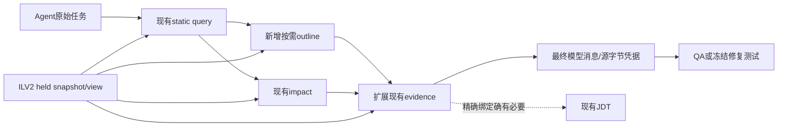

# 04 增量设计：一个事实中心，三段短链

## 目标架构

**不加第二索引、不加第二daemon、不加LLM、不改owner拓扑。** `queryFiles/queryReadRanges/queryEvidenceSources/queryCallers/queryCallees`均已有；只按需要增加窄投影。禁止为outline调用`queryContextGraph()`或装载整仓kg。[S19]

## 4.1 统一请求证据

沿用现有workspaceId、contentManifestId、indexView与请求budget。字段在一层产生，往后只引用，不把完整view重复到每条候选里。Stable symbolId是声明定位器，不是源字节版本；evidence必须另带contentHash和精确范围。

一个请求可读到held快照，随后live文件变更。允许返回明确的快照片段，但不能用旧hash标注新live文本。新鲜度、解析完整性、请求截断、绑定强度分别保留；一个局部绑定不能使整请求升级为完整。

## 4.2 Outline：只回答“这个文件里还有哪些可检查对象”

拟增加`java_symbol operation=outline`，输入一个授权范围内的Java相对路径；复用queryFiles读取单文件事实。返回类/构造器/方法/字段的名称、签名、selection、行范围、stability、symbolId或已有snapshot handle，不返回方法体。字段纳入是因为“字段/接口影响”是三条主工作流之一（[15](15-java-workflow-priorities.md)），DTO/实体文件里字段就是主要结构。

默认8条、最多20条；可提供`nearLine`：包含该行的声明优先，其余按与该行的距离选取，选中后按源码顺序输出（规则见05§5.2）。不能退化为“包含者+文件开头若干条”，否则大文件尾部的邻近重载会被挤掉。不在服务内用自然语言判断“最重要”方法。输出UTF-8序列化预算4096 bytes，按完整条目裁减，附omittedSymbols；不靠切JSON字符串。

未给nearLine且文件有100个方法时，不能伪装完整大纲。下一步可由Agent按已返回的范围、原生read或明确nearLine继续；不提前造分页session存储。

测试：同文件同名重载、nested/匿名、一个超长签名、CRLF/emoji前缀、受限预算、来源变化、workspace串ID，均以事实身份/范围验收。

## 4.3 Evidence：读取“已经选定目标”的源码，不代替发现

扩展现有`operation=evidence`，不恢复java_context。第一版支持Java声明片段与现有MyBatis关联；Q05才允许通过已验证局部关系增加关联片段。

顺序：明确anchor行 → 声明签名 → 关系证明行 → 同一需求的必要补充。仍使用8units/80lines/16000bytes全请求硬预算，2MiB单文件读取上限。不能为了一个400行方法默默突破。

长方法不是默认头尾截取。先以请求position或关系位置为中心取窗口，再补签名；窗口合并只能在同path+hash上做。没有关键位置的symbolId请求只给声明/合理开头并标`BODY_PARTIAL`，不声称完整方法已到达。Agent可通过原生read进一步查看。

每unit含path/hash/范围/text/sourceKind/proof/completion；源码必须字节可验证。敏感内容拒绝或明确redacted，不计入真实源码覆盖；default关闭外发。原XML位置信息不改成Java行号。outline签名摘要也不算source body证据。

## 4.4 关系：按精确声明定向，不按图规模推进

复用现有provider与有限SQL查询，先覆盖caller/callee/implementation/mapper四类。对每个已选source site保留sourceRange和target候选；方法名相同而owner不同不能合并。

首轮一跳，总关联target不超过8个；同名多实现显示AMBIGUOUS。二跳仅在真实失败归因要求时启动Q05附加试验，仍受总预算，不为每个节点重新给一份预算。

关系证明分为源码事实、静态候选、给定JDT/classpath状态下的绑定；不新增运行时推断器。Spring qualifier/profile、动态SQL、反射和代理没有实际环境证据时明确局限。

## 4.5 选择与展示：不改变事实来优化指标

read-plan现有ReadUnit继续用，先保证mandatory anchor/evidence再考虑候选多样性。相同source范围重复来源只计一份内容；不同hash绝不合并。改选择算法前固定候选池；改发现算法时固定选择器，这样能归因。

compact已修复保留spans与anchors，本轮默认冻结这条行为。只把在最终wire消失的精确证据位置纳入修复，不按看起来更短的JSON判断收益。

## 4.6 小范围读取复用

仅允许请求内cache：键为held view + canonical path + expected contentHash。每个文件最多一次bounded read供多个units选择；末次anchor验证仍按现有约束进行。跨请求缓存不在首批范围，因为它会增加失效与文件变更竞态。

是否实施由Q09的实际read/hash耗时占比决定，不能以“代码看起来重复”作为性能收益证明。

## 4.7 失败与下一步提示

拒绝/不完整结果都带稳定reason：INDEX_NOT_READY、SOURCE_CHANGED、AMBIGUOUS、OUTPUT_LIMIT、SOURCE_BUDGET、UNSUPPORTED_RELATION、JDT_NOT_READY。客户端可以据此重定位/缩scope/等待；不返回长篇通用建议。

已有no_vocabulary_overlap与terms能力直接复用。跨语言意图由宿主用可见terms改写，服务不暗中翻译、不新建全局同义词词典。精确请求永远不静默降为fuzzy。

## 4.8 允许改动的模块

在线新增主要限于`src/discovery/outline.ts`、`src/discovery/evidence-source-reader.ts`、必要的`src/discovery/local-relations.ts`；修改`src/tools/symbol.ts`和现有query/evidence/readPlan链。新文件名是计划，不是当前已有接口。

评测复用`scripts/ilv2-mac-*`与`evaluate-java-task.mjs`；新增最终消息receipt适配，不另起一套完整评测器。每阶段报告新增/删除在线LOC和维护入口，目录搬迁不算缩小。
