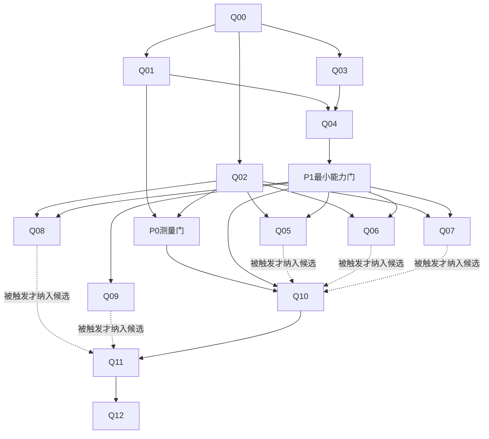

# Post-ILV2 Java Evidence Implementation Plan

> For agentic workers: use superpowers:executing-plans or subagent-driven-development when available. 没有该工具时按本包任务卡串行执行，不声称派发了不存在的子代理。

**Goal:** 保持ILV2稳定基础，用最小改动改善Java入口定位、证据交付和可测量的Agent任务效果。

**Architecture:** 复用owner、held snapshot、SQLite、Tree-sitter和按需JDT；扩展现有java_symbol的outline/evidence；以固定候选/预算的真实任务验收。

**Tech Stack:** 当前冻结的macOS arm64/APFS、Node、TypeScript、SQLite、JDT。没有新默认运行依赖。附件离线检查为Python/JDK-only。

**Spec:** [04](04-design.md)、[05](05-contracts.md)。

## Global Constraints

Java-only；五个tool名；默认无embedding；不改owner拓扑；不写目标仓；不泄漏gold；新接口保持view/hash/completion；不预设必须做全部可选卡；真实部署和模型费用另行授权。详见[AGENTS](../AGENTS.md)。

## Review Focus

1. SOURCE_CHANGED发生在locator返回与evidence读取之间：Q04必须拒绝混hash源码。
2. 同文件同名重载与同FQN跨模块：Q03/Q08不得按display name重新绑定。
3. 超长签名、巨长单行和CRLF/Unicode：Q03/Q04保证字节预算与有效JSON。
4. 部分coverage或关系预算耗尽：Q05/Q07不得输出确定性“无引用”。
5. 完成标记/路径存在但正文未入最终请求：Q01/Q10不得判任务有效成功。

## Phase DAG



| Phase | 任务 | 阶段产物 | 阶段门 |
|---|---|---|---|
| P0 | Q00–Q02 | 身份清单、测量控制、失败ledger | G0：不混版本/分母/证据，labels不泄漏；只门控Q10的LIVE运行 |
| P1 | Q03–Q04 | outline + Java evidence最小增量 | G1：工具不启动JDT；正确身份/范围；硬预算；source真实到达 |
| P2 | 按触发选择Q05–Q09 | 仅一到两个高ROI增量；不触发卡留记录 | G2：每增量关闭一类真实失败，无正确性退化 |
| P3 | Q10 | 配对效果与原始usage/失败 | G3：利益证据可判断，不达门可NO_GAIN或INCONCLUSIVE |
| P4 | Q11–Q12 | 受影响工程回归、删减、候选交接 | G4：工程资格与效果/部署授权分开 |

Phase编号表示交付分组，依赖以DAG和`contracts/tasks.json`为准。Q00之后，Q01、Q02与Q03三条线可并行：outline是`queryFiles`上的纯投影，不消费receipt或归因结果，不必等G0；G0只门控Q10的付费LIVE（与[09](09-acceptance.md)“仍可做纯函数/fixture实现”一致）。Q04需要Q01的最终消息receipt做全链测试，所以依赖Q01与Q03。Q05–Q08的触发证据来自Q02的失败ledger。Q01/Q02的评测schema由Q01唯一owner；Q03/Q04都接symbol.ts，合入必须串行。P2中Q05/Q07共享选择路径，不同时独立调参；Q08/Q09涉及JDT，先只做各自只读诊断，再单独合入。每张卡仅定向测试，每phase再独立review和相关整测。

## 任务大小与退出

每张卡一个可否定假设。工程PASS不要求编造收益；没有触发记录`NOT_TRIGGERED`并列证据。P1后允许直接Q10，不先跑全部P2。模型费用未授权可交付ENGINEERING_ELIGIBLE候选，但BENEFIT_UNMEASURED，不能宣称节省token。

## 命令合同

产品现有命令 [S21]：

```bash
npm run build:isolated
npm test
npm run gate:pr
npm run gate:release
npm run measure:tool-schema
```

定向命令（在新测试文件创建/编译后）：

```bash
sh scripts/run-isolated-node.sh scripts/run-isolated-validation.mjs \
  --profile targeted -- node --test dist/discovery/outline.test.js
```

不得在本包目录把这些命令当产品命令执行。卡片里拟新增script必须先创建并通过`--help`/selftest才运行；没有脚本不伪造报告。实时工作目录仍采用用户已有Mac broker/配额/授权规则，不绕过。

## 完成定义

已有ILV2保护仍在；新质量链的单位/整链和最终wire测试通过；基线/候选/数据hash匹配；每条效果主张有测量；未测项和已接受原地板FAIL原样保留；新模块有清晰删除条件；没有默认embedding、无新服务，无私自安装/重启/外发。


## 无模型授权时的工程通道

Q10可在无模型调用时完成runner/控制测试并交付`UNMEASURED`结论；这允许Q11评估工程资格，不允许G3收益PASS。DAG依赖的是可审查产物，而不是强迫消耗模型费用。Q12必须保留benefit未测，不把流程完成等同收益成立。

所有任务命令中的测试入口由该卡负责保证：当前已有则扩展；当前没有则创建对应测试文件并先编译。这里列的是计划执行的验收入口，绝不是本次已运行的产品命令。
