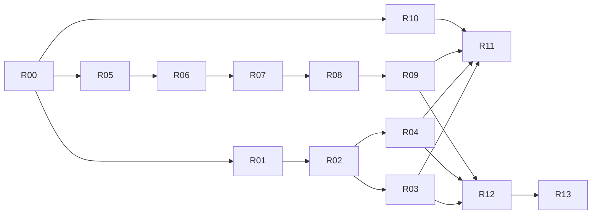

# Java Specialist v1.1 Implementation Plan

> For agentic workers: 按 `tasks/plan.json` 逐任务执行；可使用已有执行工作流，但不得并行修改相同文件或跳过测量门禁。

**Goal:** 修复 b9 的产品正确性与评测有效性，使上线资格由可交付原始证据支持。  
**Architecture:** 保持现有五工具、SQLite、Tree-sitter、JDT和worktree；改造最后模型消息、统一scorer、静态检索边界、可选实验身份。  
**Tech Stack:** 项目锁定 Node/TypeScript/native依赖；离线审计 Python3.10+、Node22+、JDK17+。  
**Spec:** `docs/03-design-delta.md`。

## Global Constraints

源基线b9完整SHA；原frozen dataset/scorer/gates不改；部署未授权；默认禁网禁模型；真实运行层必须实测；工具面保持5；实验不进入生产依赖；全部输出放隔离run目录。允许破坏性schema调整但不做永久双版本。

## Review Focus

1. 原始tool返回正确，最后消息却丢内容：R01测试最终chat参数及实际SDK往返。
2. 同文件不同方法/相同FQN不同module互相污染：R05/R10必须包含反序写入与disk reload。
3. scope外候选耗尽cap/sourceSetOR：R06测试scope内第21候选以及main/test/模块交集。
4. 查询中编辑与XML-only变化：R08/R12按真实writer/watcher验证hash、scope和locator一致。
5. 记录了SOURCE_RECEIVED却没有有效payload，或错误被排除分母：R02/R03/R11测试协议、严格scorer和实际原始轨迹。

## 依赖与阶段

R01–R04是评测可信性主线；R05–R09是产品正确性主线，可以不同工作区并行，但R08依赖同一query/scopes定义。R10/R11仅服务可选实验，**静态产品可选择保持实验禁用**，不因此强制调用远端；R12/K27仍需测关闭/故障的安全降级。若要恢复T10效果结论或启用实验，则R10/R11不得跳过。

## 各阶段验收

| 阶段 | 任务 | 合法产物 | 禁止的签字方式 |
|---|---|---|---|
| S0 冻结/更正 | R00 | 原字节恢复、hash一致、历史失效登记 | 更新manifest接受坏fixture |
| S1 可信评测 | R01–R04 | final-payload sentinel、严格scorer、候选树、对称工具、可搬运judge | fakechat PASS冒充模型有效性 |
| S2 静态正确性 | R05–R09 | scoped多候选、source provenance、deadline、preview、runtime回归 | 原12 PASS替代新边界 |
| S3 选择性实验 | R10–R11 | 先offline再授权pilot，四向决策或DISABLED_INVALID | 多模型共同犯同一harness错误却称稳健 |
| S4 完整验证 | R12–R13 | K32完整矩阵、独立任务、macOS、可交付raw、人工review | 代码提交等于允许部署 |

## 跟踪规则

每个任务状态只允许 NOT_STARTED / IN_PROGRESS / BLOCKED_ENV / BLOCKED_AUTH / DONE；DONE要求该任务的定向测量通过，其他全局门禁仍由R12/R13控制。任务卡代码是行为断言/接口，不是隐藏在文档里的已完成生产实现；新增测试必须在仓库落地。

一次只改变一个效果假设。连续两次失败回到根因，不叠加权重；不以“个人项目”否决所有数据库或进程，也不借优化无限增加管理器。目录移动不算复杂度减少。

`baseline-kit/`携带全部原36任务/72查询/8repair/32contract内容；本轮新增27个机制反例不计新的统计任务。所有者拥有完整gold，但实现者/被测Agent应隔离locked，执行前记录已暴露范围。
